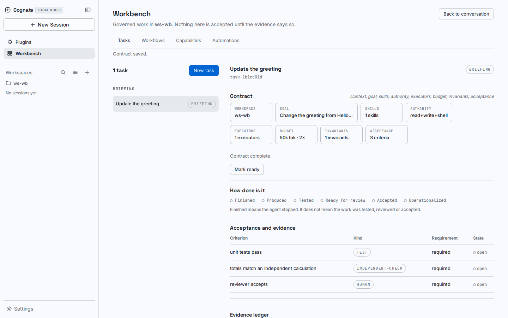

# Cognate

**The agentic application framework.**

You steer the software. AI agents build it, and work within it.

Cognate is an open-source TypeScript framework and SDK (Apache-2.0) for applications that are:

- **Agent-built.** You describe the software you want. Your coding agent builds it from Cognate's SDK, its *Building with Cognate* skill, and reusable capabilities.
- **Agent-operated.** AI agents can work *inside* the finished application. They use its capabilities, work with its state and workflows, and talk to people. They do all of this within permissions you set, and they pause for a person when it matters.
- **Agent-extensible.** When you need something new, you authorize your coding agent to add a capability using the same method that built the app. The new part plugs into the same structure.

People stay in charge throughout. You decide what gets built, which actions need approval, and what counts as done. An agent saying "finished" is not the same as you accepting the work.

> **Status: v0. Published and early.** All `@godspeedai/cognate-*` packages are on npm at **0.5.0**. APIs will still change before 1.0. Known gaps are tracked openly in [`.agents/DEBT.md`](.agents/DEBT.md).

**Landing page:** [`landing/`](landing/), an interactive walkthrough of everything below.

---

## When to use Cognate

Use Cognate when you want an application where AI agents do real work, and where the application has to be trusted:

- **Agents should only act through named, permission-checked capabilities.** Every capability call is authorized first, and the default is no.
- **Some actions should wait for a person.** An agent can pause durably on an approval and resume after someone decides, even across a restart.
- **You need a record of what happened.** Runs are recorded as durable events, so views can be rebuilt and decisions can be audited.
- **You want to keep building with agents.** New capabilities slot into the same structure instead of becoming one-off code.

Cognate is probably **not** what you want if you need a hosted no-code app builder, a drop-in chatbot widget, a thin wrapper around a single model API, or a stable 1.0 API today.

## Quick start: build your first app with your coding agent

You need **Bun ≥ 1.4**, **git**, **Node.js** (for `npx`), and a coding agent such as Claude Code. The first app itself needs **no AI API key** because it runs without a model; your coding agent uses whatever sign-in it normally does. Optional: Rust's `cargo`, if your agent wants to install the DomainForge checker for the app's domain model (the skill also has a check that needs no install).

**1. Make a project folder and give your agent the skill.**

```bash
mkdir refund-desk && cd refund-desk && git init
npx skills add GodSpeedAI/Cognate \
  --skill building-with-cognate --skill deriving-interaction-domain-models --skill domainforge-sea \
  -a claude-code -y
```

This installs three skills into your project (for Claude Code, under `.claude/skills/`). It does not install them globally. For other agents, change `-a` (see `npx skills add --help`).
*Coming soon:* a [skills.sh listing](https://skills.sh/godspeedai/cognate/building-with-cognate) *(placeholder; not live yet)*. The command above already works from GitHub.

**2. Ask your agent for the app.** Paste this:

```text
Use the building-with-cognate skill to build a small Cognate app called Refund Desk.
A support agent looks up an order and proposes a refund. Refunds of $50 or less go
through on their own; anything over $50 must pause until a person approves or denies it.
Keep a durable history of every step. Use the published @godspeedai/cognate-* packages
from npm (no Cognate source checkout) and no AI API key.
When you're done, run `bun test` and show me passing tests for:
small refund completes, large refund waits for approval, approval completes it,
denial refunds nothing, and the history records each step.
```

**3. Check that it works.** Run the tests yourself:

```bash
bun test
```

You should see all five behaviours pass. You're done when the tests pass on your machine. The agent saying it finished doesn't count. If your agent reaches for `cognate create` or asks for a Cognate source checkout, tell it to add the published `@godspeedai/cognate-*` packages with `bun add` and build the app directly. If something else fails, see [Troubleshooting](docs/troubleshooting.md).

**Want to see a finished answer first?** [`examples/refund-desk/`](examples/refund-desk/) is the same app, built from npm packages only:

```bash
cd examples/refund-desk && bun install && bun test
```

---

## What you just built

Refund Desk is a small support application. A support agent looks up an order and proposes a refund. Refunds of $50 or less complete on their own. Larger refunds pause until a person approves or denies them. Every step lands in a durable event log.

The app is in [`examples/refund-desk/`](examples/refund-desk/). Its seven tests pass locally (`bun install && bun test`). Here is how each part of the description maps to Cognate.

**Capabilities are how the agent reaches orders and money.** The commerce component provides two named contracts, `orders.lookup` and `refunds.issue`:

```ts
// examples/refund-desk/src/refund-desk.ts (excerpt)
const lookup: CapabilityContract = { id: "orders.lookup", version: "1.0.0" };
const issue: CapabilityContract = { id: "refunds.issue", version: "1.0.0" };
return {
  id: "commerce",
  provides: [lookup, issue],
  activate(fiber) {
    fiber.provide(lookup, async (input) => { /* read the order */ });
    fiber.provide(issue, async (input) => { /* record the refund */ });
  },
};
```

**Permission is default no, and the app grants two names.** The runtime is created with an explicit policy. Only the two capabilities listed are allowed for the refund-desk caller:

```ts
policy: allowCapabilities("refund-desk", ["orders.lookup", "refunds.issue"]),
```

**The agent proposes, and a person decides when the amount is large.** The agent's logic is short. Small refunds are recorded as auto-approved. Large refunds call `ctx.waitFor`, which opens a durable continuation that the run cannot pass without a decision:

```ts
if (amountCents > APPROVAL_THRESHOLD_CENTS) {
  await ctx.emit("refund.awaiting_approval", { orderId, amountCents, thresholdCents: APPROVAL_THRESHOLD_CENTS });
  const decision = await ctx.waitFor("approve-refund", {
    type: "refund-approval",
    condition: { kind: "human_approval" },
    payload: { orderId, amountCents },
  });
  // ...deny ends the run with no refund; approve falls through to refunds.issue
}
```

A reviewer answers the open continuation with `client.resolveContinuation(continuationId, "resume", { approved, by })`. The run resumes from durable state, so the wait survives a closed browser or a restarted process.

**The event log is the record.** Each run writes events such as `refund.proposed`, `refund.auto_approved` or `refund.awaiting_approval`, then `refund.approved` or `refund.denied`, then `refund.issued`. Rejected requests write `refund.rejected` with a reason. The `history(runId)` helper reads them back in stream order.

Two limits, stated plainly. The demo's caller is a fixed identity in the source. A real application takes the caller from its own authenticator. The demo's `actions.authorize` hook allows every action, and the file says so. Both are demo scaffolding, not patterns to copy.

---

## How capabilities work

A **capability** is a named, versioned job. A **component** provides it. An app or agent asks for it by name, not by which code runs it. Policy checks every call, and the default answer is no. A provider can be swapped without changing the code that asks.

The contract is a small type. It has a stable id, a version, and optional attributes and a semantic reference:

```ts
// packages/kernel-api/src/types.ts (excerpt)
export interface CapabilityContract {
  /** Stable capability identity, e.g. `customer.read`. */
  readonly id: string;
  /** Semantic version of the contract, `MAJOR.MINOR.PATCH`. */
  readonly version: string;
  readonly attributes?: Attributes;
  readonly semanticRef?: SemanticRef;
}
```

A consumer states what it needs with a `Requirement`: a capability id, an optional major version, and optional attributes. A provider with the same major version and an equal or newer minor version is compatible. Eligibility is decided deterministically, before any ranking.

Every invocation takes the same path. The kernel builds an authorization request from the caller, the provider's scope, the contract and the correlation id, then asks the policy. The decision is recorded as an `invocation` event. Only an allowed call reaches the handler:

```ts
// packages/kernel-cordis/src/lease.ts (excerpt, simplified)
const decision = await policy.authorize(request);
emit({ type: "invocation", capability: provider.contract.id, providerId: provider.providerId, correlationId: context.correlationId, decision });
if (!decision.allow) return { ok: false, failure: { kind: "denied", decision } };
// ...only now is the provider's handler run, with cancellation and deadline handling
```

So authorization happens before the work, not after it. A prompt is not an authority boundary. The agent can ask for `refunds.issue` as often as it likes, and the policy still decides each call.

To add one yourself, see [How to: add a capability](docs/how-to/add-a-capability.md). The wider extension model is in [Extending Cognate](docs/extensions.md).

### Vocabulary

| Term | Plain meaning |
| --- | --- |
| Capability | A named, versioned job, such as `refunds.issue`. |
| Component | A unit that provides capabilities and may require others. |
| Policy | The rule that allows or denies each capability call. The default is deny. |
| Event | A durable record of something that happened. The event log is the history. |
| Projection | A view built from events, such as current state or a run history. It can be rebuilt. |
| Continuation | A durable pause, such as a human approval. The run resumes from it. |
| Provider | A component that satisfies a capability. Providers can be swapped. |
| Profile | A reusable composition of components, such as `copilot` or `harness`. |

---

## Extending an app with your agent

Cognate treats extension as a development act. A person authorizes it, and the coding agent carries it out in five steps, in order:

1. **Model.** Update the domain model in DomainForge `.sea` first: the new journey, the new actor, the new rule. The skill does not implement a journey that is missing from the catalog.
2. **Build.** Write the capability or agent behavior on the Cognate SDK. Keep agent code deterministic, and put I/O and model calls behind recorded steps or capabilities.
3. **Bind.** Connect semantic ids to capability contracts explicitly with `bindCapabilities`. Nothing becomes a capability implicitly.
4. **Test.** Add a test for each journey the change touches. The test runs the real runtime and checks the outcome in events or state, not only that the run finished.
5. **Accept.** A person reviews the diff and the evidence and decides whether it is done. The agent saying it finished does not count.

An example request, in the same shape as the first build:

```text
Use the building-with-cognate skill to add a refund-history capability to Refund Desk.
The support agent may read a customer's past refunds through a read-only capability.
Model the journey in the .sea file first. Bind it explicitly. Add tests that a
denied caller gets nothing and that the history matches the event log. Show me the
diff and the passing tests before you call it done.
```

Extension is not something a running agent does to itself. An operational agent can only invoke the capabilities its policy grants, and it can pause for a person. Cognate gives it no built-in way to add capabilities to its own application or to widen its own permissions. If you grant an agent a capability that edits code, that grant is your decision and it is recorded like any other. Extension happens as a development step that a person starts and reviews. A provider can be replaced while the app runs, as in the [capability hot-swap example](examples/capability-hot-swap/index.ts), but that is a composition the developer chose.

The skill that drives this loop is in `.agents/skills/building-with-cognate/` and ships with the repository. Its companions are `deriving-interaction-domain-models` and `domainforge-sea`.

---

## Cognate-Workbench: a real application built with Cognate

[Cognate-Workbench](https://github.com/GodSpeedAI/Cognate-Workbench) is an agent harness for coding and general work: a workspace where AI agents write and run code, plan, and carry out tasks in conversation with you. People scope the work, approve risky steps and accept the results. It is a real application, and it is built on Cognate. It is an example of what Cognate can carry. It is not Cognate itself, and the two repositories are separate.

Workbench is a single Bun process. It serves a React interface over Connect RPC and keeps its authoritative state in PostgreSQL. A task starts with a contract that names the goal, the authority, the budget and the acceptance criteria. In Workbench, "the agent finished" is not acceptance. Acceptance needs recorded evidence and a review decision. Completion without proof is theater, and Workbench is built so that the proof is a record, not a claim.

**What Workbench inherits from Cognate.** The runtime, kernel, event store contracts, projections, continuations, Connect transport, headless client and React hooks, the DomainForge binding, the model provider adapters, and the RealityTrace observation port all come from Cognate packages.

**What Workbench implements itself.** Its 23 workbench capabilities (task contracts, the review gate, evidence recording, authority checks, workflows, skills, steering), its coding-agent loop, its approval points, and its 12 registered projections are Workbench code. Its approval points are concrete. A plan review pauses the run, and the approval gate escalates `run_code` calls that request elevated sandbox permissions. Both use the same `ctx.waitFor` continuation mechanism described above.

**What is not finished.** The Workbench README and the evidence file are explicit, and so is this page:

- Parallelism plans are recorded. `parallelism.plan` returns a plan and starts no workers.
- Automation records are stored. The main branch has no background scheduler for them.
- Budgets are informational. They are not enforced as a runtime limit.
- Capability substitution is recorded. It does not rebind a running tool.
- The main branch pins Cognate `0.2.0`. The development branch consumes `0.5.0`.

**Expert Teams is on a development branch.** The `feature/expert-teams` branch adds persistent Experts, custom Teams, scoped memory and native schedules. It is not merged to Workbench's main branch. Its concurrency is opt-in and bounded. Experts overlap only when run capacity is raised above one, and only for turns that use no workspace-effect tools. The default is one run at a time. Treat Expert Teams as work in progress, not as a shipped feature.

Running Workbench needs PostgreSQL 18, or the pinned `pg0` binary that its `just db-setup` recipe installs. The Workbench README has the steps.

One screenshot, taken from Workbench's own E2E test, shows a task whose contract is complete:



---

## Under the hood

This is the summary. The full detail, with source references, is in [docs/explanation/under-the-hood.md](docs/explanation/under-the-hood.md).

**Semantic modelling.** DomainForge makes business meaning executable. Cognate loads a `.sea` model through DomainForge and treats the result as read-only semantics. Bindings from semantic ids to capabilities are explicit, and Cognate does not add framework syntax to `.sea`. A new integration is a new adapter, not a new kind of meaning. The projection reference is [docs/semantics.md](docs/semantics.md).

**Capability contracts and replaceable providers.** Components declare what they require and what they provide. The kernel matches providers by compatible version, scopes them, and deactivates a dependent component when its provider disappears. Model providers, tools, storage and UI all plug in through this one mechanism. Reference: [docs/concepts.md](docs/concepts.md).

**Durable events, projections and the outbox.** The authoritative history is an append-only event log, backed by SQLite by default and PostgreSQL when configured. Current state, agent history, UI state and cognitive indexes are projections. A projection can crash and rebuild from history. Reference: [docs/subsystems/](docs/subsystems/).

**Continuations.** `ctx.waitFor` records a durable pause. The pause can wait for a human, a tool result, an OAuth flow, an external job or a scheduled event. The condition is checked after a restart, and the run resumes from its checkpoint. A continuation can also expire or be cancelled.

**Authority and learning boundaries.** Authorization is deterministic and comes first. Cognitive retrieval and adaptive ranking happen after eligibility, and they can only choose among candidates that already passed policy. Learning can optimize execution. It cannot grant authority. Reference: [docs/explanation/authority-and-learning.md](docs/explanation/authority-and-learning.md).

**Recoverability.** The runtime recovers in-flight work after a restart, and the cognitive index is derived. Deleting it leaves authorization outcomes unchanged, and rebuilding it restores retrieval. Recovery of in-flight runs is implemented in `packages/runtime-bun/src/runtime.ts`. The restart path is covered by tests under `tests/integration/`.

**Evidence: a receipt is not evidence.** Cognate's RealityTrace adapter (version 0.3.0, pinned) submits observations through RealityTrace's CLI. RealityTrace needs repository enrollment, a snapshot, a declared question and threshold, a run, and a committed plan before an observation counts. A receipt for an observation is neither qualifying evidence nor a settled result. The adapter's job is to keep correlation ids intact so that a later evidence derivation can reconnect each observation to its event. Reference: [docs/evidence.md](docs/evidence.md).

**Protocols are adapters.** Native cross-process contracts are Protocol Buffers, served over Connect. AG-UI, MCP and A2A are projections of the same runtime. Cognate does not make any of them the internal event model. Use an adapter because you need interoperability. Reference: [docs/protocols.md](docs/protocols.md).

**Bun-native, any model.** Bun is the reference runtime, package manager, test runner and SQLite host. The core does not depend on an LLM SDK. Model providers are packages: OpenAI-compatible, OpenAI Responses, Anthropic-compatible, OpenAI OAuth, typesafe and local. Provider credentials are leased per request and are not written into events. The package list is below.

**Profiles.** A profile is a reusable composition of existing components. There are two reference profiles: `copilot` (an agent UI with shared state, artifacts, continuations and AG-UI) and `harness` (an autonomous agent loop with tools, skills, sessions and a sandbox). They run on the same substrate. Scaffold one from a source checkout:

```bash
bun x @godspeedai/cognate-cli@0.5.0 create my-app --profile copilot --source ./cognate
cd my-app && bun install && bun dev
```

`cognate create` needs `--source`, which points at a Cognate checkout whose packages are vendored into the new app. The published CLI does not yet ship the starter template on its own. The first app in this README does not need that step, because it uses the npm packages directly.

**Packages.** Each package is published on npm under the `@godspeedai/cognate-*` name at version 0.5.0. The repository contains these 45 packages. Each has its own README and `AGENTS.md`.

| Group | Packages |
| --- | --- |
| Kernel and runtime | `cognate-kernel-api`, `cognate-kernel-cordis`, `cognate-runtime-api`, `cognate-runtime-bun`, `cognate-profile`, `cognate-cli`, `cognate` (SDK umbrella) |
| Durable state and execution | `cognate-events`, `cognate-projections`, `cognate-continuations`, `cognate-capabilities`, `cognate-artifacts`, `cognate-store-memory`, `cognate-store-sqlite`, `cognate-store-postgres`, `cognate-execution`, `cognate-execution-ssh`, `cognate-execution-wsl`, `cognate-agent-discovery`, `cognate-hook-interoperability` |
| Cognition | `cognate-cognitive-api`, `cognate-cognitive-memory`, `cognate-cognitive-ruvector`, `cognate-cognitive-rvf` |
| Semantics and evidence | `cognate-domainforge`, `cognate-realitytrace` |
| Wire and protocols | `cognate-proto`, `cognate-protocol-connect`, `cognate-protocol-connect-bun`, `cognate-ag-ui`, `cognate-mcp`, `cognate-a2a` |
| Client and UI | `cognate-client`, `cognate-react`, `cognate-ui-astryx` |
| Model providers | `cognate-provider-anthropic-compatible`, `cognate-provider-auth`, `cognate-provider-local`, `cognate-provider-openai-compatible`, `cognate-provider-openai-oauth`, `cognate-provider-openai-responses`, `cognate-provider-typesafe`, `cognate-provider-wire` |
| Profiles | `cognate-profile-copilot`, `cognate-profile-harness` |

You do not install all of them. A profile or your app depends on the ones it uses.

**Concurrency.** Runs are admitted by a background loop, which ticks every 10 ms by default (`tickMs`). By default the runtime runs one run at a time. `execution.maxConcurrentRuns` accepts 1 to 64, and it defaults to 1. Above 1, you must supply an `execution.resourceKeys(run)` policy. Runs that share a key serialize in the same process, and runs with no shared key may overlap up to the limit. Returning an empty array declares that a run is independent. This is process-local. It is not distributed ownership and not OS isolation. Source: `packages/runtime-bun/src/index.ts` (the `execution` option), with the full behavior in [docs/runtime-concurrency.md](docs/runtime-concurrency.md).

**Security.** The authority rule is simple: possessing relevant information does not grant permission to act on it. Capability invocation and cognitive retrieval are scoped separately, so similarity cannot bypass authorization. External actions use idempotency keys and durable commit records. Sensitive cognitive entries store references or redacted projections instead of unrestricted payloads. The full notes are in [docs/security.md](docs/security.md).

---

## Cognate compared with other kinds of software

Other frameworks also support agent-built applications, and several are good at what they do. Cognate is a different layer. The question is which part of the application each tool owns.

- **An agent framework** runs agents. In Cognate, an agent is one component inside a larger application that also has people, state, UI, policy and external systems.
- **A frontend agent SDK** renders agent output in a browser. In Cognate, the UI is one surface over the application. The application survives a change of surface.
- **A memory framework** makes prior experience searchable. In Cognate, memory is derived. Durable history stays in the event log, and the index can be rebuilt.
- **A workflow engine** runs long, interruptible work. In Cognate, a workflow is one form of execution, next to services, agents, human decisions and schedules, all under the same capability and event model.

The full comparison and the lineage of the ideas are in [docs/comparisons.md](docs/comparisons.md).

---

## Documentation

Start at [docs/README.md](docs/README.md). It routes by intent: learn the system, get something done, understand why, look something up, or find the implementation.

| Need | Start here |
| --- | --- |
| Build a first app | [Refund Desk](examples/refund-desk/README.md) and [getting started](docs/getting-started.md) |
| Understand the model | [mental model](docs/mental-model.md), [concepts](docs/concepts.md), [architecture](docs/architecture.md) |
| Extend the app | [add a capability](docs/how-to/add-a-capability.md), [extensions](docs/extensions.md), [add a projection](docs/how-to/add-a-projection.md) |
| Why it is shaped this way | [design principles](docs/explanation/design-principles.md), [what you can build](docs/explanation/what-you-can-build.md), [under the hood](docs/explanation/under-the-hood.md) |
| Compare or trace lineage | [comparisons and lineage](docs/comparisons.md) |
| Look things up | [reference](docs/reference/), [commands and configuration](docs/reference/commands-and-configuration.md), [events and stores](docs/reference/events-and-stores.md) |
| Subsystems and workflows | [subsystems](docs/subsystems/), [workflows](docs/workflows/) |
| Decisions | [architecture decision records](docs/decisions/) |
| Topic guides | [getting started](docs/getting-started.md), [concepts](docs/concepts.md), [architecture](docs/architecture.md), [semantics](docs/semantics.md), [cognition](docs/cognition.md), [RVF](docs/rvf.md), [evidence](docs/evidence.md), [UI](docs/ui.md), [protocols](docs/protocols.md), [extensions](docs/extensions.md), [security](docs/security.md) |
| Trouble | [troubleshooting](docs/troubleshooting.md) |
| Maps | [documentation map](docs/documentation-map.md), [source map](docs/source-map.md) |

Each package and profile has its own `README.md` and `AGENTS.md`. The package README standard is in [docs/package-readme-standard.md](docs/package-readme-standard.md).

---

## Examples

Each example is a single runnable program. It uses real package APIs, runs against in-memory or temporary state, and checks its own outcome. From a checkout, run one with `bun run example:<name>`:

```text
examples/
├── copilot/              # the Copilot profile: a model and a backend tool loop
├── autonomous-harness/   # the Harness profile: model providers, a tool registry, an agent loop
├── human-approval/       # an agent waits on a durable continuation until a person resolves it
├── generative-ui/        # ui.render events rendered to HTML through a component registry
├── shared-state/         # state derived from snapshots and JSON Patch deltas
├── artifact-workbench/   # a durable, content-addressed artifact written and read back
├── multi-agent/          # a parent run spawns and awaits a child run
├── cognitive-memory/     # indexing and semantic recall, with authorization
├── rvf-branching/        # a branched RVF cognition file diverges from its parent
├── capability-hot-swap/  # live replacement of a capability provider
├── domainforge/          # a DomainForge model projected to read-only semantics, explicitly bound
├── realitytrace/         # observation delivery through the committed outbox
├── ag-ui/                # a run projected as an AG-UI event stream
├── mcp/                  # runtime capabilities exposed as authorized MCP tools
└── connect/              # the same RuntimeService served and consumed over Connect RPC
```

Each runs independently and verifies its own outcome (`tests/examples.test.ts`).

The Refund Desk example is separate. It is an application with its own `package.json`, not a root script:

```bash
cd examples/refund-desk && bun install && bun test
```

The examples are listed with their documentation in [examples/README.md](examples/README.md).

---

## Development

Work on Cognate itself from a checkout:

```bash
git clone https://github.com/GodSpeedAI/Cognate.git
cd Cognate
bun install
```

Install [`just`](https://github.com/casey/just) to run the workspace recipes. The main ones:

| Command | What it runs |
| --- | --- |
| `just verify` | The regression baseline: substrate check, typecheck, the README gate, and every gate marked implemented |
| `just gates` | Every ledger gate with PASS or FAIL, and status drift |
| `just gate <ID>` | One requirement's proof, for example `just gate CG-KRN-001` |
| `just docs` | The published-package README gate (`scripts/check-readmes.mjs`) |
| `bun run check` | The substrate check (`scripts/check-substrate.ts`) |
| `bun run typecheck` | TypeScript across packages, profiles, tests and scripts |
| `bun run test` | All workspace tests |
| `bun run test:properties` | Invariant property tests (`tests/properties`) |
| `bun run test:e2e` | The Playwright journey (`tests/e2e`) |
| `bun run example:<name>` | One example, from the list above |
| `just setup-realitytrace` | Installs the pinned RealityTrace CLI used by evidence gates |

Packages ship TypeScript source that Bun runs directly, so there is no separate build step. Some gates need external tools. `remote-workspaces-live` and `sea-forge-live` fail, and do not skip, when their tools are missing.

---

## Contributing

Start with [CONTRIBUTING.md](CONTRIBUTING.md): contribution paths, review criteria, and how to prove a change works.

Read before you change a package:

1. the root [`AGENTS.md`](AGENTS.md);
2. the package's `README.md` and `AGENTS.md`;
3. the package's dependency contract;
4. the relevant decision records in [docs/decisions/](docs/decisions/);
5. the invariants its tests exercise.

A change should extend Cognate without weakening the replaceability of the layers around it. [How to verify a change](docs/how-to/verify-a-change.md) describes the gates. Known gaps are tracked in the [debt register](.agents/DEBT.md).

---

## Release status

Cognate is **v0**. It is published and early. The SDK packages are at **0.5.0**, and APIs will still change before 1.0.

- Releases are managed by Release Please. The `packages/cognate` umbrella and the other `@godspeedai/cognate-*` packages are one linked-version group, so one SDK version covers them all.
- Each SDK version gets one GitHub release tagged `vX.Y.Z`. The process is described in [docs/releases.md](docs/releases.md).
- Known limits are listed in the [debt register](.agents/DEBT.md) and in each package README.

**Known limits, stated plainly.**

- Cognate is v0. APIs will change before 1.0.
- `cognate create` needs a Cognate checkout passed with `--source`. The first app in this README does not.
- The RVF Bun binding is experimental. Cognition is exposed through the API, not yet through the CLI.
- Workbench's parallelism plans, automation schedules and budgets are recorded, not enforced. Expert Teams is on a development branch.
- Run concurrency is process-local. Distributed run ownership is not provided.

---

## Architecture lineage

Cognate builds on ideas from several open-source projects: runtime composition from Cordis and the DeepSeek harness; rich agent and user interaction from CopilotKit and AG-UI; semantic grounding from DomainForge and `.sea`; execution evidence from RealityTrace; and cognitive memory from RuVector and RVF. Cognate brings those concerns into one architecture without merging their implementations. The longer account is in [docs/comparisons.md](docs/comparisons.md).

---

## Philosophy

Software now contains actors that interpret, people who step in, providers that change, and work that pauses and resumes. Cognate keeps those layers distinct and connects them through semantics.

```text
SEMANTICS -> EXECUTION -> EVENTS -> EVIDENCE
                              \-> COGNITION -> PROJECTIONS
```

**Define meaning once. Project it everywhere.** The reasoning is in [docs/explanation/design-principles.md](docs/explanation/design-principles.md).

---

## License

Cognate is licensed under the [Apache License 2.0](LICENSE).
