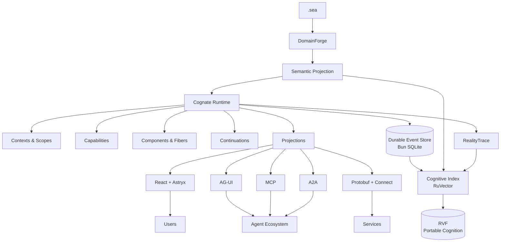

# Cognate

**Define meaning once. Project it everywhere.**

> **Status: v0 — published, early.** The framework packages, reference profiles, CLI, examples, and documentation in this repository are implemented, verified, and **published on npm under the [`@godspeedai/cognate-*`](https://www.npmjs.com/package/@godspeedai/cognate) names** (releases are managed by Release Please; see [ADR-0012](docs/decisions/ADR-0012-cognate-package-naming.md) for the naming convention). `just gates` reports every ledger requirement passing, and `bun run test` passes across the workspace. The ledger is a *candidate* rather than a frozen contract, and the known gaps are tracked openly in the [debt register](.agents/DEBT.md) — for example Connect supports unary and server-streaming only ([ADR-0003](docs/decisions/ADR-0003-wire-connect-protobuf.md)), and runs default to one at a time ([runtime concurrency](docs/runtime-concurrency.md)). The [software design specification](.agents/specs/software-design-spec-cognate.-frameworkmd) is the normative contract; where this README describes behavior, the linked gates prove it.

Cognate is an open-source **semantic application SDK for building agent-native software**. It runs on Bun, and every package is published and installable on its own.

An application built with Cognate keeps its own meaning at the center: the domain it serves, the operations it can perform, the rules that decide who may do what, and the history of what actually happened. Agents, interfaces, tools, models, and protocols all interact with that one application through shared contracts. None of them carries a private copy of it.

That is the whole idea, and the rest of this page is its consequences.

---

## Why Cognate?

Most agent software is assembled vertically. The agent framework owns the loop. The frontend SDK owns the chat. State lives in someone else's database. Memory becomes a vector store. Human approval gets its own widget. Observability is added after the fact. Each new capability means new glue, and eventually the glue becomes the architecture.

Cognate starts one level lower, with the application's semantics.

Define the domain in [`.sea`](docs/semantics.md), a small semantic modeling language. [DomainForge](https://github.com/GodSpeedAI/DomainForge) validates it and projects it. The Cognate runtime turns that projection into a live, composable system of agents, capabilities, state, workflows, UI, memory, protocols, and evidence — without making any one agent framework, frontend library, model provider, or transport the center of your architecture.

The consequence is practical. A tool your agent can call and a button your user can click can be the *same operation*, permission-checked the same way, recorded the same way. Swap the model provider, the renderer, or the storage engine, and the application's meaning does not move. Deterministic code keeps doing what code is good at. Agents do the flexible, context-dependent work, behind the same contracts as everything else. People stay in the loop where the work is consequential.

**Semantics constrain execution. Events preserve truth. Cognition discovers relevance. Observations record execution. Representations remain replaceable.**

---

## What you can build

Every kind of software below is a composition of the same substrate, not a separate template:

- **Copilots that touch real state.** An agent reads application state through capability calls and writes back through the same events the UI observes. Chat is one surface of the product, not the product.
- **Autonomous agent harnesses.** Models, tools, sessions, sandboxes, and schedulers are replaceable capabilities. Providers can appear, disappear, or be swapped while the app runs.
- **Workflows and cases that wait for people.** An agent suspends on a durable continuation — for an approval, an OAuth flow, an external job, or a scheduled event. The process can stop and restart; the unfinished work survives and resumes.
- **Multi-agent workspaces.** Runs spawn and await other runs. Every step lands in a durable event log with causal identity, so history can be replayed and audited.
- **Governed systems.** Every capability call is authorized first, and the default answer is no. Events carry correlation and causation for audit; RealityTrace observations can be attached as external evidence.

If your application has people, agents, state, interfaces, and consequences in it at the same time, Cognate gives all of them somewhere coherent to live.

---

## A real example: the refund desk

The first app you build below is small on purpose. A support agent looks up an order and proposes a refund. Refunds of $50 or less complete on their own. Anything larger must wait for a person. Every step is written to a durable history.

The interesting line is the wait. When the amount is large, the agent's run stops at an approval gate and records why:

```ts
if (amountCents > APPROVAL_THRESHOLD_CENTS) {
  await ctx.emit("refund.awaiting_approval", { orderId, amountCents, thresholdCents: APPROVAL_THRESHOLD_CENTS });
  const decision = await ctx.waitFor("approve-refund", {
    type: "refund-approval",
    condition: { kind: "human_approval" },
    payload: { orderId, amountCents },
  });
  // deny ends the run with no refund; approve falls through to refunds.issue
}
```

That `ctx.waitFor` is a **continuation**: a durable pause, not a sleeping process. The app can restart, the browser can close, the person can go home for the weekend. When someone answers the open approval, the run resumes from its checkpoint and the decision joins the history as events — `refund.approved` or `refund.denied`, then `refund.issued` or nothing.

One small app, and most of Cognate's ideas are already in it: a semantic domain, capabilities the agent calls by name, a permission check before anything runs, a pause that survives a restart, and a record of what happened. The [quick start](#quick-start) builds it against the published packages, with no AI key, and proves it with tests you run yourself.

---

## Quick start

Cognate targets **Bun ≥ 1.4**. The fastest path uses your coding agent, and the app it builds needs **no AI API key**: the first app runs without a model.

### Build your first app with your coding agent

You need Bun, git, Node.js (for `npx`), and a coding agent such as Claude Code. Optional: Rust's `cargo`, if your agent wants to install the DomainForge checker for the domain model (the skill also has a check that needs no install).

**1. Make a project folder and give your agent the skill.**

```bash
mkdir refund-desk && cd refund-desk && git init
npx skills add GodSpeedAI/Cognate \
  --skill building-with-cognate --skill deriving-interaction-domain-models --skill domainforge-sea \
  -a claude-code -y
```

This installs three skills into your project (under `.claude/skills/` for Claude Code, plus a project copy under `.agents/skills/` and a `skills-lock.json`). It does not install anything globally. For other agents, change `-a` (see `npx skills add --help`).

**2. Ask your agent for the app.** Paste this:

```text
Use the building-with-cognate skill to build a small Cognate app called Refund Desk.
A support agent looks up an order and proposes a refund. Refunds of $50 or less go
through on their own; anything over $50 must pause until a person approves or denies it.
Keep a durable history of every step. Use the published @godspeedai/cognate-* packages
from npm (no Cognate source checkout) and no AI API key.
When you're done, run `bun test` and show me passing tests for:
small refund completes, large refund waits for approval, approval completes it,
denial refunds nothing, and the history records each step.
```

**3. Check it yourself.** Run the tests:

```bash
bun test
```

You should see all five behaviours pass. You are done when the tests pass on your machine; the agent saying it finished does not count. If your agent reaches for a Cognate source checkout, tell it to add the published `@godspeedai/cognate-*` packages with `bun add` and build directly. If something else fails, see [Troubleshooting](docs/troubleshooting.md).

### Without a coding agent

The SDK is ordinary npm packages. Add the umbrella and you have the runtime and the headless client:

```bash
bun add @godspeedai/cognate
```

```ts
import { createRuntime, createClient } from "@godspeedai/cognate";
```

[Getting started](docs/getting-started.md) walks through a first app by hand, and [run your first agent](docs/tutorials/run-your-first-agent.md) is a guided tutorial.

To scaffold a reference profile, the published CLI currently vendors packages from a Cognate checkout, so clone this repository first and point `--source` at it (tracked as DEBT-016 in the [debt register](.agents/DEBT.md)):

```bash
git clone https://github.com/GodSpeedAI/Cognate.git
bunx @godspeedai/cognate-cli create my-app --profile copilot --source ./Cognate
cd my-app && bun install && bun dev
```

`bun dev` loads the `domain/*.sea` projection through DomainForge, restores durable state from `.cognate/app.sqlite`, mounts the profile's components, and serves the Connect runtime service, AG-UI (copilot profile), and the Astryx reference UI. Use `--profile harness` for an autonomous agent harness. The scaffold flow is proven end to end by `tests/integration/cli-create.test.ts`.

The SDK itself never needs the checkout: applications depend on published packages, and the local stack is just Bun and SQLite. No Redis, no external database, no separate vector service, no mandatory cloud.

---

## The architecture in one picture

Cognate separates six concerns that agent frameworks often mix together:

| Plane | Responsibility |
| --- | --- |
| **Semantic** | What the application means |
| **Execution** | What is currently alive and what can happen |
| **Durable** | What happened |
| **Cognitive** | What is relevant now |
| **Wire** | How representations cross boundaries |
| **Presentation** | How people and agents interact with them |



Read it with the refund desk in mind. The `.sea` model gives the app its vocabulary (orders, refunds, the $50 rule). The runtime executes runs as **components** — each live instance a *fiber* with its own scope, dependencies, and lifecycle. Agents, tools, storage, and the model behind them all plug in as **capabilities**: named contracts that components provide or require. Everything a run does becomes an append-only **event**. State, history, UI, analytics, and the cognitive index are all **projections** of those events, which is why they can crash, disappear, and be rebuilt without losing the truth. Interfaces and protocols are adapters at the edge, and none of them is the application.

---

## One operation, many representations

Take the operation `refunds.issue`.

To the agent, it is a tool it may call — if policy allows. To the person, it is an approval card with a $75 decision to make. To another service, it is a protobuf RPC over Connect. To the audit system, it is a short sequence of events. To a future run, it is a retrievable prior episode in the cognitive index.

```text
                    refunds.issue
                          │
             ┌────────────┼─────────────┐
             │            │             │
             ▼            ▼             ▼
           Agent          UI          Connect
            Tool       Projection       RPC
             │            │             │
             └────────────┼─────────────┘
                          │
                          ▼
                       Events
                     /        \
                    ▼          ▼
              RealityTrace   Cognition
              Observation   (derived)
```

These are not five integrations to build and keep in sync. They are views of one semantic operation, and Cognate keeps them coherent because they all read from the same source. That is what *define meaning once, project it everywhere* buys you in practice.

(Bindings are explicit: a semantic id becomes a capability contract because your app binds it, in code — not by magic. See [Semantics](docs/semantics.md).)

---

## How the substrate works

Each mechanism below has a dedicated doc. This table is the map.

| Mechanism | What it gives you | Read |
| --- | --- | --- |
| **Semantics** | `.sea` defines the domain; DomainForge projects it; Cognate consumes it read-only and never adds framework syntax to the language. New integrations are new adapters, not new semantics. | [docs/semantics.md](docs/semantics.md) |
| **Capabilities** | Everything — models, tools, storage, browsers, renderers, even a human — can be provided behind a named, versioned contract. Consumers ask by name; providers can be swapped live. | [docs/concepts.md](docs/concepts.md) |
| **Live components** | Each running instance is a fiber that owns its effects. Register a tool, listener, renderer, or timer, and the fiber unloads — everything it registered unwinds automatically. | [docs/architecture.md](docs/architecture.md) |
| **Durable events** | The append-only event log is the application's truth, with correlation and causation on every event. Current state, run history, UI state, and analytics are projections, rebuildable from history. | [docs/explanation/why-replay.md](docs/explanation/why-replay.md) |
| **Continuations** | `ctx.waitFor` records a durable pause for a human, a tool, an OAuth flow, an external job, or a schedule. The run resumes from its checkpoint when the condition is satisfied. | [docs/subsystems/continuations-and-commitments.md](docs/subsystems/continuations-and-commitments.md) |
| **Cognition** | A `CognitiveIndex` (RuVector reference implementation) answers *what is relevant now* — semantic, temporal, causal, and episodic retrieval. It is derived: delete it and the application stays correct; rebuild it and recall returns. Learning can optimize selection. It can never grant authority. | [docs/cognition.md](docs/cognition.md) |
| **Evidence** | The RealityTrace adapter (version-pinned) carries correlation ids into RealityTrace observations. A receipt is not evidence and a recorded event is not settled reality; derivation stays with RealityTrace. | [docs/evidence.md](docs/evidence.md) |
| **UI** | A headless client, React bindings, and the Astryx reference UI — chat, generative UI, artifacts, approval surfaces. The browser can *provide* capabilities too, and Astryx is a renderer you can replace, not the ontology. | [docs/ui.md](docs/ui.md) |
| **Protocols** | Cross-process contracts are protobuf, served over Connect. AG-UI, MCP, and A2A are adapters for interop; Cognate does not adopt any of them as its internal model. | [docs/protocols.md](docs/protocols.md) |
| **Models** | Any provider — OpenAI-compatible, Anthropic, local llama.cpp/Ollama, your own — behind one capability contract, with credentials leased per request and never written into events. | [docs/concepts.md](docs/concepts.md) |
| **Portable cognition** | RVF snapshots let you export, import, and branch cognitive state for experiments and evaluations, with Cognate-owned integrity manifests. | [docs/rvf.md](docs/rvf.md) |
| **Security** | Possessing relevant information does not imply permission to act on it. Capability invocation and cognitive retrieval are scoped separately; similarity cannot bypass authorization. | [docs/security.md](docs/security.md) |

A built-in stack, with the boundaries kept honest:

| Concern | Reference implementation | Cognate boundary |
| --- | --- | --- |
| Runtime | Bun | Runtime |
| Composition | Cordis | Kernel |
| Durable state | `bun:sqlite` (PostgreSQL adapter available) | EventStore |
| Semantics | DomainForge / `.sea` | Semantic projection |
| Cognition | RuVector | CognitiveIndex |
| Portable cognition | RVF | CognitiveSnapshot |
| Observations/evidence | RealityTrace | ObservationPort |
| RPC | Connect | Service transport |
| Wire schema | Protobuf | Message contracts |
| Agent/UI interop | AG-UI | Projection adapter |
| UI framework | React | Headless client |
| Design system | Astryx | Renderer |

Strong defaults should reduce decisions, not become architectural traps. The failure model is part of the design: if the cognitive index is unavailable, deterministic execution continues; if a client disconnects, durable events keep accruing and the client reconnects from a known position; if a provider disappears, dependents deactivate or resolve a compatible replacement; if a projection crashes, history remains and the projection rebuilds.

---

## What Cognate is not

- **Not only an agent framework.** Cognate can run agents, but the agent is a component inside a larger semantic application — one that also has people, state, UI, policy, and external systems.
- **Not a frontend agent SDK.** The UI is one surface over the application. React, Astryx, Slack, a mobile app, and a CLI can all be different surfaces; the application survives the surface.
- **Not a memory framework.** Memory is derived. RuVector makes prior experience discoverable; SQLite preserves durable history; RealityTrace preserves evidence; DomainForge preserves meaning. Each has a different job.
- **Not a workflow engine.** Workflow is one form of execution. A deterministic service, an agent, a UI component, a human decision, and a scheduled process all participate in the same capability and event model.

---

## Applications built on Cognate

**[Cognate-Workbench](https://github.com/GodSpeedAI/Cognate-Workbench)** is a working, open-source coding-agent harness built on the published SDK: a browser cockpit where AI agents plan, write and run code, and carry out tasks in conversation with you, with task contracts, approvals, review gates, and evidence records instead of a final chat message as proof of work. It is an application built *from* Cognate — runtime, kernel, event store, projections, continuations, Connect transport, client, React bindings, and provider adapters all come from `@godspeedai/cognate-*` packages — not an example shipped in this repository. Its own README and debt register state plainly what is enforced there and what is not.

**[Horizon](https://github.com/GodSpeedAI/Horizon)** is a second application in early development on the same substrate: an operational navigation environment that connects a shared semantic model of the world to contextual discovery, governed action, observation, and learning. Its README describes the intended product and marks it as such.

A demonstration establishes what it actually exercises. Neither app is a universal production-readiness claim for the SDK, and the SDK needs neither of them.

---

## Examples

Fifteen runnable examples, one per topic, each a single self-contained file using only real exported package APIs, with in-memory or temp-dir state. Run any of them from a checkout and it verifies its own outcome:

```bash
bun run example:generative-ui
```

```text
examples/
├── copilot/              # the Copilot profile: a model and a backend tool loop
├── autonomous-harness/   # the Harness profile: model providers, a tool registry, an agent loop
├── human-approval/       # an agent waits on a durable continuation until a person resolves it
├── generative-ui/        # ui.render events rendered to HTML through a component registry
├── shared-state/         # state derived from snapshots and JSON Patch deltas
├── artifact-workbench/   # a durable, content-addressed artifact written and read back
├── multi-agent/          # a parent run spawns and awaits a child run
├── cognitive-memory/     # indexing and semantic recall, with authorization
├── rvf-branching/        # a branched RVF cognition file diverges from its parent
├── capability-hot-swap/  # live replacement of a capability provider
├── domainforge/          # a DomainForge model projected to read-only semantics, explicitly bound
├── realitytrace/         # observation delivery through the committed outbox
├── ag-ui/                # a run projected as an AG-UI event stream
├── mcp/                  # runtime capabilities exposed as authorized MCP tools
└── connect/              # the same RuntimeService served and consumed over Connect RPC
```

Each runs independently and verifies its own outcome (`tests/examples.test.ts`). The full table with documentation links is in [examples/README.md](examples/README.md).

---

## What works today, and what doesn't

Cognate is v0: published, tested, and in active use by downstream applications — with APIs that will still change before 1.0. The honest short list:

- **The SDK installs from npm and works there.** The CLI scaffold currently needs a source checkout (`--source`), as above. Known gaps are tracked per item in the [debt register](.agents/DEBT.md), and package READMEs state their own limits.
- **Connect supports unary and server-streaming only** ([ADR-0003](docs/decisions/ADR-0003-wire-connect-protobuf.md)).
- **Runs execute one at a time by default.** `maxConcurrentRuns` (1–64) is process-local; there is no distributed run ownership ([runtime concurrency](docs/runtime-concurrency.md)).
- **The RVF Bun binding is experimental**, per its own package documentation; cognition is exposed through the API, not yet the CLI.
- **The event log is the application's record of itself.** For what happened *outside* the application, RealityTrace observations carry the correlation; a receipt is not evidence, and evidence is not settlement.
- **Governance is integration, not enforcement.** Cognate keeps events inspectable and authorization deterministic, and it can hand semantics to an external authority such as SEA-Forge when one is configured. The enforcement belongs to that authority.

The test suite treats these boundaries as invariants: reversible composition (unmounting a component returns the world to its prior state), dependency closure (no component stays active without its required capabilities), scope isolation, cognitive non-authority (deleting the index cannot change authorization outcomes), and replay (the same events rebuild equivalent state).

---

## Documentation

Start at **[docs/README.md](docs/README.md)** — the documentation home, navigated by intent.

| Layer | Pages |
| --- | --- |
| Orientation and model | [docs/README.md](docs/README.md) · [docs/getting-started.md](docs/getting-started.md) · [docs/mental-model.md](docs/mental-model.md) · [docs/concepts.md](docs/concepts.md) · [docs/architecture.md](docs/architecture.md) |
| Topic guides | [docs/semantics.md](docs/semantics.md) · [docs/cognition.md](docs/cognition.md) · [docs/rvf.md](docs/rvf.md) · [docs/evidence.md](docs/evidence.md) · [docs/ui.md](docs/ui.md) · [docs/protocols.md](docs/protocols.md) · [docs/extensions.md](docs/extensions.md) · [docs/security.md](docs/security.md) |
| Subsystems | [docs/subsystems/](docs/subsystems/) — kernel, durable state, runtime, continuations and commitments, capabilities and cognition, wire and protocols, presentation, application composition |
| Workflows | [docs/workflows/](docs/workflows/) — startup and the background loop, run execution, capability invocation, continuation and resume, shared state, evidence and observation, client and UI session |
| Explanation | [docs/explanation/](docs/explanation/) — why replay, why projection, why learning cannot grant authority, why adapters · [docs/decisions/](docs/decisions/) — ADR-0001..0013 |
| Tutorials | [docs/tutorials/](docs/tutorials/) — run your first agent, a human in the loop, start an app from a checkout |
| How-to | [docs/how-to/](docs/how-to/) — add a capability, add a projection, add a protocol adapter, verify a change |
| Reference | [docs/reference/](docs/reference/) — commands and configuration, the runtime service and agent surface, events and stores, capability and architecture contracts, the ledger and evidence model · [docs/troubleshooting.md](docs/troubleshooting.md) |
| Maps | [docs/documentation-map.md](docs/documentation-map.md) · [docs/source-map.md](docs/source-map.md) |

For implementation work, start with the [agent operating guide](AGENTS.md) and [current status](.agents/CURRENT_STATUS.md). Each package and profile has its own `README.md` and `AGENTS.md`.

---

## Development

Clone Cognate and install with Bun:

```bash
git clone https://github.com/GodSpeedAI/Cognate.git
cd Cognate
bun install
```

Install [`just`](https://github.com/casey/just) for the workspace recipes. The main ones:

| Command | What it runs |
| --- | --- |
| `just verify` | Regression baseline: substrate check, typecheck, the README gate, and every gate marked implemented |
| `just gates` | Every ledger gate with PASS/FAIL and status drift |
| `just gate <ID>` | One requirement's proof, e.g. `just gate CG-KRN-001` |
| `bun run test` | All workspace tests (packages, profiles, integration, architecture, properties, examples) |
| `bun run test:properties` | fast-check invariant properties |
| `bun run test:e2e` | The Playwright journey |
| `bun run example:<name>` | One example from the list above |
| `bun run typecheck` | TypeScript across packages, profiles, tests, and scripts |
| `just setup-realitytrace` | Install the pinned RealityTrace CLI used by the evidence gates |

Packages ship TypeScript source that Bun runs directly; there is no separate build step.

---

## Contributing

Cognate is designed around explicit architectural boundaries. Before changing a package, read its `README.md` and `AGENTS.md`, its dependency contract, the relevant decision records in [docs/decisions/](docs/decisions/), and the invariants its tests exercise. A change should extend Cognate without weakening the replaceability of the layers around it.

The design rule that keeps the kernel small: when adding a feature, ask whether it needs a genuinely new semantic or runtime primitive. If it is another representation, build an adapter. If it is another bundle of capabilities, build a profile. If it is another provider, implement the existing capability.

---

## Architecture lineage

Cognate stands on ideas proven by several open-source systems: runtime composition from **Cordis** and the DeepSeek harness; rich agent–user interaction from **CopilotKit** and **AG-UI**; semantic grounding from **DomainForge** and `.sea`; execution evidence from **RealityTrace**; cognitive memory from **RuVector** and portable, branchable cognition from **RVF**. Cognate brings those concerns into one architecture without collapsing them into one implementation.

---

## Philosophy

Software increasingly contains actors that do more than execute predefined procedures. Agents interpret. People intervene. Providers change. Work pauses and resumes. Interfaces are generated. Prior experience affects future behavior, and external actions have consequences. The architecture has to remain understandable while all of that is happening.

Cognate's answer is to keep the layers distinct and connect them through semantics:

```text
SEMANTICS
   │
   ▼
EXECUTION
   │
   ▼
EVENTS
   │
   ├────────► EVIDENCE
   │
   ▼
COGNITION
   │
   ▼
PROJECTIONS
```

**Define meaning once. Project it everywhere.**

---

## License

[Apache 2.0 License](LICENSE)
