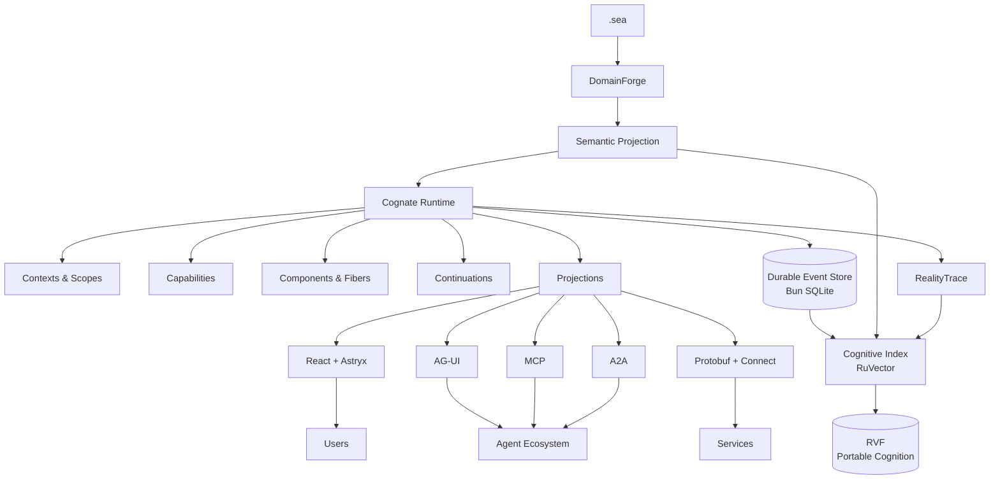

# Cognate

**Define meaning once. Project it everywhere.**

> **Status: v0 — published, early.** The framework packages, reference profiles, CLI, examples, and documentation in this repository are implemented, verified, and **published on npm under the [`@godspeedai/cognate-*`](https://www.npmjs.com/package/@godspeedai/cognate) names** (releases are managed by Release Please; see [ADR-0012](docs/decisions/ADR-0012-cognate-package-naming.md) for the naming convention). `just gates` reports every ledger requirement passing, and `bun run test` passes across the workspace. The ledger is a *candidate* rather than a frozen contract, and the known gaps are tracked in the [debt register](.agents/DEBT.md) — for example Connect supports unary and server-streaming only (ADR-0003), and runs default to one at a time (`maxConcurrentRuns`; see [runtime concurrency](docs/runtime-concurrency.md)). The [software design specification](.agents/specs/software-design-spec-cognate.-frameworkmd) is the normative contract; where this README describes behavior, the linked gates prove it.

Cognate is an open-source semantic application framework for building agent-native software.

Define your application's domain in `.sea`. Cognate turns those semantics into a live, composable system of agents, tools, state, workflows, UI, memory, protocols, and evidence — without making any one agent framework, frontend library, model provider, or transport the center of your architecture.

Build a copilot. Build an autonomous agent harness. Build a case-management system with agents inside it. Build a multi-agent workspace, an adaptive application, or a governed enterprise workflow.

They are all compositions of the same substrate.

```text
.sea
  │
  ▼
DomainForge
  │
  ▼
semantics
  │
  ▼
Cognate
  ├── agents
  ├── capabilities
  ├── tools
  ├── workflows
  ├── continuations
  ├── state
  ├── artifacts
  ├── UI
  ├── memory
  └── protocols
```

---

## Why Cognate?

Most agent applications are assembled vertically.

An agent framework owns one part. A frontend SDK owns another. State lives somewhere else. Memory becomes a vector database. Human approval gets its own abstraction. Observability is added after the fact. Each protocol introduces another representation of the same application.

Eventually the glue becomes the architecture.

Cognate starts one level lower.

The application has **semantics**. Everything else is a representation of those semantics.

Cognate provides the execution substrate that lets those representations live together without collapsing them into one framework.

**Semantics constrain execution.
Events preserve truth.
Cognition discovers relevance.
Observations record execution.
Representations remain replaceable.**

---

## Quick Start

Cognate targets Bun. The quickest way to scaffold an app is the published CLI (it vendors the profile's packages from a Cognate checkout into the new app, so they resolve without a workspace):

```bash
bunx @godspeedai/cognate-cli create my-app --profile copilot
cd my-app && bun install
```

The generated app depends on the `@godspeedai/cognate-*` packages from npm, at the same version as the CLI.
To try unreleased local changes, add `--source <checkout>` to vendor the packages from a Cognate checkout instead.
To develop Cognate itself, run the CLI from a checkout: `bun cognate/packages/cli/src/bin.ts`.

Use `--profile harness` for an autonomous agent harness. The starter layout is:

```text
my-app/
├── domain/              # .sea semantic model
├── src/
│   ├── agents/
│   ├── capabilities/
│   ├── components/
│   ├── projections/
│   └── ui/
├── cognate.config.ts
└── package.json
```

Start the development runtime:

```bash
bun dev
```

`bun dev` runs `cognate dev`: it loads the `domain/*.sea` semantic projection through DomainForge, restores durable state from `.cognate/app.sqlite`, mounts the profile's components, and serves `/health`, the Connect runtime service, AG-UI (copilot), and the Astryx reference UI. Proven end to end by `tests/integration/cli-create.test.ts`.

No Redis. No external database. No separate vector service. No mandatory cloud runtime.

The local stack uses Bun and SQLite. RuVector is a derived cognitive index; RVF is an optional snapshot and portability format, not a required live database.

---

# What You Can Build

### Agent-native applications

Agents can read application state, invoke capabilities, produce artifacts, suspend for input, resume later, collaborate with other agents, and participate in the same lifecycle as every other component.

### Generative interfaces

Project agent and application behavior into interactive UI rather than reducing every interaction to text.

The design targets:

* streamed responses;
* tool rendering;
* shared application state;
* interactive artifacts;
* human approval;
* forms and structured input;
* agent-generated surfaces;
* long-running work;
* resumable sessions.

### Autonomous agent harnesses

Models, tools, skills, storage, sandboxes, schedulers, agent loops, subagents, and other services can be composed as capabilities.

Providers can appear, disappear, or be replaced at runtime.

Consumers depend on capabilities, not implementations.

### Stateful workflows and cases

Cognate continuations make unfinished work explicit.

An execution can pause because it is waiting for:

* a human;
* a tool;
* another agent;
* an OAuth flow;
* an external job;
* a capability;
* a scheduled event;
* additional information.

When the condition is satisfied, execution resumes from durable state.

### Cognitive applications

Cognate applications can recall relevant:

* domain objects;
* previous cases;
* artifacts;
* agent runs;
* decisions;
* tool outcomes;
* framework run records and accepted RealityTrace observation references;
* related capabilities;
* prior solutions.

RuVector provides the reference cognitive implementation.

RVF provides portable and branchable cognition through the `@godspeedai/cognate-cognitive-rvf` adapter, with Cognate-owned integrity manifests because RVF 0.3.4 does not verify files on open ([ADR-0006](docs/decisions/ADR-0006-portable-cognition-rvf.md)).

### Governed systems

Cognate preserves the semantic identity and causal provenance needed for external governance.

Because Cognate applications are grounded in `.sea`, existing SEA-Forge governance can operate over their semantics without becoming a Cognate dependency.

The RealityTrace adapter submits observations through RealityTrace's CLI and leaves evidence derivation and settlement to RealityTrace. Each observation carries Cognate's correlation ids in the committed record's CEP `extensions.cognate` field, and the adapter reads them back by ledger position (`AK-006`).

---

# One Application, Many Representations

Consider a business operation called `ApproveRefund`.

It may appear to a model as a tool.

It may appear to a user as an approval card.

It may appear over AG-UI as a tool call and state transition.

It may appear over Connect as a protobuf RPC.

It may appear in an audit system as a sequence of events.

It may appear in RuVector as a retrievable prior episode.

It may be correlated with a RealityTrace observation that later participates in evidence derivation.

These are not seven unrelated integrations.

They are projections of one semantic operation.

```text
                    ApproveRefund
                         │
            ┌────────────┼─────────────┐
            │            │             │
            ▼            ▼             ▼
          Agent          UI          Connect
           Tool       Projection       RPC
            │            │             │
            └────────────┼─────────────┘
                         │
                         ▼
                      Events
                    /        \
                   ▼          ▼
             RealityTrace   RuVector
             Observation   Cognition
```

That is the central idea behind Cognate.

---

# Architecture



Cognate separates six concerns that agent frameworks often mix together:

| Plane            | Responsibility                              |
| ---------------- | ------------------------------------------- |
| **Semantic**     | What the application means                  |
| **Execution**    | What is currently alive and what can happen |
| **Durable**      | What happened                               |
| **Cognitive**    | What is relevant now                        |
| **Wire**         | How representations cross boundaries        |
| **Presentation** | How people and agents interact with them    |

---

# Semantics First

Cognate is grounded in `.sea`.

`.sea` describes domain semantics. DomainForge projects those semantics into representations Cognate can consume.

Cognate does **not** extend `.sea` with framework-specific syntax.

There is no:

```text
react_component
grpc_service
copilot_tool
ruvector_memory
```

in the language simply because a framework integration needs it.

Integrations are projections.

```text
                    .sea
                     │
                DomainForge
                     │
          ┌──────────┼──────────┐
          ▼          ▼          ▼
       Cognate      Tests       Other
       Runtime    Projection  Projections
```

New integrations should require new adapters, not new semantics.

The `.sea` grammar changes only when the domain itself gains a genuinely new semantic concept.

---

# Everything Is a Capability

Models are capabilities.

Tools are capabilities.

Storage is a capability.

A browser is a capability.

A renderer is a capability.

An agent loop is a capability.

A human can provide a capability.

A remote service can provide a capability.

Components declare what they **require** and what they **provide**.

Cognate resolves the rest.

```text
Component A
    provides: customer.read

Component B
    requires: customer.read
    provides: case.resolve
```

When `customer.read` becomes available, B can activate.

If its provider disappears, B deactivates.

If a compatible replacement appears, B can activate against the new provider.

Consumers depend on capability contracts rather than concrete implementations.

---

# Components Are Alive

A component definition is not the running component.

Each live instance is represented by a **fiber** with its own:

* context;
* scope;
* dependencies;
* effects;
* lifecycle;
* identity.

```text
DECLARED
   │
   ▼
WAITING
   │ dependencies satisfied
   ▼
ACTIVATING
   │
   ▼
ACTIVE
   │ dependency lost / unload
   ▼
DEACTIVATING
   │
   ▼
DISPOSED
```

Cognate's reference composition engine is Cordis, hidden behind Cognate's own kernel contracts.

Applications never need to depend on Cordis directly.

---

# Effects Undo Themselves

Runtime changes belong to their component.

Register an event listener, tool, capability, timer, renderer, subscription, or hook and the registration is owned by the fiber that created it.

When that fiber unloads, its reversible effects unwind automatically.

```text
mount component
     │
     ├── register tool
     ├── register listener
     ├── register renderer
     └── start timer

unmount component
     │
     ├── stop timer
     ├── remove renderer
     ├── remove listener
     └── remove tool
```

Lifecycle ownership is part of the runtime rather than cleanup convention.

---

# Not Everything Is Reversible

Cognate distinguishes three kinds of change.

### Reversible effects

Runtime registrations and local resources that can be cleanly removed.

### Durable facts

Things that happened and belong in history.

A user approved a request.

A tool returned a result.

A case changed state.

An agent completed a run.

These become append-only events.

### External commitments

Actions that cross a system boundary.

An email was sent.

A payment was charged.

A remote record changed.

Cognate treats these as explicit commitments with support for idempotency, durable intent, result recording, and compensation where available.

An external action is never disguised as a local disposer.

---

# Events Are Truth

Cognate's durable application history is an append-only event log.

The default implementation uses `bun:sqlite`.

Events preserve causal identity:

```text
correlation
    │
    ▼
   run
    │
    ▼
  event
    │
    ▼
causation
    │
    ├── component
    ├── fiber
    ├── capability
    ├── provider
    ├── semantic reference
    └── artifact
```

Current state is a projection.

Agent history is a projection.

UI state is a projection.

Analytics are a projection.

Cognitive indexes are projections.

If derived state disappears, Cognate can rebuild it from authoritative history.

---

# Cognition Is Not Truth

Cognate's design includes a first-class cognitive layer because agent-native applications need to answer a different question from ordinary storage:

> Given what is happening now, what prior knowledge, relationships, experiences, artifacts, and capabilities are relevant?

The public abstraction is `CognitiveIndex`.

RuVector is the reference implementation.

Cognate uses it for:

* semantic retrieval;
* vector similarity;
* graph relationships;
* temporal retrieval;
* causal retrieval;
* episodic memory;
* relevant artifact discovery;
* prior-run retrieval;
* provider ranking;
* learned routing.

But cognition is derived.

```text
AUTHORITATIVE

.sea / DomainForge
       +
Event Store
       +
Artifacts
       +
RealityTrace refs
       │
       ▼
    Indexers
       │
       ▼
    RuVector

DERIVED
```

Delete the cognitive index and the application remains correct.

Rebuild it and cognition returns.

That is an intentional invariant.

---

# Learning Cannot Grant Authority

Cognate can learn which eligible option tends to work best.

It cannot learn that an ineligible option is suddenly allowed.

```text
all providers
      │
      ▼
semantic constraints
      │
      ▼
security + policy
      │
      ▼
compatible candidates
      │
      ▼
RuVector / adaptive ranking
      │
      ▼
selection
```

Adaptive ranking happens **after** deterministic eligibility.

Use learning to optimize execution.

Never use it to manufacture authority.

---

# Portable Cognition with RVF

Cognate targets RVF as an optional portable cognitive container. The current RVF Bun native binding is described as experimental by its package documentation, so export, import, and branching remain subject to an executable compatibility spike.

An RVF can carry cognitive state such as:

* vectors;
* relationships;
* metadata;
* learned retrieval state;
* provenance;
* lineage;
* witness information.

Cognition can be snapshotted, exported with a Cognate integrity manifest, imported, and branched through `@godspeedai/cognate-cognitive-rvf` (runnable: `bun run example:rvf-branching`):

```ts
const index = await createRvfIndex({ path: "./cognition.rvf", dimension: 384 });
const manifest = await index.snapshot(store, { dir: "./snapshots", name: "base", lineage: "my-app", indexedThrough, storeHead, onBehind: "fail", frameworkVersion: "0.0.0" });
const experiment = await index.branch("./experiment-a.rvf");
const imported = await importSnapshot(store, "./snapshots/base.manifest.json", { lineage: "my-app", storeHead, allowedTenants: ["tenant-a"], maxEntries: 100_000, maxBytes: 1 << 30 });
```

The CLI does not expose cognition commands yet; use the API above.

This enables inexpensive cognitive forks for:

* agent experiments;
* simulations;
* user-specific branches;
* case branches;
* evaluation environments;
* sandboxes.

```text
base.rvf
   │
   ├── alice.rvf
   ├── scenario-a.rvf
   ├── agent-experiment.rvf
   └── evaluation.rvf
```

A cognitive branch does not rewrite authoritative event history.

Imported cognition is tracked with lineage and can remain detached until its relationship to the current application is verified.

---

# RealityTrace Observations and Evidence

Cognate provides a version-pinned adapter for RealityTrace (v0.3.0) without changing RealityTrace.

The adapter records observations through RealityTrace's supported CLI and CEP workflow. RealityTrace currently requires repository enrollment, a snapshot, a declared question and threshold, a run, and a committed plan before the relevant observation can be recorded. An observation receipt alone is neither qualifying evidence nor a settled result.

Where available, an observation carries:

* event identity;
* run identity;
* causation;
* component;
* fiber;
* capability;
* provider;
* continuation;
* semantic reference;
* artifact reference.

```text
.sea
 │
 ▼
expected semantics
 │
 ▼
Cognate execution
 │
 ├──────────────► durable events
 │
 └──────────────► RealityTrace observation
                         │
                  evidence derivation
                         │
                      settlement
```

This is the intended connection between declared semantics and observed execution. The adapter must preserve correlation in schema-valid fields and independently reconcile delivery; it cannot treat arbitrary framework events as understood RealityTrace evidence.

---

# Continuations: Work That Is Not Done Yet

Human-in-the-loop is useful, but it is only one instance of a broader problem.

Sometimes valid execution cannot continue yet.

Cognate represents that directly.

```ts
const approval = await ctx.waitFor("approval", {
  type: "refund-approval",
  condition: { kind: "human_approval" },
  payload: { amount, account },
});
```

A continuation can wait for:

```text
human approval
tool result
OAuth authorization
remote agent
external workflow
scheduled event
missing capability
additional information
```

Continuations are durable.

The process can stop.

The browser can close.

The application can restart.

When the condition is satisfied, the run resumes.

---

# Agent-Native UI

The plan includes a headless client, React bindings, and a reference Astryx UI layer.

```text
Cognate
   │
   ▼
Headless Client
   │
   ├── React
   │     │
   │     ▼
   │   Astryx
   │
   └── other clients
```

The headless client supports:

* runs;
* state projections;
* capability registration;
* tools;
* artifacts;
* continuations;
* cognition;
* streaming;
* reconnect/resume.

The reference UI adds:

* chat;
* generative UI;
* artifact viewers;
* approval surfaces;
* interactive state;
* run inspection;
* dark/light themes;
* accessible application primitives.

Astryx is a renderer, not the ontology.

Replace it without rewriting your application.

---

# Frontend Capabilities

The browser is allowed to provide capabilities too.

```ts
useCapability("map.focus", async ({ latitude, longitude }) => {
  map.flyTo({ latitude, longitude });
});
```

An agent requiring `map.focus` does not need to know whether it is implemented by:

* React;
* a native application;
* another browser framework;
* a remote display.

It requires a capability.

The current client happens to provide it.

---

# Shared State

Application state is derived from semantic events and projections.

Agents and UI can participate in the same state without maintaining unrelated copies of reality.

```ts
const entries = useProjection("orders"); // tenant-partitioned key/value entries
const order = entries?.find((entry) => entry.key === "current")?.value;

return <OrderCard order={order} />;
```

When an agent changes the underlying application state, subscribed projections update.

When the UI performs a valid semantic action, the resulting events become visible to agents.

Shared state is therefore not a special synchronization subsystem.

It is two consumers observing and acting upon the same application.

---

# Artifacts Are First-Class

Agents produce more than messages.

Cognate treats artifacts as durable, addressable outputs.

Examples include:

* documents;
* tables;
* graphs;
* plans;
* diffs;
* reports;
* images;
* datasets;
* code;
* forms;
* discussions;
* domain-specific interactive objects.

Artifacts can expose multiple projections.

```text
Artifact
   │
   ├── model representation
   ├── React renderer
   ├── document viewer
   ├── table view
   ├── graph view
   ├── diff view
   └── external serialization
```

The artifact remains the same semantic object.

The representation changes.

---

# Protocols Are Adapters

Cognate does not turn transport protocols into application architecture.

Native cross-process contracts use Protocol Buffers.

The reference RPC transport is Connect.

Optional adapters include:

* AG-UI;
* MCP;
* A2A;
* SSE;
* WebSocket;
* gRPC-compatible services;
* custom transports.

```text
             Cognate
                │
          service contracts
                │
       ┌────────┼──────────┐
       ▼        ▼          ▼
    Connect   AG-UI       MCP
       │        │          │
       ▼        ▼          ▼
   services   clients    tools
```

---

# AG-UI Compatibility

Cognate can project its native execution model into AG-UI.

That includes mappings for:

* run lifecycle;
* streamed messages;
* tool calls;
* tool results;
* state snapshots;
* state deltas;
* activities;
* custom events.

This allows Cognate applications and agents to participate in the broader AG-UI ecosystem without using AG-UI as their internal event ontology.

Use AG-UI because you need interoperability.

Not because your application should become AG-UI internally.

---

# Protobuf + Connect

Cross-language boundaries use protobuf contracts.

```text
TypeScript / Bun
       │
       ▼
    Protobuf
       │
     Connect
   /    │     \
  ▼     ▼      ▼
 Rust   Go   Browser
```

Cognate's reference runtime uses Connect over Bun's Web-standard request/response APIs.

Application services are defined independently from the transport, so another RPC implementation can replace Connect without redefining the application.

---

# Bun Native

Cognate uses Bun as the reference runtime and development platform.

Bun provides the default:

* runtime;
* TypeScript execution;
* package management;
* workspaces;
* bundling;
* test runner;
* HTTP server;
* WebSockets;
* SQLite.

Typical development is intentionally boring:

```bash
bun install
bun dev
bun test
```

A local Cognate application does not require an infrastructure diagram before it can say hello.

---

# Any Model

Models are capability providers.

The core does not depend on an LLM SDK.

Use:

* OpenAI-compatible APIs;
* Anthropic;
* DeepSeek;
* local llama.cpp servers;
* Ollama;
* custom inference;
* your own provider.

```ts
components: [
  modelComponent(
    openAICompatible({
      id: "local",
      baseURL: "http://localhost:8080/v1",
      model: "qwen2.5-7b-instruct",
    }),
  ),
];
```

Consumers request model capabilities.

They do not need to know which provider eventually satisfies them.

---

# Providers Can Be Replaced Live

Suppose an application requires a model capable of structured output.

```text
Agent
  requires
model.generate
  +
structured_output
```

Three configured providers satisfy that contract.

Cognate can filter them deterministically and optionally rank the remaining providers using historical outcomes.

If the selected provider disappears, the runtime can resolve another compatible provider.

No consumer import changes.

---

# Profiles

Cognate profiles are reusable application compositions.

A profile selects and configures capabilities without adding new kernel concepts.

The design calls for two reference profiles.

## Copilot

```bash
cognate create my-app --profile copilot --source ./cognate
```

Includes:

* agent runtime;
* headless client;
* React bindings;
* Astryx UI;
* shared state;
* frontend tools;
* artifacts;
* continuations;
* generative UI;
* AG-UI compatibility;
* durable threads;
* cognitive recall.

## Harness

```bash
cognate create my-agent --profile harness --source ./cognate
```

Includes:

* model providers;
* agent loop;
* tool registry;
* skills;
* sessions;
* subagents;
* scheduler;
* workspace;
* storage;
* sandbox capability;
* cognitive memory;
* replaceable services.

These profiles demonstrate a deliberate property of Cognate:

> A user-facing agent framework and an autonomous agent harness do not require two unrelated architectures.

They are different compositions of the same substrate.

---

# Build Your Own Profile

```ts
import { defineProfile } from "@godspeedai/cognate-profile";

export default defineProfile({
  name: "research-workbench",

  components: [
    "sessions",
    "agents",
    "browser",
    "artifacts",
    "cognition",
    "realitytrace",
    "connect",
    "ui",
  ],
});
```

Profiles are composition.

They do not create privileged runtime features.

---

# Packages

Cognate is a modular workspace. Every package below exists in `packages/` with its own README and AGENTS guide — each is published on npm under its `@godspeedai/cognate-*` name, and every npm page carries a standalone, consumer-focused README ([standard](docs/package-readme-standard.md)).

```text
@godspeedai/cognate-kernel-api
@godspeedai/cognate-kernel-cordis
@godspeedai/cognate-runtime-bun
@godspeedai/cognate-profile
@godspeedai/cognate-cli

@godspeedai/cognate-events
@godspeedai/cognate-capabilities
@godspeedai/cognate-continuations
@godspeedai/cognate-projections
@godspeedai/cognate-artifacts

@godspeedai/cognate-store-memory
@godspeedai/cognate-store-sqlite
@godspeedai/cognate-store-postgres

@godspeedai/cognate-cognitive-api
@godspeedai/cognate-cognitive-memory
@godspeedai/cognate-cognitive-ruvector
@godspeedai/cognate-cognitive-rvf

@godspeedai/cognate-proto
@godspeedai/cognate-protocol-connect
@godspeedai/cognate-protocol-connect-bun

@godspeedai/cognate-client
@godspeedai/cognate-react
@godspeedai/cognate-ui-astryx

@godspeedai/cognate-ag-ui
@godspeedai/cognate-mcp
@godspeedai/cognate-a2a

@godspeedai/domainforge
@godspeedai/cognate-realitytrace

@godspeedai/cognate-provider-openai-compatible
@godspeedai/cognate-provider-local
```

You do not install everything to use Cognate.

Profiles select the packages they need.

---

# Built In, Not Locked In

The packages provide strong defaults while keeping implementation boundaries explicit.

| Concern                   | Reference implementation | Cognate boundary    |
| ------------------------- | ------------------------ | ------------------- |
| Runtime                   | Bun                      | Runtime             |
| Composition               | Cordis                   | Kernel              |
| Durable state             | `bun:sqlite`             | EventStore          |
| Semantics                 | DomainForge / `.sea`     | Semantic projection |
| Cognition                 | RuVector                 | CognitiveIndex      |
| Portable cognition        | RVF                      | CognitiveSnapshot   |
| Observations/evidence     | RealityTrace             | ObservationPort     |
| RPC                       | Connect                  | Service transport   |
| Wire schema               | Protobuf                 | Message contracts   |
| Agent/UI interoperability | AG-UI                    | Projection adapter  |
| UI framework              | React                    | Headless client     |
| Design system             | Astryx                   | Renderer            |

Strong defaults should reduce decisions.

They should not become architectural traps.

---

# Failure Is Part of the Model

Cognate assumes components fail, networks disconnect, providers disappear, applications restart, and indexes become stale.

The architecture reflects that.

### Cognitive index unavailable?

Deterministic execution continues without cognitive optimization.

### Client disconnected?

Durable events continue. The client reconnects from a known position.

### Provider removed?

Dependent components deactivate or resolve another valid provider.

### Projection crashes?

Authoritative history remains intact and the projection can rebuild.

### RVF snapshot fails?

The active index and durable event history remain untouched.

### UI fails?

The UI can be restarted without redefining application state.

Durability and rebuildability are properties of the architecture, not recovery scripts added later.

---

# Security

Cognate follows a simple authority rule:

> Possessing relevant information does not imply permission to act on it.

Capability invocation and cognitive retrieval are scoped independently.

Similarity cannot bypass authorization.

Adaptive ranking cannot bypass eligibility.

External actions can use idempotency and durable commit records.

Credentials remain provider concerns rather than becoming application semantics.

Sensitive cognitive entries can store references or redacted projections instead of embedding unrestricted source payloads.

---

# Testing the Substrate

The test suite exercises the invariants underneath applications (`tests/properties`, the kernel and store conformance kits, and `tests/integration`).

Examples:

### Reversible composition

```text
state₀
 ↓ mount component
state₁
 ↓ unmount component
state₂

state₂ == state₀
```

for all effects owned exclusively by that component.

### Dependency closure

A component cannot remain active without its required capabilities.

### Scope isolation

A child scope cannot leak isolated capabilities into its siblings or parent.

### Cognitive non-authority

Deleting the cognitive index cannot change deterministic authorization outcomes.

### Adaptive containment

An adaptive selector cannot return a candidate eliminated by deterministic eligibility.

### Replay

Deterministic projections replay to equivalent state from the same event sequence.

These tests are part of Cognate's compatibility contract.

---

# Agent-Friendly by Design

Cognate is designed to be built by people and coding agents using the same contracts.

The repository includes:

* machine-readable package boundaries;
* architecture documentation;
* per-package `AGENTS.md` guidance;
* generated dependency maps;
* protobuf contracts;
* executable examples;
* invariant tests;
* compatibility tests;
* package-local extension documentation.

An agent should be able to answer:

> What can I extend?

> What owns this behavior?

> Which package may I depend on?

> What invariant must this change preserve?

without reverse-engineering the entire repository first.

---

# Examples

The examples demonstrate:

```text
examples/
├── copilot/
├── autonomous-harness/
├── human-approval/
├── generative-ui/
├── shared-state/
├── artifact-workbench/
├── multi-agent/
├── cognitive-memory/
├── rvf-branching/       # conditional on the RVF Bun compatibility gate
├── capability-hot-swap/
├── domainforge/
├── realitytrace/
├── ag-ui/
├── mcp/
└── connect/
```

Each example runs independently and verifies its own outcome (`tests/examples.test.ts`).

```bash
bun run example:generative-ui
```

---

# Cognate vs. an Agent Framework

Cognate can run agents, but **the agent is not the architecture**.

Agents are components operating inside a larger semantic application.

That distinction becomes important as soon as software contains:

* people;
* agents;
* deterministic services;
* persistent state;
* UI;
* policy;
* external systems;
* long-running work;
* multiple representations of the same business object.

Cognate gives all of them somewhere coherent to live.

---

# Cognate vs. a Frontend Agent SDK

The target architecture includes a frontend stack, but **the UI is not the architecture**.

React, Astryx, AG-UI, Slack, a mobile application, and a CLI can all be different surfaces over the same running application.

The application survives the surface.

---

# Cognate vs. a Memory Framework

The target architecture includes cognitive memory, but **memory is not truth**.

RuVector makes prior experience discoverable.

SQLite preserves durable framework history.

RealityTrace preserves execution evidence.

DomainForge preserves connection to semantics.

Each has a different job.

---

# Cognate vs. a Workflow Engine

Cognate can model long-running, interruptible workflows, but **workflow is only one form of execution**.

A deterministic service, an agent, a UI component, a human decision, and a scheduled process all participate in the same capability and event model.

---

# The Design Rule

When adding a feature to Cognate, ask:

> Does this require a genuinely new semantic/runtime primitive, or is it another projection or composition of primitives we already have?

If it is another representation, build an adapter.

If it is another bundle of capabilities, build a profile.

If it is another provider, implement the existing capability.

Only enlarge the kernel when the existing model cannot express the new behavior without violating its invariants.

That rule keeps Cognate small even as the ecosystem around it grows.

---

# Documentation

Start at **[docs/README.md](docs/README.md)** — it is the documentation home and navigates by intent
(learn the system, get something done, understand why, look something up, follow execution, find the
implementation).

| Layer | Pages |
| --- | --- |
| Orientation and model | [docs/README.md](docs/README.md) · [docs/getting-started.md](docs/getting-started.md) · [docs/mental-model.md](docs/mental-model.md) · [docs/concepts.md](docs/concepts.md) · [docs/architecture.md](docs/architecture.md) |
| Subsystems | [docs/subsystems/](docs/subsystems/) — kernel, durable state, runtime, continuations and commitments, capabilities and cognition, wire and protocols, presentation, application composition |
| Workflows | [docs/workflows/](docs/workflows/) — startup and the background loop, run execution, capability invocation, continuation and resume, shared state, evidence and observation, client and UI session |
| Explanation | [docs/explanation/](docs/explanation/) — why replay, why projection, why learning cannot grant authority, why adapters · [docs/decisions/](docs/decisions/) — ADR-0001..0011 |
| Plane pages | [docs/semantics.md](docs/semantics.md) · [docs/cognition.md](docs/cognition.md) · [docs/rvf.md](docs/rvf.md) · [docs/evidence.md](docs/evidence.md) · [docs/ui.md](docs/ui.md) · [docs/protocols.md](docs/protocols.md) · [docs/security.md](docs/security.md) · [docs/extensions.md](docs/extensions.md) |
| Tutorials | [docs/tutorials/](docs/tutorials/) — run your first agent, a human in the loop, start an app from a checkout |
| How-to | [docs/how-to/](docs/how-to/) — add a capability, add a projection, add a protocol adapter, verify a change |
| Reference | [docs/reference/](docs/reference/) — commands and configuration, the runtime service and agent surface, events and stores, capability and architecture contracts, the ledger and evidence model · [docs/troubleshooting.md](docs/troubleshooting.md) |
| Maps | [docs/documentation-map.md](docs/documentation-map.md) — what every page is for and which concepts it owns · [docs/source-map.md](docs/source-map.md) — concept to implementation |

For implementation work today, start with the [agent operating guide](AGENTS.md), [current status](.agents/CURRENT_STATUS.md), and [software design specification](.agents/specs/software-design-spec-cognate.-frameworkmd). Each package and profile has its own `README.md` and `AGENTS.md`.

---

# Development

Clone Cognate and install with Bun:

```bash
git clone <repository>
cd cognate
bun install
```

| Command | What it runs |
| --- | --- |
| `just verify` | Regression baseline: ledger/substrate check, typecheck, and every gate marked implemented |
| `just gates` | Every ledger gate with PASS/FAIL and status drift |
| `just gate <ID>` | One requirement's proof, e.g. `just gate CG-KRN-001` |
| `bun run test` | All workspace tests (packages, profiles, integration, architecture, properties, examples) |
| `bun run test:properties` | fast-check invariant properties (`tests/properties`) |
| `bun run test:e2e` | The §36 Playwright journey (`tests/e2e`) |
| `bun run example:<name>` | One README example (see [examples/](examples/README.md)) |
| `bun run typecheck` | TypeScript across packages, profiles, tests, and scripts |
| `just setup-realitytrace` | Install the pinned RealityTrace CLI used by the RealityTrace gates |

Packages ship TypeScript source executed directly by Bun; there is no separate build step. Applications run with `cognate dev` (see Quick Start).

---

# Contributing

Cognate is being designed around explicit architectural boundaries.

Before contributing to a package, read its available contracts:

1. the root `AGENTS.md`;
2. the package README;
3. the package's dependency contract;
4. the relevant architecture decision records;
5. the invariants exercised by its tests.

A contribution should extend Cognate without weakening the replaceability of its surrounding layers.

Implementation contributions should follow the specification's staged acceptance criteria.

---

# Architecture Lineage

Cognate stands on ideas developed across several open-source systems.

**Cordis and DeepSeek Harness** demonstrate runtime composition based on scoped capabilities, reactive dependencies, lifecycle-owned effects, and replaceable services.

**CopilotKit and AG-UI** demonstrate rich agent/user interaction through shared state, frontend capabilities, generative UI, human interaction, and protocol-level interoperability.

**DomainForge and `.sea`** provide Cognate's semantic grounding and projection model.

**RealityTrace** provides the execution-evidence boundary.

**RuVector** provides the reference cognitive implementation.

**RVF** provides portable and branchable cognitive state.

Cognate brings those concerns into one architecture without collapsing them into one implementation.

---

# Philosophy

Software increasingly contains actors that do more than execute predefined procedures.

Agents interpret.

People intervene.

Providers change.

Context evolves.

Work pauses and resumes.

Interfaces are generated dynamically.

Prior experience affects future behavior.

External actions have consequences.

The architecture has to remain understandable while all of that is happening.

Cognate's answer is to keep the layers distinct and connect them through semantics.

```text
SEMANTICS
   │
   ▼
EXECUTION
   │
   ▼
EVENTS
   │
   ├────────► EVIDENCE
   │
   ▼
COGNITION
   │
   ▼
PROJECTIONS
```

**Define meaning once. Project it everywhere.**

---

# License

[Apache 2.0 License](LICENSE)
