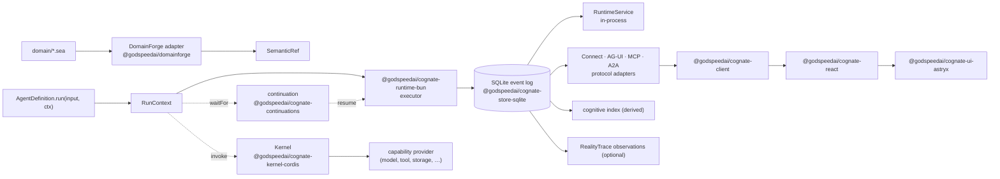

# Cognate documentation

Cognate is a Bun workspace that composes dynamically-mounted components over an append-only
SQLite event log into in-process and Connect-served runtimes, so agents, UI, wire protocols,
cognition, and execution evidence are projections of one durable event history.

This page is the entry point. It assumes no prior knowledge of the repository. Every page below
links to the next one, and each page names the source files that establish its claims.

## Start here

| If you want to | Read |
|---|---|
| run something in five minutes | [getting-started.md](getting-started.md) |
| understand the system without code | [mental-model.md](mental-model.md) |
| know the vocabulary | [concepts.md](concepts.md) |
| see the whole architecture and its dependency rules | [architecture.md](architecture.md) |
| find where a concept is implemented | [source-map.md](source-map.md) |
| see what a page is for, and who owns which concept | [documentation-map.md](documentation-map.md) |

## The system in one picture

Only the parts needed for a first mental model. Every arrow is a real call in the code.

What to notice: the event log is the only thing arrows point *into* for state. The kernel, the
protocols, the client, and the cognitive index are all readers. Nothing else is authoritative.

## The eight concepts you need first

Defined in full in [concepts.md](concepts.md); the short version:

1. **Event** — an immutable, causally linked fact appended to a stream. The only authority.
2. **Component** — a *declaration* of what something requires and provides, plus an `activate` function.
3. **Fiber** — one *live activation* of a component in one scope, owning the effects it registered.
4. **Capability** — a versioned contract a provider publishes and a consumer requires. Eligibility is deterministic; selection may be ranked.
5. **Run** — the durable execution of one `AgentDefinition` on stream `run-<id>`.
6. **RunContext** — what an agent sees while running. Every call is recorded, so re-entry replays instead of repeating.
7. **Continuation** — valid but unfinished work (waiting for a human, a tool, a schedule), persisted so a restart does not lose it.
8. **Projection** — a checkpointed fold of events. Application state, the UI, the cognitive index, and audit views are all projections.

## A representative journey

What happens when someone types a message into a Copilot app, end to end. Each step names the
code that does it; [workflows/run-execution.md](workflows/run-execution.md) has the full trace.

1. The browser's `ChatPanel` calls `client.startRun("agent.copilot", input)`
   ([packages/react/src/index.tsx](../packages/react/src/index.tsx)).
2. `RuntimeService.startRun` authorizes `run.start`, then commits **one** transaction: the
   `run.started` event, a `runs` record, and a `run.execute` outbox intent
   ([packages/runtime-bun/src/service.ts:33](../packages/runtime-bun/src/service.ts)).
3. The runtime's background loop drains that outbox topic and calls `executeOnce`
   ([packages/runtime-bun/src/runtime.ts:78](../packages/runtime-bun/src/runtime.ts)).
4. `executeOnce` re-reads the run stream, re-enters the agent from the top, and records each
   `ctx` call as an event under a deterministic step id
   ([packages/runtime-bun/src/executor.ts:17](../packages/runtime-bun/src/executor.ts)).
5. The agent calls `ctx.invoke("billing.quote", …)`; the kernel authorizes it and the result is
   appended as `run.invocation`. The agent emits `message.delta` events as the model streams.
6. The agent calls `ctx.waitFor("approve", …)`. A continuation is opened, `run.waiting` is
   appended, and the execution halts.
7. A human clicks Approve. `resolveContinuation` commits the record change, the
   `continuation.resumed` event, the idempotency result, and a `continuation.resume` outbox
   intent atomically; the loop re-enters the run, which replays steps 4–5 from their recorded
   results and continues.
8. Meanwhile the client's reconnecting event stream delivers the new events, `RunStore` folds
   them into `RunState`, and React re-renders.

Nothing above survives only in memory. Kill the process at any point and the run resumes from
recorded events.

## Where to go next

- **I want to run it.** [getting-started.md](getting-started.md), then
  [how-to/start-an-app.md](tutorials/start-an-app-from-a-checkout.md).
- **I want to understand the architecture.** [mental-model.md](mental-model.md) →
  [architecture.md](architecture.md) → [subsystems/](subsystems/).
- **I want to watch it work.** [workflows/](workflows/).
- **I want to know why it is built this way.** [explanation/](explanation/) and
  [decisions/](decisions/).
- **I want to change it.** [how-to/](how-to/), then the relevant subsystem page's
  *Extension points* section.
- **I want to add a feature.** Read [extensions.md](extensions.md) first: the design rule is that
  a feature is usually a new capability or a new projection, not a new kernel primitive.
- **I am debugging something.** [troubleshooting.md](troubleshooting.md).
- **I need exact API, event, or configuration details.** [reference/](reference/).

## Status: read this before trusting a claim

Every requirement in [requirements/ledger.yaml](../requirements/ledger.yaml) is currently
`implemented`, and `just gates` reports 78/78 passing. That is a statement about the local
substrate under Bun 1.4.0, not about production readiness. The known limits are enumerated in
[.agents/DEBT.md](../.agents/DEBT.md) and summarized in
[reference/verification.md](reference/verification.md). Where a page names a requirement id, the
ledger is the authority; run `just gate <ID>` to re-prove it.
