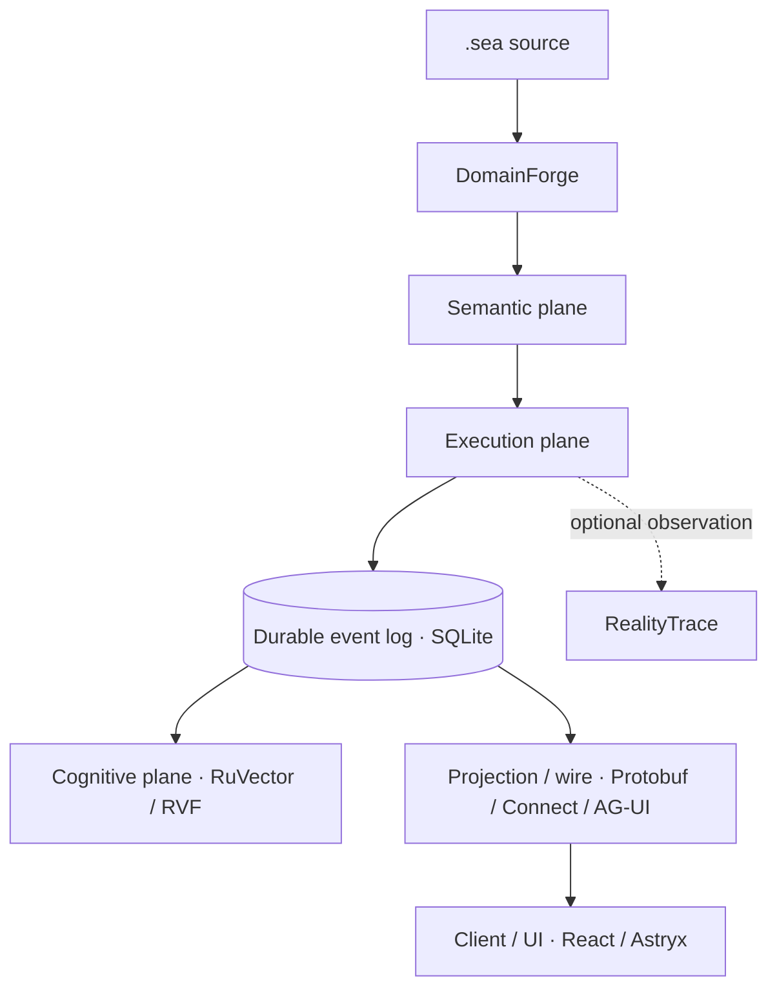
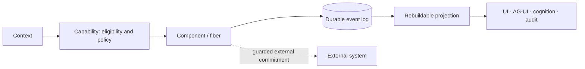

# Architecture

Cognate separates six concerns that a monolithic agent framework usually conflates: what something means, what is currently executing, what happened, what is relevant, how it is represented, and how it is transported (spec §2). No layer may silently become authoritative for a responsibility belonging to another layer.



## Planes (spec §7)

| Plane | Responsibilities | Reference implementation |
|---|---|---|
| Semantic | `.sea` meaning, DomainForge projection into `SemanticRef` | [`@godspeedai/domainforge`](../packages/domainforge/README.md) — see [semantics.md](semantics.md) |
| Execution | contexts, scopes, capabilities, components, fibers, dependencies, reversible effects, continuations, event emission, boundary classification | [`@godspeedai/kernel-api`](../packages/kernel-api/README.md) + [`@godspeedai/kernel-cordis`](../packages/kernel-cordis/README.md) |
| Durable state | authoritative event log, idempotency, outbox, projections | [`@godspeedai/events`](../packages/events/README.md), [`@godspeedai/store-sqlite`](../packages/store-sqlite/README.md), [`@godspeedai/projections`](../packages/projections/README.md) |
| Cognitive | recall, ranking, portable snapshots | [`@godspeedai/cognitive-api`](../packages/cognitive-api/README.md), [`@godspeedai/cognitive-ruvector`](../packages/cognitive-ruvector/README.md), [`@godspeedai/cognitive-rvf`](../packages/cognitive-rvf/README.md) — see [cognition.md](cognition.md), [rvf.md](rvf.md) |
| Wire/interop | Protobuf schema, Connect RPC, AG-UI, MCP, A2A | [`@godspeedai/proto`](../packages/proto/README.md), [`@godspeedai/protocol-connect`](../packages/protocol-connect/README.md), [`@godspeedai/ag-ui`](../packages/ag-ui/README.md), [`@godspeedai/mcp`](../packages/mcp/README.md), [`@godspeedai/a2a`](../packages/a2a/README.md) — see [protocols.md](protocols.md) |
| Presentation | headless client, React bindings, Astryx renderer | [`@godspeedai/client`](../packages/client/README.md), [`@godspeedai/react`](../packages/react/README.md), [`@godspeedai/ui-astryx`](../packages/ui-astryx/README.md) — see [ui.md](ui.md) |

No layer's public API leaks another layer's engine types: framework public APIs never expose Cordis (spec §3.4), `@godspeedai/react`/`@godspeedai/client` never expose Astryx types (`CG-UI-003`), and wire representation is not semantic ontology (spec §3.7).

## Authority and projection paths

Two paths run through the same durable event log but never merge:

- **Authority path**: `Context` → `Capability` (eligibility, then policy at invocation) → `Component`/fiber → reversible effect, durable fact, or external commitment. Only this path can change what is true or authorized (spec §32, [security.md](security.md)).
- **Projection path**: durable events → `Projection` → any read-side representation (application state, AG-UI stream, cognitive index, audit view). Projections are derived and rebuildable; a projection failure must not corrupt authoritative history (spec §11), and cognitive ranking built on projections can narrow eligible choices but never grant authority (`CG-CAP-002`, spec §3.6).



## Package topology (spec §27)

```text
packages/
├── kernel-api/, kernel-cordis/
├── events/, capabilities/, continuations/, projections/, artifacts/
├── store-memory/, store-sqlite/
├── cognitive-api/, cognitive-memory/, cognitive-ruvector/, cognitive-rvf/
├── proto/, protocol-connect/, protocol-connect-bun/
├── runtime-api/, runtime-bun/
├── client/, react/, ui-astryx/
├── ag-ui/, mcp/, a2a/
├── domainforge/, realitytrace/
├── provider-openai-compatible/, provider-local/
├── profile/                 # defineProfile composition API
└── cli/                     # create/dev commands
profiles/
├── copilot/
└── harness/
```

`@godspeedai/runtime-api` ([ADR-0011](decisions/ADR-0011-runtime-service-contract-package.md)) is one package beyond the spec's original layout: a transport-independent `RuntimeService` contract with no dependency beyond `kernel-api` and `events`, so `runtime-bun` can implement it in-process while `protocol-connect` maps it to Connect and `client` consumes it over any transport — proving `CG-WIR-003` (transport replaceability).

## Dependency rules (spec §28)

Allowed, by example:

```text
kernel-cordis      → kernel-api
store-sqlite       → events
cognitive-ruvector → cognitive-api
cognitive-rvf      → cognitive-api
react              → client
ui-astryx          → react
ag-ui              → events, client
domainforge        → kernel-api, projections
realitytrace       → events, evidence contracts
runtime-api        → kernel-api, events
profiles/*         → packages/*
profile            → kernel-api (types only)
```

Forbidden, by example:

```text
kernel-api → cordis, ruvector, react, astryx, ag-ui, domainforge, realitytrace
events         → ruvector
cognitive-api  → ruvector
client         → react
react          → astryx
```

Framework-owned packages (`kernel-api`, `events`, `runtime-api`, `cognitive-api`, ...) never depend on the engine that implements them. This is what makes the architectural acceptance criteria possible (spec §40): Cordis, RuVector, Astryx, and Connect can each be replaced or deleted without changing the packages above them.

## Package table

| Package | Role | Status (ledger) |
|---|---|---|
| [kernel-api](../packages/kernel-api/README.md) | Framework-owned kernel contract | implemented (`CG-KRN-001..008`; [DEBT-005](../.agents/DEBT.md)) |
| [kernel-cordis](../packages/kernel-cordis/README.md) | Cordis-backed kernel engine | implemented |
| [events](../packages/events/README.md) | Canonical event envelope, append store contract | implemented (`CG-EVT-001..006`) |
| [store-sqlite](../packages/store-sqlite/README.md) | Authoritative SQLite event/record store | implemented ([DEBT-011](../.agents/DEBT.md)) |
| [store-memory](../packages/store-memory/README.md) | In-memory store for tests | implemented |
| [projections](../packages/projections/README.md) | Checkpointed, rebuildable projections | implemented |
| [capabilities](../packages/capabilities/README.md) | Two-phase eligibility/selection, adaptive ranking | implemented (`CG-CAP-001/002`) |
| [continuations](../packages/continuations/README.md) | Continuations and external commitments | implemented |
| [artifacts](../packages/artifacts/README.md) | Content-addressed artifact records | implemented (`CG-ART-001`) |
| [runtime-api](../packages/runtime-api/README.md) | Transport-independent runtime service contract | implemented |
| [runtime-bun](../packages/runtime-bun/README.md) | In-process runtime, run execution | implemented ([DEBT-011](../.agents/DEBT.md), [DEBT-015](../.agents/DEBT.md)) |
| [cognitive-api](../packages/cognitive-api/README.md) | `CognitiveIndex` contract, recall pipeline | implemented (`CG-COG-001/002`) |
| [cognitive-memory](../packages/cognitive-memory/README.md) | Reference in-memory index | implemented |
| [cognitive-ruvector](../packages/cognitive-ruvector/README.md) | RuVector-backed index | implemented ([DEBT-007](../.agents/DEBT.md)) |
| [cognitive-rvf](../packages/cognitive-rvf/README.md) | Portable cognitive snapshots | implemented ([DEBT-006](../.agents/DEBT.md)) |
| [domainforge](../packages/domainforge/README.md) | Semantic adapter to `.sea`/DomainForge | implemented (`CG-SEM-001/002`; [DEBT-001](../.agents/DEBT.md)–[003](../.agents/DEBT.md)) |
| [realitytrace](../packages/realitytrace/README.md) | Execution evidence adapter to SXR | implemented (`AK-006`, `CG-RT-001..003`) |
| [proto](../packages/proto/README.md) | Canonical protobuf sources | implemented |
| [protocol-connect](../packages/protocol-connect/README.md) | Connect RPC mapping | implemented ([DEBT-004](../.agents/DEBT.md)) |
| [protocol-connect-bun](../packages/protocol-connect-bun/README.md) | `Bun.serve()` Connect bridge | implemented |
| [client](../packages/client/README.md) | Headless transport-agnostic client | implemented |
| [react](../packages/react/README.md) | React 19 bindings | implemented (`CG-UI-001/003`) |
| [ui-astryx](../packages/ui-astryx/README.md) | Reference UI surfaces | implemented (`CG-UI-002`) |
| [ag-ui](../packages/ag-ui/README.md) | AG-UI interoperability | implemented (`CG-AGUI-001..003`) |
| [mcp](../packages/mcp/README.md) | MCP tool adapter | implemented (`CG-MCP-001`; [DEBT-013](../.agents/DEBT.md) closed) |
| [a2a](../packages/a2a/README.md) | A2A protocol adapter | implemented (`CG-A2A-001`) |
| [provider-local](../packages/provider-local/README.md) | Local model provider | implemented |
| [provider-openai-compatible](../packages/provider-openai-compatible/README.md) | OpenAI-compatible provider | implemented |
| [profile](../packages/profile/README.md) | `defineProfile` composition API | implemented (`CG-PRF-001`) |
| [cli](../packages/cli/README.md) | `cognate create`/`dev` | implemented (`CG-CLI-001`; [DEBT-016](../.agents/DEBT.md)) |
| [profiles/copilot](../profiles/copilot/README.md) | Reference copilot application | implemented (`CG-PRF-002`) |
| [profiles/harness](../profiles/harness/README.md) | Reference autonomous harness | implemented (`CG-PRF-003`) |

Status reflects [`requirements/ledger.yaml`](../requirements/ledger.yaml) as of this writing; run `just gates` for the current, authoritative view.

The dependency table above is explicitly "by example". The complete internal graph, computed from every manifest, is in [source-map.md](source-map.md#the-full-internal-dependency-graph); the machine-checked rules are in [reference/capability-and-architecture-contracts.md](reference/capability-and-architecture-contracts.md).

## Deeper

- [mental-model.md](mental-model.md) — the conceptual structure behind these planes.
- [subsystems/](subsystems/) — one page per subsystem, with its responsibilities, state, lifecycle, failure modes, and extension points.
- [workflows/](workflows/) — what actually happens at runtime.
- [explanation/](explanation/) — why the structure is this way.
- [source-map.md](source-map.md) — every concept mapped to its implementation.
