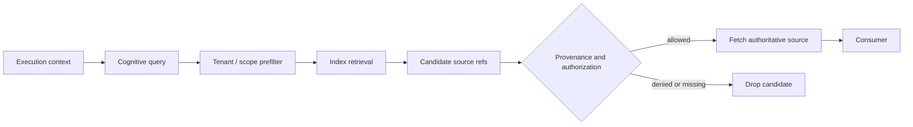

# Cognition: recall, ranking, and safety

## Cognition is not truth

The framework defines a dependency-free `CognitiveIndex` interface rather than exposing RuVector types (spec §14). A retrieved cognitive item MUST NOT be treated as authoritative merely because similarity is high (spec §16). Cognition can rank among already-eligible, already-authorized candidates; it can never grant authority, widen an eligible set, or bypass policy (spec §3.6, §17) — see [concepts.md](concepts.md#capabilities-eligibility-vs-selection).

## `CognitiveIndex` contract

[`@godspeedai/cognitive-api`](../packages/cognitive-api/README.md) defines the contract every implementation passes through a shared conformance kit (spec §14–16, `CG-COG-001`):

- `types.ts` — `CognitiveEntry`, `CognitiveIndex`, `Embedder`, `SourceResolver`.
- `recall.ts` — `createRecall`: embed → `similar` (tenant/scope pre-filter) → provenance post-filter → authorized fetch. A denied or missing source drops silently; the pipeline degrades to `{status: "degraded"}` on index/embedder failure, or throws `CognitionUnavailableError` when the caller passes `required: true` (`CG-COG-005`).
- `indexer.ts` — `cognitiveIndexer`: a `Projection` (see [concepts.md](concepts.md#projections)) that embeds extracted documents and upserts them into a `CognitiveIndex`, and removes entries whose source event is erased.
- `conformance.ts` — `cognitiveIndexConformance`, reused by every implementation.

Capability flags are discoverable rather than assumed: `vector_search`, `graph_traversal`, `temporal_search`, `causal_search`, `adaptive_ranking`, `snapshot`, `branch`, `witness`. Not every implementation supports every flag.

A `CognitiveEntry` preserves a link back to its authoritative source (`source_ref`) — the vector or graph record is a retrieval aid, never the record of truth (spec §15). Deleting and rebuilding the index leaves deterministic behavior unchanged (`CG-COG-004`); a rebuild replays from authoritative sources, never from the index itself.

## Retrieval pipeline (spec §16)



Filtering happens as early as the implementation safely permits. `CG-COG-002` proves retrieval filters by scope and authorizes each dereference without leaking a restricted candidate's existence.

## Reference implementations

- **[`@godspeedai/cognitive-memory`](../packages/cognitive-memory/README.md)** — in-memory reference implementation; the one to reach for in tests and examples.
- **[`@godspeedai/cognitive-ruvector`](../packages/cognitive-ruvector/README.md)** — the reference vector-index binding, pinning `@ruvector/core@0.1.32` exactly, scoped to the `vector_search` capability flag only ([ADR-0004](decisions/ADR-0004-cognition-ruvector.md)). Because RuVector's own `filter` option does not actually filter, tenant/scope enforcement and provenance disclosure happen in the adapter: `similar` overfetches from RuVector and filters by tenant/scope locally, growing `k` if too few candidates survive — correctness over speed. RuVector never discloses another tenant's id. See [DEBT-007](../.agents/DEBT.md): metadata round-trips only as a JSON string, there is no in-memory mode (a storage path is always required), and graph/temporal/causal retrieval need a separate, unevaluated package.

## Adaptive selection

[`@godspeedai/capabilities`](../packages/capabilities/README.md) implements the two-phase selection model (spec §17, §30): every eligibility rule filters first; only the eligible set reaches an adaptive `Ranker`, which can narrow but never widen it (`CG-CAP-002`, proven adaptive-containment property). `recordSelection`/`recordOutcome` make a selection and its outcome durable facts; `outcomeProjection()` counts successes and outcomes per `(capability, provider)`, and `createOutcomeRanker(store)` turns them into a UCB1 `Ranker`: `successRate + sqrt(2 ln N / n)` over the eligible providers, with untried providers first and ties in provider-id order. The exploration term keeps re-trying a provider that failed early instead of abandoning it. Feedback changes ranking only after it is committed and projected, never in-flight (`AK-008`).

**SONA was rejected as the adaptive ranker** ([ADR-0005](decisions/ADR-0005-adaptive-ranking-sona.md)); the UCB1 ranker above replaces it. Phase 0 characterization (`compatibility/phase0/sona/sona.test.ts`) found `SonaEngine`'s full public surface (`addTrajectoryContext`, `addTrajectoryStep`, `applyBaseLora`, `applyMicroLora`, `beginTrajectory`, `endTrajectory`, `findPatterns`, `flush`, `forceLearn`, `getStats`, `isEnabled`, `setEnabled`, `setTrajectoryRoute`, `tick`) has no candidate-ranking method at all. No profile claims SONA support. The forbidden pattern the spec explicitly rules out either way:

```text
all providers → SONA chooses one → skip policy check     # forbidden
eligible providers → rank by historical outcome (UCB1)    # the implemented shape
```

## Status

`CG-COG-001` through `CG-COG-005` are `implemented` per [`requirements/ledger.yaml`](../requirements/ledger.yaml). `CG-COG-003` (RuVector passes the conformance kit) carries [DEBT-007](../.agents/DEBT.md). Adaptive ranking (`AK-008`) is implemented by the Cognate-owned UCB1 ranker; [DEBT-008](../.agents/DEBT.md) is closed.

## Related

- [rvf.md](rvf.md) — portable snapshots of cognitive state.
- [security.md](security.md) — retrieval authorization in detail.
- [concepts.md](concepts.md) — capabilities, eligibility, and selection.
- [subsystems/capabilities-and-cognition.md](subsystems/capabilities-and-cognition.md) — the subsystem page: selection, the index contract, and the adapters.
- [workflows/evidence-and-observation.md](workflows/evidence-and-observation.md) — how observations and cognitive entries are indexed from the same events.
- [explanation/authority-and-learning.md](explanation/authority-and-learning.md) — why ranking sits after eligibility.
