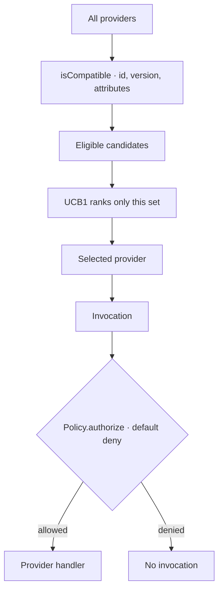

# Why learning cannot grant authority

**What is confirmed vs. inferred.** The separation of eligibility from selection, and the
containment property, are confirmed by the implementation and pinned by tests. The reasoning about
*why the two phases are separate* is reconstructed; treat it as strong inference.

## The shape



The rule is one line: **adaptive ranking happens after deterministic eligibility, and cannot widen
it.** Authorization is checked separately at invocation, after selection. The forbidden shape is
"all providers → ranker chooses → skip the policy check".

## Three different "may I?" questions

Most of the confusion in an agent system comes from collapsing these:

| Question | Decided by | Can learning answer it? |
|---|---|---|
| *Which providers are compatible?* | `isCompatible` — id, semver, attributes | no |
| *Is this caller allowed to invoke it?* | `Policy.authorize` at invocation, default `denyAll` | never |
| *Among the allowed ones, which works best right now?* | `outcomeProjection` + UCB1 | yes, this is the only one |

A fourth question sits above all of them, at the service boundary: *may this caller start/cancel
this run, or resume this continuation?* That is the `ActionPolicy`, which is not the kernel's
`Policy` and knows nothing about providers.

## What the ranker is actually allowed to do

`createSelector(...).select(request)`:

1. every `EligibilityRule` evaluates every candidate, and **every** `(provider, rule)` result is
   recorded in the decision;
2. only the eligible set is handed to the `Ranker`;
3. ranker output is filtered again: an entry that is unknown, ineligible, duplicated, or
   non-finite is dropped;
4. a missing or throwing ranker falls back to deterministic `providerId` order.

Step 3 is what makes containment a property of the code rather than a promise about ranker
authors. `tests/properties/containment.property.test.ts` generates arbitrary selector/ranker
combinations and asserts an ineligible candidate is never selected.

## Why the learning signal is itself a durable fact

`recordSelection` writes `capability.selected`; `recordOutcome` writes `capability.outcome`. Both
are events. `outcomeProjection()` counts successes and totals per `(capability, provider)`, and
`createOutcomeRanker(store)` turns that into UCB1:

```text
score = successRate + sqrt(2 ln N / n)
```

Two consequences follow from the signal being durable rather than in-memory:

- **Feedback affects ranking only after it is committed and projected** (`CG-COG-006`). An
  in-flight decision is never revised under the caller.
- **Deleting the learning input is impossible without deleting history.** The counters are a
  projection; the events behind them are not erasable by ordinary means.

## UCB1 specifically

`successRate + sqrt(2 ln N / n)`, untried providers first, ties broken by provider id. The
exploration term is the point: a provider that failed on its first two attempts is still tried
again, because `sqrt(2 ln N / n)` is large when `n` is small. A purely greedy ranker would abandon
it — and `AK-008`'s contract test was written against a greedy ranker first, which failed it.

SONA was evaluated and rejected ([ADR-0005](../decisions/ADR-0005-adaptive-ranking-sona.md)): the
Phase 0 characterization found `SonaEngine`'s public surface has no candidate-ranking method at
all. DEBT-008 records the choice of a Cognate-owned UCB1 ranker instead.

## The same rule in the cognitive plane

Cognition obeys the identical shape. `createRecall` filters by tenant/scope *before* disclosing
metadata, and authorizes each authoritative dereference *after* retrieval; a denied or missing
source drops silently so a restricted object never reveals its existence. A high similarity score
is not permission, and a retrieved item is not a record of truth.

`CG-COG-004` is the sharpest test in the repository: deleting the cognitive index entirely must
not change a single deterministic authorization outcome. If it did, cognition would be a backdoor.

## Failure modes and what they mean

| Symptom | What it usually means |
|---|---|
| `unavailable` when a provider is configured | the contract is not `isCompatible` with the requirement — a version or attribute mismatch, not a permission problem |
| `denied` with a `PolicyDecision` | eligibility passed; the policy refused. Look at `policyId` and `reason` on the `run.invocation` metadata |
| a ranker seems to have no effect | the feedback projection has not caught up, or the provider is untried and sorts first anyway |
| a good provider is never selected | the eligible set may be empty; the selection decision records every `(provider, rule)` explanation — read it |
| a new tenant can see another's recall | a `Policy` or `SourceResolver` that ignores `context.tenant` / the `tenant` argument |

## Source trail

- `packages/capabilities/src/selector.ts` — `createSelector`, `recordSelection`, `recordOutcome`,
  `outcomeProjection`, `createOutcomeRanker`.
- `packages/capabilities/src/types.ts` — `Candidate`, `EligibilityRule`, `Ranker`,
  `SelectionDecision`, `Outcome`.
- `packages/kernel-api/src/compat.ts` — `isCompatible`.
- `packages/kernel-api/src/policy.ts` — `denyAll`, `rulePolicy`.
- `packages/kernel-cordis/src/kernel.ts:33-44` — resolution consults no policy.
- `packages/runtime-bun/src/invoker.ts:36-43` — per-invocation decision capture.
- `packages/cognitive-api/src/recall.ts` — filter, post-filter, authorized fetch.
- `tests/properties/containment.property.test.ts`,
  `packages/capabilities/test/adaptive-ranker.test.ts`, `packages/capabilities/test/feedback.test.ts`.
- `packages/cognitive-api/test/retrieval.test.ts` — `CG-COG-002`.
- spec §3.6, §8.2, §14–17, §30, §32; acceptance criteria B and I.
- [../cognition.md](../cognition.md) — the cognitive plane in full.

## Related

- [../security.md](../security.md) — the rules in their normative form.
- [../workflows/capability-invocation.md](../workflows/capability-invocation.md) — the path.
- [why-projection-not-storage.md](why-projection-not-storage.md) — the other half of the design.
