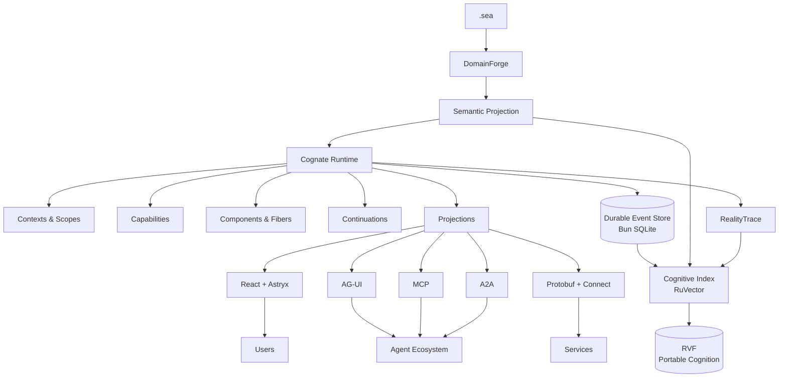

# Under the hood

The technical detail behind the summary in the root README: planes, the kernel, durable state, cognition, evidence, protocols, packages, concurrency, and security. Claims cite source files; the ledger in `actualize/product-model.md` is internal and not linked from public docs.

## Architecture



Cognate separates six concerns that agent frameworks often mix together:

| Plane            | Responsibility                              |
| ---------------- | ------------------------------------------- |
| **Semantic**     | What the application means                  |
| **Execution**    | What is currently alive and what can happen |
| **Durable**      | What happened                               |
| **Cognitive**    | What is relevant now                        |
| **Wire**         | How representations cross boundaries        |
| **Presentation** | How people and agents interact with them    |

---


## Portable Cognition with RVF

Cognate targets RVF as an optional portable cognitive container. The current RVF Bun native binding is described as experimental by its package documentation, so export, import, and branching remain subject to an executable compatibility spike.

An RVF can carry cognitive state such as:

* vectors;
* relationships;
* metadata;
* learned retrieval state;
* provenance;
* lineage;
* witness information.

Cognition can be snapshotted, exported with a Cognate integrity manifest, imported, and branched through `@godspeedai/cognate-cognitive-rvf` (runnable: `bun run example:rvf-branching`):

```ts
const index = await createRvfIndex({ path: "./cognition.rvf", dimension: 384 });
const manifest = await index.snapshot(store, { dir: "./snapshots", name: "base", lineage: "my-app", indexedThrough, storeHead, onBehind: "fail", frameworkVersion: "0.5.0" });
const experiment = await index.branch("./experiment-a.rvf");
const imported = await importSnapshot(store, "./snapshots/base.manifest.json", { lineage: "my-app", storeHead, allowedTenants: ["tenant-a"], maxEntries: 100_000, maxBytes: 1 << 30 });
```

The CLI does not expose cognition commands yet; use the API above.

This enables inexpensive cognitive forks for:

* agent experiments;
* simulations;
* user-specific branches;
* case branches;
* evaluation environments;
* sandboxes.

```text
base.rvf
   │
   ├── alice.rvf
   ├── scenario-a.rvf
   ├── agent-experiment.rvf
   └── evaluation.rvf
```

A cognitive branch does not rewrite authoritative event history.

Imported cognition is tracked with lineage and can remain detached until its relationship to the current application is verified.

---

## RealityTrace Observations and Evidence

Cognate provides a version-pinned adapter for RealityTrace (v0.3.0) without changing RealityTrace.

The adapter records observations through RealityTrace's supported CLI and CEP workflow. RealityTrace currently requires repository enrollment, a snapshot, a declared question and threshold, a run, and a committed plan before the relevant observation can be recorded. An observation receipt alone is neither qualifying evidence nor a settled result.

Where available, an observation carries:

* event identity;
* run identity;
* causation;
* component;
* fiber;
* capability;
* provider;
* continuation;
* semantic reference;
* artifact reference.

```text
.sea
 │
 ▼
expected semantics
 │
 ▼
Cognate execution
 │
 ├──────────────► durable events
 │
 └──────────────► RealityTrace observation
                         │
                  evidence derivation
                         │
                      settlement
```

This is the intended connection between declared semantics and observed execution. The adapter must preserve correlation in schema-valid fields and independently reconcile delivery; it cannot treat arbitrary framework events as understood RealityTrace evidence.

---

## Continuations: Work That Is Not Done Yet

Human-in-the-loop is useful, but it is only one instance of a broader problem.

Sometimes valid execution cannot continue yet.

Cognate represents that directly.

```ts
const approval = await ctx.waitFor("approval", {
  type: "refund-approval",
  condition: { kind: "human_approval" },
  payload: { amount, account },
});
```

A continuation can wait for:

```text
human approval
tool result
OAuth authorization
remote agent
external workflow
scheduled event
missing capability
additional information
```

Continuations are durable.

The process can stop.

The browser can close.

The application can restart.

When the condition is satisfied, the run resumes.

---

## Agent-Native UI

The plan includes a headless client, React bindings, and a reference Astryx UI layer.

```text
Cognate
   │
   ▼
Headless Client
   │
   ├── React
   │     │
   │     ▼
   │   Astryx
   │
   └── other clients
```

The headless client supports:

* runs;
* state projections;
* capability registration;
* tools;
* artifacts;
* continuations;
* cognition;
* streaming;
* reconnect/resume.

The reference UI adds:

* chat;
* generative UI;
* artifact viewers;
* approval surfaces;
* interactive state;
* run inspection;
* dark/light themes;
* accessible application primitives.

Astryx is a renderer, not the ontology.

Replace it without rewriting your application.

---

## Frontend Capabilities

The browser is allowed to provide capabilities too.

```ts
useCapability("map.focus", async ({ latitude, longitude }) => {
  map.flyTo({ latitude, longitude });
});
```

An agent requiring `map.focus` does not need to know whether it is implemented by:

* React;
* a native application;
* another browser framework;
* a remote display.

It requires a capability.

The current client happens to provide it.

---

## Shared State

Application state is derived from semantic events and projections.

Agents and UI can participate in the same state without maintaining unrelated copies of reality.

```ts
const entries = useProjection("orders"); // tenant-partitioned key/value entries
const order = entries?.find((entry) => entry.key === "current")?.value;

return <OrderCard order={order} />;
```

When an agent changes the underlying application state, subscribed projections update.

When the UI performs a valid semantic action, the resulting events become visible to agents.

Shared state is therefore not a special synchronization subsystem.

It is two consumers observing and acting upon the same application.

---

## Artifacts Are First-Class

Agents produce more than messages.

Cognate treats artifacts as durable, addressable outputs.

Examples include:

* documents;
* tables;
* graphs;
* plans;
* diffs;
* reports;
* images;
* datasets;
* code;
* forms;
* discussions;
* domain-specific interactive objects.

Artifacts can expose multiple projections.

```text
Artifact
   │
   ├── model representation
   ├── React renderer
   ├── document viewer
   ├── table view
   ├── graph view
   ├── diff view
   └── external serialization
```

The artifact remains the same semantic object.

The representation changes.

---

## Protocols Are Adapters

Cognate does not turn transport protocols into application architecture.

Native cross-process contracts use Protocol Buffers.

The reference RPC transport is Connect.

Optional adapters include:

* AG-UI;
* MCP;
* A2A;
* SSE;
* WebSocket;
* gRPC-compatible services;
* custom transports.

```text
             Cognate
                │
          service contracts
                │
       ┌────────┼──────────┐
       ▼        ▼          ▼
    Connect   AG-UI       MCP
       │        │          │
       ▼        ▼          ▼
   services   clients    tools
```

---

## AG-UI Compatibility

Cognate can project its native execution model into AG-UI.

That includes mappings for:

* run lifecycle;
* streamed messages;
* tool calls;
* tool results;
* state snapshots;
* state deltas;
* activities;
* custom events.

This allows Cognate applications and agents to participate in the broader AG-UI ecosystem without using AG-UI as their internal event ontology.

Use AG-UI because you need interoperability.

Not because your application should become AG-UI internally.

---

## Protobuf + Connect

Cross-language boundaries use protobuf contracts.

```text
TypeScript / Bun
       │
       ▼
    Protobuf
       │
     Connect
   /    │     \
  ▼     ▼      ▼
 Rust   Go   Browser
```

Cognate's reference runtime uses Connect over Bun's Web-standard request/response APIs.

Application services are defined independently from the transport, so another RPC implementation can replace Connect without redefining the application.

---

## Bun Native

Cognate uses Bun as the reference runtime and development platform.

Bun provides the default:

* runtime;
* TypeScript execution;
* package management;
* workspaces;
* bundling;
* test runner;
* HTTP server;
* WebSockets;
* SQLite.

Typical development is intentionally boring:

```bash
bun install
bun dev
bun test
```

A local Cognate application does not require an infrastructure diagram before it can say hello.

---

## Any Model

Models are capability providers.

The core does not depend on an LLM SDK.

Use:

* OpenAI-compatible APIs;
* Anthropic;
* DeepSeek;
* local llama.cpp servers;
* Ollama;
* custom inference;
* your own provider.

```ts
components: [
  modelComponent(
    openAICompatible({
      id: "local",
      baseURL: "http://localhost:8080/v1",
      model: "qwen2.5-7b-instruct",
    }),
  ),
];
```

Consumers request model capabilities.

They do not need to know which provider eventually satisfies them.

---

## Providers Can Be Replaced Live

Suppose an application requires a model capable of structured output.

```text
Agent
  requires
model.generate
  +
structured_output
```

Three configured providers satisfy that contract.

Cognate can filter them deterministically and optionally rank the remaining providers using historical outcomes.

If the selected provider disappears, the runtime can resolve another compatible provider.

No consumer import changes.

---

## Profiles

Cognate profiles are reusable application compositions.

A profile selects and configures capabilities without adding new kernel concepts.

The design calls for two reference profiles.

## Copilot

```bash
cognate create my-app --profile copilot --source ./cognate
```

Includes:

* agent runtime;
* headless client;
* React bindings;
* Astryx UI;
* shared state;
* frontend tools;
* artifacts;
* continuations;
* generative UI;
* AG-UI compatibility;
* durable threads;
* cognitive recall.

## Harness

```bash
cognate create my-agent --profile harness --source ./cognate
```

Includes:

* model providers;
* agent loop;
* tool registry;
* skills;
* sessions;
* subagents;
* scheduler;
* workspace;
* storage;
* sandbox capability;
* cognitive memory;
* replaceable services.

These profiles demonstrate a deliberate property of Cognate:

> A user-facing agent framework and an autonomous agent harness do not require two unrelated architectures.

They are different compositions of the same substrate.

---

## Build Your Own Profile

```ts
import { defineProfile } from "@godspeedai/cognate-profile";

export default defineProfile({
  name: "research-workbench",

  components: [
    "sessions",
    "agents",
    "browser",
    "artifacts",
    "cognition",
    "realitytrace",
    "connect",
    "ui",
  ],
});
```

Profiles are composition.

They do not create privileged runtime features.

---


## Built In, Not Locked In

The packages provide strong defaults while keeping implementation boundaries explicit.

| Concern                   | Reference implementation | Cognate boundary    |
| ------------------------- | ------------------------ | ------------------- |
| Runtime                   | Bun                      | Runtime             |
| Composition               | Cordis                   | Kernel              |
| Durable state             | `bun:sqlite`             | EventStore          |
| Semantics                 | DomainForge / `.sea`     | Semantic projection |
| Cognition                 | RuVector                 | CognitiveIndex      |
| Portable cognition        | RVF                      | CognitiveSnapshot   |
| Observations/evidence     | RealityTrace             | ObservationPort     |
| RPC                       | Connect                  | Service transport   |
| Wire schema               | Protobuf                 | Message contracts   |
| Agent/UI interoperability | AG-UI                    | Projection adapter  |
| UI framework              | React                    | Headless client     |
| Design system             | Astryx                   | Renderer            |

Strong defaults should reduce decisions.

They should not become architectural traps.

---

## Failure Is Part of the Model

Cognate assumes components fail, networks disconnect, providers disappear, applications restart, and indexes become stale.

The architecture reflects that.

### Cognitive index unavailable?

Deterministic execution continues without cognitive optimization.

### Client disconnected?

Durable events continue. The client reconnects from a known position.

### Provider removed?

Dependent components deactivate or resolve another valid provider.

### Projection crashes?

Authoritative history remains intact and the projection can rebuild.

### RVF snapshot fails?

The active index and durable event history remain untouched.

### UI fails?

The UI can be restarted without redefining application state.

Durability and rebuildability are properties of the architecture, not recovery scripts added later.

---

## Security

Cognate follows a simple authority rule:

> Possessing relevant information does not imply permission to act on it.

Capability invocation and cognitive retrieval are scoped independently.

Similarity cannot bypass authorization.

Adaptive ranking cannot bypass eligibility.

External actions can use idempotency and durable commit records.

Credentials remain provider concerns rather than becoming application semantics.

Sensitive cognitive entries can store references or redacted projections instead of embedding unrestricted source payloads.

---

## Testing the Substrate

The test suite exercises the invariants underneath applications (`tests/properties`, the kernel and store conformance kits, and `tests/integration`).

Examples:

### Reversible composition

```text
state₀
 ↓ mount component
state₁
 ↓ unmount component
state₂

state₂ == state₀
```

for all effects owned exclusively by that component.

### Dependency closure

A component cannot remain active without its required capabilities.

### Scope isolation

A child scope cannot leak isolated capabilities into its siblings or parent.

### Cognitive non-authority

Deleting the cognitive index cannot change deterministic authorization outcomes.

### Adaptive containment

An adaptive selector cannot return a candidate eliminated by deterministic eligibility.

### Replay

Deterministic projections replay to equivalent state from the same event sequence.

These tests are part of Cognate's compatibility contract.

---

## Agent-Friendly by Design

Cognate is designed to be built by people and coding agents using the same contracts.

The repository includes:

* machine-readable package boundaries;
* architecture documentation;
* per-package `AGENTS.md` guidance;
* generated dependency maps;
* protobuf contracts;
* executable examples;
* invariant tests;
* compatibility tests;
* package-local extension documentation.

An agent should be able to answer:

> What can I extend?

> What owns this behavior?

> Which package may I depend on?

> What invariant must this change preserve?

without reverse-engineering the entire repository first.

---


## Examples

The examples demonstrate:

```text
examples/
├── copilot/
├── autonomous-harness/
├── human-approval/
├── generative-ui/
├── shared-state/
├── artifact-workbench/
├── multi-agent/
├── cognitive-memory/
├── rvf-branching/       # conditional on the RVF Bun compatibility gate
├── capability-hot-swap/
├── domainforge/
├── realitytrace/
├── ag-ui/
├── mcp/
└── connect/
```

Each example runs independently and verifies its own outcome (`tests/examples.test.ts`).

```bash
bun run example:generative-ui
```

---

