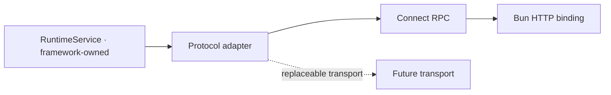

# Protocols: Protobuf, Connect, AG-UI, MCP, A2A

Wire representation is not semantic ontology (spec §3.7): every adapter here maps a stable internal contract (`RuntimeService`, durable events) to a protocol's own shapes, and never lets the protocol define what something means. Internal framework events are never aliases of a protocol's events (spec §24).

## Protobuf: `@godspeedai/proto`

[`@godspeedai/proto`](../packages/proto/README.md) holds the canonical `proto/cognate/v1/*.proto` sources and their generated bindings. Codegen determinism is verified by `test/codegen.test.ts`: two fresh generations plus the committed output must be byte-for-byte identical.

| Concern | Support |
|---|---|
| Message/enum codegen | Full |
| `RuntimeService` methods | Unary + server-streaming only ([DEBT-004](../.agents/DEBT.md)); no client/bidi streaming methods exist in the schema |
| Wire formats | JSON and binary |

## RPC: `@godspeedai/protocol-connect` and `@godspeedai/protocol-connect-bun`

Default RPC is Connect over standard HTTP (spec §22), chosen so the framework does not depend on Node-only server adapters — the transport must be isolated from `RuntimeService` itself, which is why `@godspeedai/runtime-api` exists independently ([ADR-0011](decisions/ADR-0011-runtime-service-contract-package.md), [architecture.md](architecture.md)):



[`@godspeedai/protocol-connect`](../packages/protocol-connect/README.md) maps `RuntimeService` to the generated `cognate.v1.RuntimeService`, independent of the HTTP server:

- `registerRuntimeService(router, service, { authenticate, maxJsonDepth })` — server routes. The caller comes from request headers via `authenticate`, never from message bodies (spec §32). `google.protobuf.Value` inputs are depth-checked.
- `createRemoteRuntimeService(transport, tokenFor)` — a `RuntimeService` implementation over any Connect transport; `ServiceError` codes round-trip exactly.
- `errorCodes` — the `ServiceError` ↔ Connect code table.

`test/service.test.ts` runs the *same* service conformance kit as the in-process runtime, over both JSON and binary encoding — this is what proves `CG-WIR-003` (transport replaceability, spec §40.G).

[`@godspeedai/protocol-connect-bun`](../packages/protocol-connect-bun/README.md) adapts `Bun.serve()`'s Request/Response handling to that router, since Bun has no first-party Connect server adapter.

**Mode matrix ([DEBT-004](../.agents/DEBT.md))**: unary and server streaming only. `@connectrpc/connect-web`'s fetch transport rejects streaming request bodies over HTTP/1.1, and no HTTP/2 path has been demonstrated, so bidirectional streaming is not advertised, per spec §22's explicit requirement not to advertise it until HTTP/2 is proven. Design agent code and runtime services so they never require client or bidi streaming.

## AG-UI: `@godspeedai/ag-ui`

[`@godspeedai/ag-ui`](../packages/ag-ui/README.md) ([ADR-0008](decisions/ADR-0008-ag-ui.md)) is a projection and interoperability layer over `@ag-ui/core` 1.0.0, publishing an event-by-event compatibility matrix (`MatrixRow[]`, one row per AG-UI `EventType`, all 31) rather than assuming full parity. Unsupported event kinds are rejected or explicitly ignored per the matrix, never silently reinterpreted.

```text
Framework run lifecycle       → AG-UI RUN_* events
Framework message projection  → AG-UI TEXT_MESSAGE_* events
Framework tool execution      → AG-UI TOOL_CALL_* events
Framework projected state     → AG-UI STATE_SNAPSHOT / STATE_DELTA
```

`createProjector({ threadId, runId })` is a stateful per-run projector: feed it durable events in order, get schema-valid AG-UI events (`rawEvent.cognate` carries `{ eventId, position }` of the source). The recorded run invocation input (`run.invocation`, an erasable payload) is what `TOOL_CALL_ARGS` carries — the projector never emits `{}` for a tool call it has real input for. `run.artifact` events project to a `CUSTOM cognate.artifact` event. `createAgUiHandler(options)` is an HTTP endpoint: POST `RunAgentInput` → SSE stream of AG-UI events. Inbound actions (user message, frontend-tool results, continuation responses, cancellation) go through `RuntimeService` with the authenticated caller — the same authorization path as native clients (spec §32). `forwardedProps.cognate.cursor` resumes from a durable position (sending a snapshot then only newer events); an unknown cursor triggers a full resync. Disconnecting never cancels the durable run.

`CG-AGUI-001..003` are `implemented`: `bun test ./packages/ag-ui ./packages/runtime-bun ./tests/integration/{causality,erasure}.test.ts` proves the outbound matrix over all 31 AG-UI 1.0.0 event types against a real `@ag-ui/client` `HttpAgent` consumer, inbound actions through native auth/authorization/idempotency (approvals, frontend tool results, cancellation, unsupported interactions reported), and cursor reconnect/resync semantics (`.agents/evidence/m8-wire-client.md`).

## MCP: `@godspeedai/mcp`

[`@godspeedai/mcp`](../packages/mcp/README.md) ([ADR-0010](decisions/ADR-0010-mcp.md)) exposes runtime capabilities as MCP tools via `@modelcontextprotocol/sdk` 1.30.1. `createMcpServer({ service, caller, tools })` registers one tool per binding (name defaults to the capability id with `.` → `_`), advertising the binding's JSON Schema. Every call goes through `RuntimeService.invoke` as the connection's authenticated caller, so kernel policy applies (spec §32); a `ServiceError` returns `isError: true` with `<code>: <message>`, never a partial success. Tools are proven both over the in-memory transport and, from a separate process, over stdio.

`CG-MCP-001` is `implemented`. [DEBT-013](../.agents/DEBT.md) (MCP proven only over the in-memory transport) is **closed**: `packages/mcp/test/mcp.test.ts` now drives the adapter over stdio from a separate process.

## A2A: `@godspeedai/a2a`

[`@godspeedai/a2a`](../packages/a2a/README.md) exposes a runtime agent over the [A2A protocol](https://github.com/a2aproject/A2A) v1.0 via `@a2a-js/sdk` 1.2.1 (proto-JSON). `createA2AHandler(options)` serves the agent card at `/.well-known/agent-card.json` and JSON-RPC at `/a2a`. `message/send` starts (or, with a `taskId`, resumes) a durable run: the A2A task id equals the Cognate run id; an open continuation surfaces as `TASK_STATE_INPUT_REQUIRED`; completion returns `TASK_STATE_COMPLETED` with the run output in artifacts.

```ts
interface A2AAdapterOptions {
  service: RuntimeService;
  agent: string; // runtime agent id served, e.g. `agent.refund`
  card: { name: string; description: string; version: string; skills: readonly { id: string; name: string; description: string }[] };
  authenticate: (headers: Headers) => Caller | undefined | Promise<Caller | undefined>;
  baseUrl: string; // public base URL written into the agent card
}
```

`CG-A2A-001` is `implemented`: `bun test ./packages/a2a` proves the SDK `ClientFactory` + `JsonRpcTransportFactory` client sees `TASK_STATE_INPUT_REQUIRED` on the first `SendMessage`, `TASK_STATE_COMPLETED` with "approved" in artifacts on the follow-up, and a 401 for an unauthenticated request; a resume race (a run still `waiting` on a continuation that was just resolved) is handled (`.agents/evidence/m8-wire-client.md`).

## Status summary

| Protocol | Ledger status |
|---|---|
| Protobuf / Connect (`CG-WIR-001..004`) | implemented ([DEBT-004](../.agents/DEBT.md) on `CG-WIR-002`) |
| AG-UI (`CG-AGUI-001..003`) | implemented |
| MCP (`CG-MCP-001`) | implemented |
| A2A (`CG-A2A-001`) | implemented |

## Related

- [security.md](security.md) — every protocol adapter authenticates and authorizes exactly like a native caller.
- [ui.md](ui.md) — the headless client AG-UI and native clients both sit above.
- [subsystems/wire-and-protocols.md](subsystems/wire-and-protocols.md) — the subsystem page, with the internal operation and failure modes of each adapter.
- [how-to/add-a-protocol-adapter.md](how-to/add-a-protocol-adapter.md) — extending the wire without letting a protocol define semantics.
- [reference/runtime-service-and-agents.md](reference/runtime-service-and-agents.md) — the contract every adapter maps.
