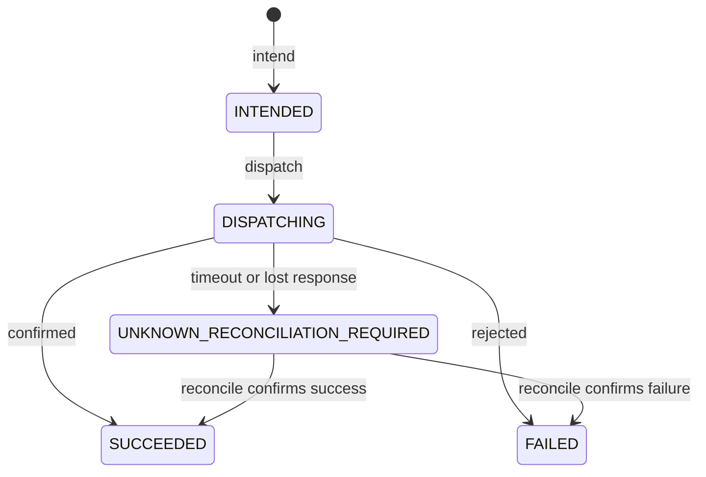

# Subsystem: continuations and external commitments

## Purpose

Represent the two things a durable runtime must not lose: work that is valid but unfinished, and
work that leaves the system and cannot be undone.

## Responsibilities

- Continuations: open, guard, resume, cancel, fail, expire, unblock; deliver resumes through the
  outbox.
- External commitments: `INTENT → PREPARE → COMMIT → OBSERVE` with idempotency keys, attempt
  counts, compensation, and reconciliation for the ambiguous case.

## Non-responsibilities

- It is not the authorization boundary. A `ContinuationService` constructed by `runtime-bun` is
  given an always-allow policy because the service already authorized the action
  (`packages/runtime-bun/src/runtime.ts:30-31`). Standalone use bypasses `ActionPolicy`; if you
  construct one yourself, supply a real `ContinuationPolicy`.
- It does not hold the agent's code. A continuation stores a handler **id and version**, never a
  closure — which is what makes it resumable by a different process.
- It does not define what "waiting for approval" means; that is a `condition` payload.

## Position in the system

`continuations` depends on `events` and `kernel-api` only. `runtime-bun` owns one instance and
registers a `run.resume@1` handler on it. Clients, AG-UI inbound actions, and A2A follow-ups reach
it only through `RuntimeService.resolveContinuation`.

## Core abstractions

- **`ContinuationRecord`** — `id`, `type`, `tenant`, `runId`, `scopeId`, `correlationId`,
  `causationId`, `condition`, `payload`, `handler: { id, version }`, `semanticRef`,
  `semanticProjectionVersion`, `expiresAt`, `ownerComponentId`, `status`,
  `createdEventId`, `resolution`, plus an internal `lastTransition` that never leaks into the
  returned record.
- **`ContinuationStatus`** — `OPEN | RESUMED | CANCELLED | EXPIRED | FAILED | BLOCKED`.
- **`ResumeHandler`** — `{ id, version, supports(storedVersion), handle(record) }`.
- **`TransitionOutcome`** — `transitioned | duplicate | already_terminal | denied |
  version_mismatch | not_found`.
- **`CommitmentRecord`** — with `CommitmentState`:
  `INTENDED | DISPATCHING | SUCCEEDED | FAILED | UNKNOWN_RECONCILIATION_REQUIRED`.
- **`CommitmentTarget`** — `dispatch(request, signal)` plus an optional `status(request)` used to
  resolve the unknown case.

## Internal operation

Every transition is **exactly one** `store.commit` containing the record CAS, the event on stream
`continuation-<id>`, the idempotency result, and any resume outbox intent. The package's own
`AGENTS.md` states the rule and warns against blindly retrying on `RecordConflictError` /
`ConcurrencyError` — re-read and re-check status instead.

`resume` first `guard`s: it checks the record exists, is `OPEN`, the actor is permitted, the
`expectedVersion` matches, and the idempotency key has not been used with a different request. If
the registered handler's `supports` returns false for the stored version, the record becomes
`BLOCKED` rather than being resumed by the wrong code.

`expireDue()` scans `OPEN` records past `expiresAt` on every tick and transitions them to
`EXPIRED`, returning them so the runtime re-queues the run.

`dispatchResumes()` is an `OutboxDispatcher` on topic `continuation.resume` whose `deliver` calls
the matching handler. Delivery is at-least-once; the handler re-entering an already-resumed run is
harmless because the run is terminal or the wait is already recorded.

`CommitmentService` is the same shape for irreversible work: `intend` records the intent durably
*before* any dispatch, `dispatch` drains the `commitment.dispatch` topic with attempt counts, and a
timeout is recorded as `UNKNOWN_RECONCILIATION_REQUIRED` — explicitly **not** as a failure, because
a timeout is not proof the remote side did nothing. `reconcile` and `resolveManually` settle it;
`compensate` issues the compensating operation when the target supports one.

## State

| Where | What |
|---|---|
| stream `continuation-<id>` | `continuation.opened`, `.resumed`, `.cancelled`, `.expired`, `.failed`, `.blocked` |
| record `continuations` | the record, versioned by CAS; `lastTransition` = the last `(scope, key)` |
| outbox `continuation.resume` | the resume delivery intent |
| stream `continuation-<id>` / record `commitments` | commitment transitions |

The payload is a known erasure gap: a continuation's `payload` and `resolution.input` are not
scrubbed by `runtime.erase` (DEBT-014). Do not put personal or regulated content there.

## Lifecycle

Continuations: see [continuation-and-resume](../workflows/continuation-and-resume.md).

Commitments:

`compensate()` is available only after `SUCCEEDED`; it creates a new commitment that refers to
the original rather than moving the original commitment into another state.

## Failure modes

| Symptom | Cause | Recovery |
|---|---|---|
| run stays `waiting`, nothing happens | no handler claims the stored version | the record is `BLOCKED`; deploy a handler that `supports` that version |
| resume returns `already_terminal` | someone already cancelled/expired it | treat as final; the agent fails its wait |
| resume returns `duplicate` | the same key was already used with the same request | idempotent; safe to retry |
| `version_mismatch` | someone else transitioned first | re-read the record and decide again |
| commitment stuck `UNKNOWN_RECONCILIATION_REQUIRED` | dispatch timed out | `reconcile` via the target's `status`, or `resolveManually` |
| `CommitmentRejectedError` | the target refused an invalid transition | fix the intent; nothing was dispatched |
| expiry is late | the loop is a 10 ms poll and scans on each tick | DEBT-015; do not rely on exact expiry timing |

## Extension points

- **A new wait kind** — open a continuation with your own `type` and `condition`. The kernel needs
  no new concept; clients match on `condition.kind` (as the client does for
  `frontend_capability`).
- **A different resume strategy** — register another `ResumeHandler` with a distinct `id`. A record
  is delivered to the handler whose `id` and `version` match.
- **A new external system** — implement `CommitmentTarget` and `registerTarget`. The commitment
  protocol (idempotency key, attempt number, `UNKNOWN_RECONCILIATION_REQUIRED`) is then applied to
  it for free.
- **Retries and backoff** — `ContinuationServiceOptions.delivery` and `CommitmentServiceOptions`.

Not extension points: the status set, the single-commit rule, the handler-id/version storage, or
the state machine.

## Source trail

- `packages/continuations/src/types.ts` — records, statuses, handlers, `CommitmentTarget`.
- `packages/continuations/src/continuations.ts` — `ContinuationService`.
- `packages/continuations/src/commitments.ts` — `CommitmentService`.
- `packages/runtime-bun/src/runtime.ts:30-31, 63-67` — construction and the `run.resume@1` handler.
- `packages/runtime-bun/src/executor.ts:172-215` — `ctx.waitFor`.
- `packages/continuations/test/{lifecycle,commitments}.test.ts`.
- `tests/integration/continuation-restart.test.ts`.
- `examples/human-approval/index.ts`, `examples/multi-agent/index.ts`.

## Related

- [../workflows/continuation-and-resume.md](../workflows/continuation-and-resume.md) — the trace.
- [../concepts.md](../concepts.md#reversible-effects-durable-facts-external-commitments) — the
  three kinds of change.
- [durable-state.md](durable-state.md) — the outbox the resume rides on.
- [../security.md](../security.md) — DEBT-014 and who may resolve.
