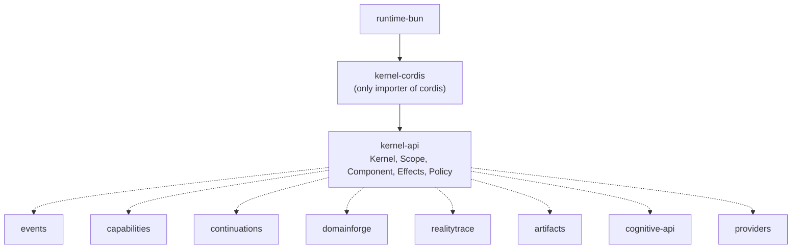

# Subsystem: the kernel

## Purpose

Give components a way to require and provide capabilities, react to a dependency appearing or
disappearing, and own their effects — without any application code knowing which composition
engine is underneath.

[../concepts.md](../concepts.md) is the canonical definition of the terms; this page is the
implementation, its state, and its failure modes.

## Responsibilities

- The framework-owned contract for contexts, scopes, capabilities, components, fibers, effects, and
  policy (`packages/kernel-api`).
- One reference implementation of that contract, backed by Cordis (`packages/kernel-cordis`), and
  the conformance kit that pins the contract executably.
- The rule that a component definition is reusable: two mounts share no state (`CG-KRN-009`).

## Non-responsibilities

- It does not persist anything. Durable facts belong to [durable-state](durable-state.md).
- It does not know what an agent is, what a run is, or what a protocol is.
- It does not implement eligibility policy beyond `isCompatible`, and it never authorizes:
  `kernel.resolve` consults no `Policy` ([capability-invocation](../workflows/capability-invocation.md)).
- It is not the place to add application concepts. A new primitive here changes the whole system.

## Position in the system

`runtime-bun` constructs one kernel in the root scope and mounts the profile's components into it.
`capabilities`, `artifacts`, `continuations`, `realitytrace`, `domainforge`, `events`,
`cognitive-api`, and both providers depend on `kernel-api` for types. Only `kernel-cordis` may
import `cordis` — enforced by `tests/architecture/dependencies.test.ts`.



## Core abstractions

- **`Context`** — a principal plus tenant/workspace scope. Values, separate from visibility.
- **`Scope`** — the unit of capability visibility and lifecycle. A provider is visible in its scope
  and descendants only. Closing a parent closes children first.
- **`CapabilityContract`** — `{ id, version, attributes?, semanticRef? }`. A `Requirement` is
  `{ capability, version?, attributes? }`.
- **`Component`** — `{ id, version?, requires?, provides?, activate(fiber), retry? }`.
- **`FiberContext`** — what `activate` receives: `id`, `context`, `scopeId`, `fiberId`, `signal`,
  `require()`, `provide()`, `effects`, `emit`.
- **`ComponentHandle`** — `{ componentId, state, fiberId?, waitFor, dispose, reset, on }`.
  `state` is `WAITING | ACTIVATING | ACTIVE | FAILED | DEACTIVATING | DISPOSED`.
- **`Effects.register(disposer)`** — a reversible effect owned by the fiber.
- **`Policy`** — `authorize(request): PolicyDecision`. Default is `denyAll`.

## Internal operation

`CordisKernel.mount` creates a `FiberUnit` in the target scope and starts it. The fiber:

1. resolves each `requires` entry; any miss keeps it `WAITING` with **no** fiber id;
2. runs `activate` with a teardown signal, bounded by `component.activationTimeoutMs`
   (default 30 000; `ActivationTimeoutError` is treated as transient and retried);
3. buffers `provide()` calls in `pendingProvides` and only **commits** them — publishing to the
   registry and pushing the disposer onto the effect stack — after `activate` resolves. A throw
   disposes the attempt's effects in reverse order and publishes nothing (`PermanentActivationError`
   marks it unretryable; anything else counts against `retry.maxAttempts`);
4. on disposal, runs every disposer in reverse registration order, unpublishes, unbinds
   dependencies, and aggregates failures into `CleanupError`. Disposal is idempotent, and a
   concurrent `dispose` beats an unfinished activation.

`CapabilityRegistry.find` walks the scope's ancestor chain, so a provider is visible downward only.
`createLease` wraps the publication with the tenant, the policy, an `isActive()` check (so a
withdrawn provider invalidates an existing lease), and the teardown signal.

`kernel.observe(listener)` reports `fiber.state`, `capability.provided`, `capability.withdrawn`,
`cleanup.failed`, and `invocation` events. `invocation` is the audit hook behind `CG-OBS-001`.

## State

| State | Where | Lifetime |
|---|---|---|
| scope tree | in-memory (`ScopeImpl` over a Cordis `Context`) | until `kernel.shutdown` |
| capability publications | in-memory registry, keyed by scope | until the owning fiber unloads |
| effect stack | per fiber, ordered | until disposal |
| retry attempts | per fiber | until `reset()` |
| policy decisions | captured per invocation by the `Invoker`'s `AsyncLocalStorage` | one call |

Nothing here is durable, and nothing here needs to be: the kernel describes what is *alive*, not
what *happened*.

## Lifecycle

```text
DECLARED → WAITING → ACTIVATING → ACTIVE → DEACTIVATING → DISPOSED
                        │                      ▲
                        └── failure → FAILED ──┘  (dependency restored)
```

- dependency lost → `DEACTIVATING`; a compatible replacement → back to `ACTIVE`
- unload → `DEACTIVATING` → `DISPOSED` (effects unwind)
- a component that never settles fails by timeout rather than hanging

## Failure modes

| Symptom | Cause | Recovery |
|---|---|---|
| stays `WAITING`, no fiber id | an unmet `requires` | provide the capability, or mount in a scope that can see it |
| `ActivationTimeoutError` | `activate` never settled | raise `activationTimeoutMs` or fix `activate` |
| `PermanentActivationError` | `activate` threw it | fix the component; call `handle.reset()` to retry |
| `CleanupError` | a disposer threw | fix the disposer; disposal already happened and is idempotent |
| `UndeclaredCapabilityError` | `provide()` for something not in `provides` | declare it |
| `ScopeClosedError` | mounting into a closed scope | mount into a live ancestor |
| resolution returns `unavailable` mid-flight | the provider was withdrawn | the caller must re-resolve; a lease is not a durable claim |

## Extension points

- **Publish a capability** — return a `CapabilityContract` from `activate`. The only way to add
  behavior. See [../extensions.md](../extensions.md).
- **Register an effect** — `fiber.effects.register(disposer, label)`; ownership and unwinding are the
  runtime's job.
- **Swap the engine** — implement `KernelFactory` and run the six conformance suites unchanged
  (`contractSuite`, `lifecycleSuite`, `effectsSuite`, `dependenciesSuite`, `scopesSuite`,
  `authoritySuite`). This is what acceptance criterion A means.

Not extension points: the fiber state machine, the effect stack order, the registry's scope walk.
Changing them changes the contract.

## Source trail

- `packages/kernel-api/src/types.ts` — every type above.
- `packages/kernel-api/src/compat.ts` — `isCompatible`.
- `packages/kernel-api/src/policy.ts` — `denyAll`, `rulePolicy`, `allowCapabilities`.
- `packages/kernel-api/src/errors.ts` — `CleanupError`, `PermanentActivationError`,
  `ActivationTimeoutError`, `UndeclaredCapabilityError`, `ScopeClosedError`.
- `packages/kernel-api/src/conformance/suites.ts` — the six suites.
- `packages/kernel-api/src/conformance/harness.ts` — shared fixtures (`provider`, `consumer`,
  `contract`, `harness`).
- `packages/kernel-cordis/src/kernel.ts`, `fiber.ts`, `scope.ts`, `registry.ts`, `lease.ts`.
- `packages/kernel-cordis/test/{contract,lifecycle,effects,dependencies,scopes,authority}.test.ts`.
- `tests/properties/kernel.property.test.ts` — reversibility, dependency closure, scope isolation,
  disposal idempotence.
- `examples/capability-hot-swap/index.ts` — provider replacement with no downtime.
- [decisions/ADR-0001-kernel-engine-cordis.md](../decisions/ADR-0001-kernel-engine-cordis.md) —
  why Cordis, and what DEBT-005 mitigates.

## Related

- [../concepts.md](../concepts.md) — the vocabulary this subsystem implements.
- [../architecture.md](../architecture.md) — where the kernel sits and what may depend on it.
- [../workflows/capability-invocation.md](../workflows/capability-invocation.md) — the invocation
  path through the kernel.
- [../troubleshooting.md](../troubleshooting.md) — kernel symptoms.
