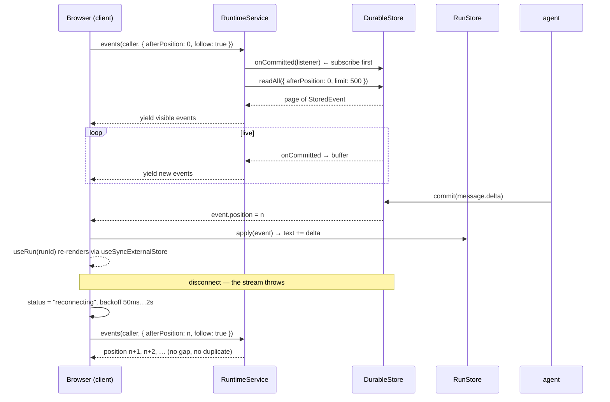

# Workflow: a client session, from connect to reconnect

How a browser or any other consumer observes a running application: one event stream, folded into
derived state, with no authority of its own.

## Summary

`createClient` opens a single reconnecting subscription to the caller's tenant event stream. Every
derived value the client exposes — run state, projections, continuation lists — is a fold over
those events. The client holds no authority: it caches nothing that cannot be rebuilt by
replaying from position 0, and it can write state only through the service's authorized path.

## Sequence

1. `createClient({ service, caller, reconnect? })` starts an engine loop; status is `connecting`.
2. The loop calls `service.events(caller, { afterPosition, follow: true, signal })`.
3. The service's `eventStream` generator **subscribes before it catches up**, so an event
   committed between subscribe and catch-up is buffered rather than lost, then dedupes by
   position. It pages `readAll({ afterPosition, limit: 500 })` until a short page, then switches to
   the live buffer. Only events whose `tenant` matches the caller (and, if `runId` was given, whose
   `runId` matches) are yielded.
4. Each event updates the engine's `position`, is appended to its replay buffer, dispatched to
   explicit subscribers, and folded into any `RunStore` / `ProjectionStore` for that run or
   projection name.
5. On a `run.waiting` event, the engine scans open continuations for a `frontend_capability` it can
   serve.
6. If the stream throws, the loop backs off (50 ms doubling to 2 s by default), sets status
   `reconnecting`, and re-subscribes **from the last position** — so a disconnect produces no gaps
   and no duplicates.
7. `close()` aborts the signal and awaits the loop; status becomes `closed`.

## Derived run state

`RunStore.apply` folds one run's events into `RunState`:

| Event | Effect |
|---|---|
| `run.started` | status `running` |
| `message.delta` | append `payload.text` |
| `state.changed` | `snapshot` replaces, `patch` applies; a non-applying patch is skipped |
| `run.artifact` | append `payload.artifactId` |
| `run.completed` / `run.failed` / `run.cancelled` | terminal status + `output` / `error`; clear waiting set |
| `run.waiting` / `run.resumed` / `run.wait.closed` | update the waiting set, then refresh continuations and settle the status |

Continuation refresh is asynchronous and generation-guarded, so a slow response cannot overwrite a
newer one. A failed refresh keeps the previous list and still applies the status transition.

`RunState.position` is the last applied store position — the value a caller would pass as
`afterPosition` to resume.

## Frontend capabilities

`client.provideCapability(name, handler)` registers a local handler and returns an unregister
function — a reversible effect owned by the React component that registered it. When the engine
sees a `run.waiting` event, it lists open continuations, matches any whose
`condition.kind === "frontend_capability"` and `condition.capability === name`, runs the handler,
and resolves the continuation with `{ ok: true, value }` or `{ ok: false, error }` under
idempotency key `frontend:<continuationId>`. A continuation is resolved at most once, tracked by
`resolvedFrontend` plus an in-flight set.

## React bindings

`@godspeedai/cognate-react` adapts the client's `Readable<T>` to React 19 with `useSyncExternalStore`:
`CognateProvider`, `useCognate`, `useRun`, `useAgent`, `useProjection`, `useCapability`,
`useSharedState`, `useContinuations`, `useArtifact`, `useConnectionStatus`. `useCapability`
unregisters on unmount. No Astryx types cross this boundary (`CG-UI-003`).

## AG-UI is an alternative surface, not a requirement

A third-party AG-UI client talks to the same durable history through a different endpoint:
`createAgUiHandler` projects framework events to AG-UI event types and routes inbound actions
through `RuntimeService` with the transport's authenticated caller. `forwardedProps.cognate.cursor`
resumes from a durable position (snapshot first, then newer events); an unknown cursor triggers a
full resync. Disconnecting never cancels the durable run. Removing `@godspeedai/cognate-ag-ui` leaves native
execution and the React UI working — acceptance criterion H.

## State changes

The client writes nothing except through the service:

- `client.startRun` → `run.started` (+ optional seeded state)
- `client.updateState` → `state.changed` on the state stream
- `client.resolveContinuation` → the continuation record + `continuation.resumed`
- `client.invoke` → a capability invocation (no event, unless the agent path is used)

Everything else is a local fold. The engine's buffer and the `RunStore`s are caches with no
persistence and no authority.

## Failure branches

| Situation | Behavior |
|---|---|
| stream error / server restart | backoff, status `reconnecting`, resume from last position; no gap, no duplicate |
| slow continuation refresh | previous list retained; generation guard discards a stale response |
| `state.changed` with a non-applying patch | skipped; later updates still apply |
| frontend handler throws | continuation resolved with `{ ok: false, error }`; the agent sees the failure |
| a run's events arrive before `run(runId)` is called | the engine's buffer replays them into the new `RunStore` |
| the caller subscribes with `afterPosition` | only later events are delivered, and the buffer is replayed first so nothing is missed |
| unknown AG-UI cursor | full resync from a synthesized snapshot |

## Sequence diagram

## Source trail

- `packages/client/src/index.ts` — `Engine`, `RunStore`, `ProjectionStore`, `createClient`.
- `packages/runtime-bun/src/service.ts:310-351` — `eventStream` (subscribe-then-catch-up).
- `packages/react/src/index.tsx` — the hook surface.
- `packages/ui-astryx/src/index.tsx` — `CognateShell`, `ChatPanel`, `Approvals`, `ArtifactViewer`,
  `RunInspector`, `StateInspector`.
- `packages/ag-ui/src/index.ts` — the 31-row compatibility matrix, `createProjector`,
  `createAgUiHandler`, `threadCorrelationId`.
- `packages/client/test/client.test.ts`, `packages/react/test/hooks.test.tsx`,
  `packages/ui-astryx/test/surfaces.test.tsx`, `packages/ag-ui/test/reconnect.test.ts`.
- [../ui.md](../ui.md) — canonical page for the presentation plane.
- [../protocols.md](../protocols.md) — canonical page for the wire plane.

## Related

- [shared-state.md](shared-state.md) — the state the client folds.
- [continuation-and-resume.md](continuation-and-resume.md) — what the client resolves.
- [../subsystems/presentation.md](../subsystems/presentation.md) — the layer stack.
- [../explanation/why-projection-not-storage.md](../explanation/why-projection-not-storage.md).
