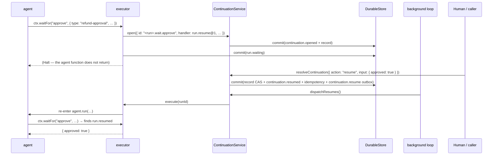

# Workflow: suspending and resuming work

A continuation is the framework's answer to "this execution is valid but cannot continue yet". It
covers human approval, tool results, scheduled wake-ups, and waiting for a capability to exist.

## Summary

`ctx.waitFor` opens a durable continuation, records `run.waiting`, and halts the execution without
the agent returning. Resolution commits the record change, the event, the idempotency result, and
a resume outbox intent in one transaction; the background loop delivers that intent, which
re-enters the run and replays to the recorded resume point.

## The lifecycle

```text
OPEN ──resume──► RESUMED      (the wait returns its input)
  │
  ├──cancel──► CANCELLED      (the wait throws ContinuationClosedError on re-entry)
  ├──expiry──► EXPIRED        (same, from the background loop's expireDue scan)
  ├──failure─► FAILED
  │
  └──handler cannot interpret the stored version ──► BLOCKED
```

`BLOCKED` is the interesting one: it means the run is still waiting, but no registered
`ResumeHandler` claims the record's handler version. That is how a downgrade or a version skew
stops a resume from being misinterpreted rather than silently mishandled.

## Sequence: suspend

1. The agent calls `ctx.waitFor("approve", { type: "refund-approval", condition: { kind:
   "human_approval" }, payload: { amount, account }, expiresAt? , semanticRef? })`.
2. The step id is `wait:approve`; continuation id is `<runId>.wait.approve`.
3. If no `run.waiting` for that step exists yet: open the continuation (one commit: the
   `continuation.opened` event on stream `continuation-<id>` plus the record) and then append
   `run.waiting` with `{ type }` and metadata `{ stepId, continuationId }`.
4. The executor reads the record and halts on any non-`RESUMED`/terminal state. The agent function
   never returns; the `Halt` sentinel propagates out of `executeOnce`, and `run-execution`'s
   "sentinel wins" branch prevents a spurious `run.completed`.

## Sequence: resume

1. A caller (client, AG-UI inbound action, A2A follow-up, harness UI) calls
   `resolveContinuation(caller, { continuationId, action: "resume", input, idempotencyKey,
   expectedVersion? })`.
2. The service loads the record, rejects a cross-tenant id as `not_found`, and authorizes
   `continuation.resume`.
3. `ContinuationService.resume` commits, in **one** `store.commit`:
   the record CAS, the `continuation.resumed` event on `continuation-<id>`, the idempotency
   result, and a `continuation.resume` outbox intent.
4. `core.kick()`. The loop's `dispatchResumes()` delivers the intent to the `run.resume@1`
   handler, whose `handle` calls `execute(record.runId)`.
5. `executeOnce` re-enters the agent; `waitFor` finds `run.resumed` for its step id and returns
   `payload.input`.

The handler is registered with `supports: (version) => version === RESUME_HANDLER.version`. A
record stored by a different version is not resumed by this handler — it goes to `BLOCKED`.

## Sequence: cancel and expiry

- **Cancel** — `resolveContinuation(..., action: "cancel")` transitions to `CANCELLED`; the service
  additionally kicks the run immediately so `waitFor` re-enters, records `run.wait.closed`, and
  throws `ContinuationClosedError`. The agent may catch it, but the default is `run.failed`.
- **Expire** — `expireDue()` runs on every tick and transitions any `OPEN` record past
  `expiresAt` to `EXPIRED`, adding the run to the pending set. The run then re-enters and fails
  its wait the same way. Because the loop is a 10 ms poll, expiry is not exact; see
  [DEBT-015](../../.agents/DEBT.md).
- **Run cancellation** — `cancelRun` cancels every open continuation for the run with
  idempotency key `run.cancel:<key>:<continuationId>`, so the two paths converge on the same
  terminal state.

## Frontend capabilities are continuations

A browser that serves a capability (a map to pan, a file picker) does not run a server component.
The agent calls `ctx.waitFor(id, { condition: { kind: "frontend_capability", capability: "map.focus" },
… })`, which opens a normal continuation. The client's engine scans open continuations on every
`run.waiting` event, matches one it can serve, runs the local handler, and resolves the
continuation with `{ ok: true, value }` or `{ ok: false, error }`. The agent sees one suspension
and one resolution regardless of where the work happened.

## State changes

| Step | Stream | Event | Record |
|---|---|---|---|
| open | `continuation-<id>` | `continuation.opened` | `continuations` created |
| wait recorded | `run-<id>` | `run.waiting` | — |
| resume | `continuation-<id>` | `continuation.resumed` | version + resolution |
| resume recorded | `run-<id>` | `run.resumed` `{ input }` | — |
| cancel/expire/fail | `continuation-<id>` | `continuation.cancelled` / `.expired` / `.failed` | terminal |
| closed recorded | `run-<id>` | `run.wait.closed` `{ reason }` | — |
| unblockable | `continuation-<id>` | `continuation.blocked` | `BLOCKED` |

## Failure branches

| Situation | Result |
|---|---|
| unknown or cross-tenant continuation | `ServiceError("not_found")` |
| caller not permitted | `ServiceError("permission_denied")` |
| `expectedVersion` mismatch | `ServiceError("failed_precondition")`, with the current version in the message |
| already terminal | `{ outcome: "already_terminal" }` — not an error |
| repeated identical resume (same key) | `{ outcome: "duplicate" }` — the recorded result is returned |
| handler version unrecognized | `BLOCKED`; the run stays `waiting` |
| cancelled or expired continuation on re-entry | `run.wait.closed` then `ContinuationClosedError` |

## Sequence diagram



## Source trail

- `packages/continuations/src/types.ts` — `ContinuationStatus`, `ContinuationRecord`,
  `ResumeHandler`, `TransitionOutcome`.
- `packages/continuations/src/continuations.ts:54-106` (`open`), `:123` (`resume`), `:171`
  (`cancel`), `:213` (`fail`), `:251` (`expireDue`), `:299` (`dispatchResumes`), `:339`
  (`unblock`).
- `packages/runtime-bun/src/executor.ts:172-215` — `ctx.waitFor`.
- `packages/runtime-bun/src/runtime.ts:63-67` — the `run.resume@1` handler registration.
- `packages/runtime-bun/src/service.ts:161-184` — `resolveContinuation` authorization and outcomes.
- `packages/client/src/index.ts:426-469` — frontend capability execution.
- `packages/continuations/test/lifecycle.test.ts`, `tests/integration/continuation-restart.test.ts`.
- `examples/human-approval/index.ts` — the minimal version of this trace.

## Related

- [run-execution.md](run-execution.md) — the replay that makes resumption work.
- [../concepts.md](../concepts.md#continuations) — the vocabulary.
- [../subsystems/continuations-and-commitments.md](../subsystems/continuations-and-commitments.md) —
  the service, plus external commitments.
- [../security.md](../security.md) — who may resolve a continuation.
