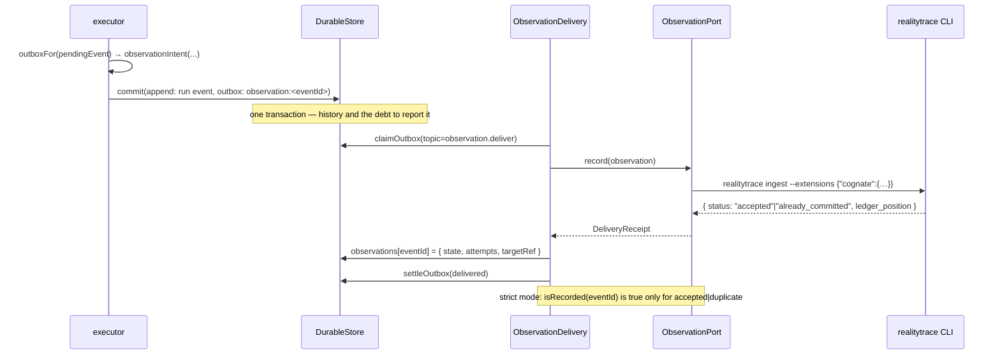

# Workflow: observations and execution evidence

Cognate records what it did. RealityTrace decides what that means. The boundary between those two
statements is the thing to understand on this page.

## Summary

An observation is a derived record of a committed event. It is built **before** the event commits,
committed to the outbox in the **same** transaction as the event, and delivered at-least-once in
the background by a version-pinned adapter that shells out to the RealityTrace CLI. A successful
delivery is a *receipt*: proof that RealityTrace's ledger stored the bytes — not evidence, and not
settlement.

## Sequence

1. `RuntimeOptions.outboxFor(pendingEvent)` is called by the executor with the event it is about to
   commit (the `eventId` is pre-assigned; `recordedAt` is provisional).
2. It returns observation intents via `observationIntent(event, extra)`, which builds an
   `Observation` (ids, tenant, correlation/causation, run, scope, component, fiber, capability,
   continuation, `semanticRef`, classification, input/output refs, timestamp) and an outbox intent
   with id `observation:<eventId>` on topic `observation.deliver`.
3. The executor commits events **and** outbox intents in one `store.commit`. Either the framework
   records that something happened and that an observation is owed, or neither.
4. The background loop drains `observation.deliver` (when the app wires `ObservationDelivery` into
   its tick).
5. `ObservationPort.record(observation)` returns `{ status: "accepted" | "duplicate", targetRef, detail }`.
6. The delivery writes an `observations` record keyed by `eventId` with the state, attempt count,
   and `targetRef`.

## The SXR CLI adapter

The adapter targets `realitytrace ingest` at a pinned tag. Before it will submit, the caller must
have completed RealityTrace's own workflow: `repo enroll → question declare → threshold declare →
run begin → plan create`. The adapter does not perform those steps and does not bypass them; it
only submits once they exist.

**Per-observation idempotency.** `sxr ingest` dedupes by `(run_id, verifier)` and mints a *fresh*
`observation_id` on every call, even for duplicates. So the adapter derives a unique verifier per
observation: `cognate.<observationId>`. A retry therefore lands on the same `ledger_position` and
reports `already_committed`, which is what makes at-least-once delivery safe here.

**Correlation round-trip.** RealityTrace 0.3.0 added `ingest --extensions <json-object>`, stored
as the record's CEP-0008 §39 `extensions` section. The adapter sends
`{"cognate": { observationId, eventId, tenant, correlationId, causationId, runId, scopeId, … }}`
and `readCorrelation(targetRef)` reads it back through `realitytrace ledger export`. Because SXR
keeps the first committed record, a duplicate delivery never rewrites the ids. `AK-006` proves the
round-trip live.

Cognate still keys its own `observations` store by `eventId` and never infers identity from SXR's
per-call `observation_id`.

## Normal vs. strict mode

| Mode | Behavior |
|---|---|
| **Normal** (default) | `observationIntent` commits with the framework event; delivery is at-least-once in the background. A slow or unreachable SXR never blocks or rolls back committed history. Failures retry with backoff, then poison. |
| **Strict** | A caller may gate an operation on `isRecorded(eventId)`, true only when the state is `accepted` or `duplicate`. `queued`/`retrying` does **not** satisfy the gate. Acceptance is still not evidence. |

Reconciliation: `unreconciled()` returns every `observations` record in state `failed` — the
operator queue for poisoned deliveries.

## State changes

| Step | Where | What |
|---|---|---|
| event commit | outbox | intent `observation:<eventId>` on topic `observation.deliver` |
| delivery attempt | `observations` record | `{ state, attempts, targetRef, lastError, observationId }`, keyed by `eventId` |
| delivery settle | outbox row | `delivered` (with receipt), `retry` (with `retryAt`), or `poisoned` |
| exhaustion | — | `state: "failed"`; appears in `unreconciled()` |

Nothing is written back into the event stream, and no framework event is ever mutated by delivery
failure. That is the isolation requirement (`CG-FAIL-001`).

## Failure branches

| Situation | Result |
|---|---|
| SXR binary missing / not on `PATH` | delivery throws; retries; eventually poisons; committed history is unaffected |
| SXR rejects the envelope | same — the adapter emits only schema-valid CEP fields and never injects unknown properties |
| SXR workflow prerequisites unmet | ingest fails; the observation retries and then poisons for operator review |
| duplicate delivery | `status: "duplicate"`, same `ledger_position`, ids unchanged |
| `deliver` throws `PermanentDeliveryError` | the item poisons immediately rather than retrying |
| attempts reach `maxAttempts` | poisons; `unreconciled()` reports it |

## Sequence diagram

## Source trail

- `packages/realitytrace/src/index.ts:11-38` — `observationIntent`.
- `packages/realitytrace/src/index.ts:51-137` — `ObservationDelivery`, `status`, `unreconciled`,
  `isRecorded`.
- `packages/realitytrace/src/sxr-cli.ts` — `createSxrCliPort`, `correlationOf`, `readCorrelation`.
- `packages/realitytrace/src/types.ts` — `Observation`, `ObservationPort`, `DeliveryReceipt`.
- `packages/runtime-bun/src/index.ts:43-47` — `RuntimeOptions.outboxFor`.
- `packages/runtime-bun/src/executor.ts:66-69` — the pre-assigned event id and the atomic commit.
- `packages/events/src/dispatcher.ts` — at-least-once delivery, backoff, poisoning.
- `packages/realitytrace/test/port.test.ts`, `packages/realitytrace/test/sxr-cli.test.ts`,
  `compatibility/phase0/realitytrace/realitytrace.test.ts`.
- [../evidence.md](../evidence.md) — the plane page, with the SXR workflow and the DEBT-009 story.
- [../reference/verification.md](../reference/verification.md) — how to install the pinned CLI and
  run the gates.

## Related

- [../evidence.md](../evidence.md) — canonical page for this plane.
- [run-execution.md](run-execution.md) — where `outboxFor` is called.
- [../subsystems/durable-state.md](../subsystems/durable-state.md) — the outbox mechanism.
- [../security.md](../security.md) — what must never appear in an observation payload.
