# Workflow: executing a run

The most important trace in the repository, and the canonical explanation of run execution. A run
is executed by **replay**, not by resumption:
every attempt re-enters the agent from the top and answers already-recorded questions with their
recorded results.

## Summary

`startRun` commits the run's first fact and schedules its execution atomically. The background
loop hands the run id to `executeOnce`, which re-reads the run's stream, indexes every recorded
result by step id, re-enters `agent.run`, and appends new events for anything not yet recorded.
The agent's own code is the only thing that knows what the run should do; the runtime supplies
durability, ordering, and cancellation.

## Sequence

1. `startRun(caller, { agent, input, idempotencyKey, correlationId?, state? })`:
   authorize `run.start`; look up the agent; mint `runId`;
   **one** `store.commit` containing
   - `run.started` on stream `run-<runId>` at `expectedVersion: 0`,
   - optionally a caller-seeded `state.changed{snapshot}` on `run-state-<runId>`,
   - a `runs` record (`tenant`, `agent`, `correlationId`, `startedBy`, `scopeId`),
   - a `run.execute` outbox intent,
   - the idempotency result `{ runId }`.
   Then `core.kick()` and return the folded `RunView`.
2. The loop drains `run.execute` and calls `execute(runId)`.
3. `executeOnce` re-reads the whole run stream, folds the `RunView`, and returns `done` if terminal
   or unknown.
4. It builds `recorded: Map<stepId, StoredEvent[]>` from event metadata, and a `writes` promise
   chain so concurrent `RunContext` calls cannot race the stream version.
5. It calls `agent.run(input, ctx)`. Every `ctx` method consults `recorded` first.
6. When `agent.run` returns, `execute` appends `run.completed` (payload `output`) or
   `run.failed` (payload `error`).
7. If a `Halt` sentinel escaped — i.e. the agent suspended or was cancelled — the sentinel wins and
   no completion event is appended.

## The step-id contract

Every `RunContext` method records its result under a deterministic key stored in event
`metadata.stepId`:

| Method | Step id | Recorded event | On replay |
|---|---|---|---|
| `ctx.step(id, fn)` | `step:<id>` | `run.step.completed` `{ result }` | returns `result` |
| `ctx.emit(type, payload)` | `emit:<n>` (n = per-execution counter) | the event itself, type unchanged | skipped |
| `ctx.invoke(cap, input)` | `invoke:<n>` | `run.invocation` | returns the recorded `result`, or throws `InvocationFailedError` |
| `ctx.artifact(input)` | `artifact:<n>` | `run.artifact` `{ artifactId }` | returns the recorded id |
| `ctx.recall(id, q)` | `recall:<id>` | `run.recall` `{ result }` | returns the recorded result |
| `ctx.state(id)` | `state:<id>` | `run.step.completed` `{ result }` | returns the value read *at that point* |
| `ctx.waitFor(id, spec)` | `wait:<id>` | `run.waiting`, then `run.resumed` or `run.wait.closed` | returns the resume input, or throws `ContinuationClosedError` |

`emit` and `invoke` use counters, not caller-chosen ids. That is the constraint: **a run must make
the same sequence of `emit`/`invoke`/`artifact` calls on every replay.** Adding a conditional
`ctx.invoke` that depends on a value not obtained through `ctx` changes the numbering and breaks
replay. Put nondeterminism behind `ctx.step` first.

Note what `state:<id>` is doing: it records the *folded state at read time*. Replay returns that
value, not today's state — which is what makes a run's later steps deterministic even though a
caller has since written new state.

## Event ordering and write races

- Every event carries `causationId` = the previous run event's id; only `run.started` has `null`.
- Appends CAS on the stream version inside the executor's own promise chain.
- A `ConcurrencyError` (someone else appended first, e.g. `cancelRun`) is *not* an error: it halts
  the attempt with `retry: true`, and the next attempt re-reads and sees the other writer's event.
- `execute` retries up to 5 times, then gives up silently for that tick (the run stays
  non-terminal and the next kick tries again).
- The event id is **pre-assigned** (`crypto.randomUUID()`) before the commit, so
  `RuntimeOptions.outboxFor` can derive outbox intents that commit atomically with the event.

## Cancellation

`cancelRun` appends `run.cancelled` (CAS, up to 5 attempts, idempotent), aborts the run's
`AbortController` — which is `ctx.signal` — and cancels every open continuation for the run. An
in-flight agent that observes the abort through `ctx.signal` unwinds; one that does not is
abandoned when the execution returns, and the fold still reports `cancelled` because the terminal
event is in the stream.

## State changes

| Point | Stream | Events |
|---|---|---|
| `startRun` | `run-<id>` | `run.started` |
| `startRun` with `state` | `run-state-<id>` | `state.changed{snapshot, source: "caller"}` |
| each `ctx` call | `run-<id>` | the recorded event above |
| return | `run-<id>` | `run.completed` or `run.failed` |
| `cancelRun` | `run-<id>` | `run.cancelled` |
| any event | outbox | intents from `outboxFor` (e.g. RealityTrace observations) |

## Failure branches

| Situation | Result |
|---|---|
| agent id not registered | `ServiceError("not_found")` from `startRun` |
| idempotency key reused with a different fingerprint | `ServiceError("already_exists")` |
| agent throws | `run.failed` with the message; the run is terminal |
| `ctx.invoke` denied/unavailable | `InvocationFailedError` from the call, caught by the agent, or propagating to `run.failed` |
| `waitFor` on a cancelled/expired continuation | `ContinuationClosedError` |
| `ctx.emit` with a `run.*` type | `Error` — the `run.` prefix is reserved for the runtime |
| a lost write race | `Halt{retry:true}` → re-read → re-enter |
| cancellation mid-flight | terminal `cancelled`, no completion event |

## Sequence diagram

> **Interactive model:** Step through this execution trace line-by-line, inspect the memoized `recorded` step map, trigger crash restarts, and observe continuation resolution in the **[Run Execution & Replay Stepper](../explainers/run-execution-replay.html)**.

```mermaid
sequenceDiagram
    participant C as Caller / client
    participant S as RuntimeService
    participant D as DurableStore (SQLite/PostgreSQL)
    participant L as Background loop
    participant E as executeOnce
    participant A as agent.run(input, ctx)

    C->>S: startRun({ agent, input, idempotencyKey })
    S->>S: authorize("run.start")
    S->>D: commit(run.started + runs record + run.execute outbox)
    D-->>S: { kind: "committed" }
    S->>L: core.kick()
    S-->>C: RunView { status: "running" }

    Note over L,E: Gated by maxConcurrentRuns & resourceKeys(run)
    L->>E: execute(runId)
    E->>D: claimRunOwnership(runId, workerId) [PostgreSQL fencing]
    E->>D: readStream("run-<id>")
    E->>E: foldRun → build recorded: Map<stepId, StoredEvent[]>
    E->>A: agent.run(input, ctx)  (re-entered from line 1)
    
    rect rgb(30, 41, 59)
        Note over A,E: Attempt 1: First time execution
        A->>E: ctx.invoke("billing.quote", …) [stepId: invoke:0]
        E->>E: Cache miss → invoke kernel & provider
        E->>D: commit(run.invocation)
        A->>E: ctx.emit("message.delta", …) [stepId: emit:0]
        E->>D: commit(message.delta)
        A->>E: ctx.waitFor("approve", …) [stepId: wait:approve]
        E->>D: commit(run.waiting + continuation record)
        A-->>E: (Halt sentinel escaped — execution suspends)
    end
    E->>D: releaseRunOwnership(runId)
    E-->>L: Halt{retry:false} → "done" (No active thread in memory)

    Note over D: Human resolves continuation → continuation.resume outbox committed
    L->>E: execute(runId)  (Replay Attempt 2)
    E->>D: claimRunOwnership(runId, workerId) [Fresh lease]
    E->>D: readStream("run-<id>") (Includes continuation.resumed)
    E->>E: Rebuild recorded map (invoke:0, emit:0, wait:approve cached!)
    E->>A: agent.run(input, ctx) (re-entered from line 1)
    
    rect rgb(15, 23, 42)
        Note over A,E: Attempt 2: Replay skips side-effects
        A->>E: ctx.invoke("billing.quote") → CACHE HIT (Suppressed, 0 duplicate API calls)
        A->>E: ctx.emit("message.delta") → CACHE HIT (Suppressed)
        A->>E: ctx.waitFor("approve") → CACHE HIT (Returns { ok: true })
        A->>E: ctx.invoke("billing.charge") → CACHE MISS (Fresh execution)
        E->>D: commit(run.invocation)
        A-->>E: return { status: "settled" }
    end
    E->>D: commit(run.completed { output })
    E->>D: releaseRunOwnership(runId)
```

## What replay guarantees, and what it does not

Guaranteed:

- An already-recorded side effect is not repeated for the same step id.
- The event stream is the complete history of the run, in causation order.
- A crash between any two steps loses only the in-flight step, which re-executes on restart.

Not guaranteed:

- **At-most-once execution of a step.** A step running when the process died runs again. External
  side effects therefore belong in `CommitmentService`, not in a bare `ctx.step`.
- **That `emit`/`invoke` numbering is stable** if the agent's control flow depends on something
  not obtained through `ctx`.

## Source trail

- `packages/runtime-bun/src/executor.ts` — `executeOnce`, the `RunContext` implementation, the
  `Halt` sentinel, the write chain.
- `packages/runtime-bun/src/service.ts:33-102` — `startRun`; `:108-150` — `cancelRun`;
  `:245-301` — `updateState`.
- `packages/runtime-bun/src/runtime.ts:36-45` — the per-run serialization chain and retry bound;
  `:69-86` — the dispatcher and tick.
- `packages/runtime-bun/src/fold.ts` — `runStream`, `runStateStream`, `foldRun`, `isTerminal`.
- `packages/runtime-api/src/types.ts:28-73` — the `RunContext` contract.
- `packages/runtime-api/README.md` — "Replay rules", "Run model", "Background loop", "Limits".
- `packages/runtime-bun/test/service.ts` and `runtime-api/src/conformance.ts` — the service kit
  (`CG-STA-001`, concurrency case for 200 concurrent starts).
- `tests/integration/continuation-restart.test.ts`, `tests/integration/crash.test.ts` —
  restart behavior.
- `examples/human-approval/`, `examples/shared-state/`, `examples/multi-agent/` — minimal versions
  of these traces.

## Related

- [startup-and-the-background-loop.md](startup-and-the-background-loop.md) — what triggers this.
- [capability-invocation.md](capability-invocation.md) — inside `ctx.invoke`.
- [continuation-and-resume.md](continuation-and-resume.md) — inside `ctx.waitFor`.
- [shared-state.md](shared-state.md) — the two state streams.
- [../explanation/why-replay.md](../explanation/why-replay.md) — why this design.
