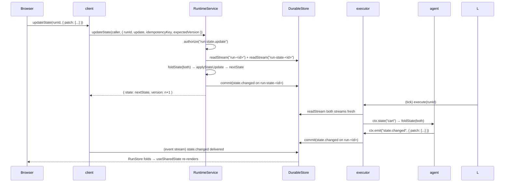

# Workflow: shared application state

A run's shared state is the fold of its `state.changed` events. Both an agent and a caller can
write it, and both observe the same value.

## Summary

Two writers, one fold, two streams. The agent writes by emitting `state.changed` on the run
stream; a caller writes through `RuntimeService.updateState`, which appends to a **separate**
`run-state-<runId>` stream. Every reader — `RunContext.state`, the client, the AG-UI projector —
folds both streams in store-position order.

## The two writers

| | Agent | Caller |
|---|---|---|
| API | `ctx.emit("state.changed", { snapshot })` or `{ patch }` | `RuntimeService.updateState(caller, { runId, update, idempotencyKey, expectedVersion? })` |
| Stream | `run-<id>` | `run-state-<id>` |
| Metadata | — | `{ source: "caller", actor }` |
| Validation | none; a patch that does not apply is **skipped by the fold** | validated before commit; a non-applying patch is `invalid_argument` |
| Authorization | run-internal | `run.state.update` through the `ActionPolicy` |
| Idempotency | step id `emit:<n>` | `idempotencyKey`, scope `<tenant>:<actor>:run.state.update` |

Seeding at start: `startRun({ state })` commits a caller-sourced `state.changed{snapshot}` on the
state stream **atomically with `run.started`**, so the agent's very first `ctx.state()` read sees
it even before it suspends. AG-UI's `RunAgentInput.state` maps onto the same field.

## Why two streams

This is the design decision worth internalizing. Caller writes go to a separate stream
*specifically so they cannot race the executor's compare-and-swap*:

```text
agent appends to run-<id>       with expectedVersion = version held in the executor
caller appends to run-state-<id>
```

If a caller appended to the run stream, its `expectedVersion` would collide with the executor's,
producing spurious `ConcurrencyError`s and halt-and-retry churn on every UI keystroke. The comment
at `packages/runtime-bun/src/fold.ts:11-13` states this explicitly. The cost is that readers must
fold two streams; `foldState` takes an iterable, so this is invisible at the call sites.

## The fold

`foldState(events)` (in `@godspeedai/runtime-api/state.ts`, the single definition shared by the
runtime and the client):

1. keep only `eventType === "state.changed"`;
2. sort by store `position`;
3. start from `{}`;
4. `snapshot` replaces the whole state; `patch` applies RFC 6902 operations.

A patch that does not apply is **skipped**, not fatal. The reasoning: one bad agent-emitted patch
must not hide later, well-formed updates. Caller writes are validated *before* commit, so they
never reach the fold in a broken state.

`applyJsonPatch` supports `add`, `remove`, `replace`, `move`, `copy`, and `test`, is atomic (any
failure leaves the document untouched and throws `StatePatchError`), never mutates its input, and
refuses to move a pointer into its own child.

## Reading as an agent

`ctx.state(id)` is a *step*, not a live read:

- both streams are re-read fresh on every call, so a caller write that landed after this execution
  started is still seen;
- the folded value is recorded as `run.step.completed` under step id `state:<id>`;
- on replay the recorded value is returned, not a re-fold.

That is what makes a run deterministic even though its state is shared with a live caller: the run
remembers what it saw.

## Reading as a client

`client.run(runId).get().state` is folded in the browser by `RunStore.apply` with the same
`applyStateUpdate`, from the `state.changed` events the reconnecting stream delivers. A patch that
fails there is also skipped, for the same reason. `useSharedState(runId)` in `@godspeedai/react`
exposes the same read/write pair.

## `updateState` semantics

```ts
await client.updateState(runId, { patch: [{ op: "replace", path: "/status", value: "shipped" }] });
```

The service loop (up to 5 attempts):

1. authorize `run.state.update`;
2. `readRun`; if terminal → `failed_precondition`;
3. read the state stream; `currentVersion` = its length;
4. if `expectedVersion` was given and differs → `failed_precondition` with the current version;
5. fold to the current state and apply the update; `StatePatchError` → `invalid_argument`;
6. commit the `state.changed` event with `expectedVersion: currentVersion`; on `ConcurrencyError`
   retry from step 2;
7. return `{ state, version: currentVersion + 1 }`.

`expectedVersion` counts **caller writes only** — the length of the state stream. Agent-emitted
state does not advance it. That is the contract a UI should implement: read the version, pass it
back, and retry on `failed_precondition`.

## State changes

| Actor | Stream | Event | Payload |
|---|---|---|---|
| `startRun` with `state` | `run-state-<id>` | `state.changed` | `{ snapshot }`, `source: "caller"` |
| `ctx.emit` | `run-<id>` | `state.changed` | `{ snapshot }` or `{ patch }` |
| `updateState` | `run-state-<id>` | `state.changed` | the `StateUpdate`, `source: "caller"`, `actor` |
| `ctx.state(id)` | `run-<id>` | `run.step.completed` | `{ result: <folded state> }` |

## Failure branches

| Situation | Result |
|---|---|
| caller patch does not apply | `ServiceError("invalid_argument")`, nothing written |
| `expectedVersion` mismatch | `ServiceError("failed_precondition")`, current version in the message |
| run is terminal | `ServiceError("failed_precondition")` |
| repeated key with a different request | `ServiceError("already_exists")` |
| five contended attempts | `ServiceError("unavailable")` |
| agent emits a non-applying patch | the fold skips it; the run continues |
| unknown run / wrong tenant | `ServiceError("not_found")` |

## Sequence diagram



## Source trail

- `packages/runtime-api/src/state.ts` — `StateUpdate`, `JsonPatchOp`, `applyJsonPatch`,
  `applyStateUpdate`, `foldState`, `StatePatchError`.
- `packages/runtime-bun/src/fold.ts:10-13` — `runStream`, `runStateStream` and the reason for two
  streams.
- `packages/runtime-bun/src/service.ts:245-301` — `updateState`.
- `packages/runtime-bun/src/service.ts:41-97` — `startRun`'s atomic seed.
- `packages/runtime-bun/src/executor.ts:227-238` — `ctx.state`.
- `packages/client/src/index.ts:187-201` — `RunStore`'s fold, with the same skip-on-bad-patch rule.
- `packages/client/src/index.ts:494-501` — `client.updateState`.
- `packages/react/src/index.tsx` — `useSharedState`.
- `tests/integration/shared-state.test.ts` — `CG-STA-001`.
- `examples/shared-state/index.ts` — agent-written state only, in ~40 lines.
- [../ui.md](../ui.md) — how the client and React layers present this.

## Related

- [run-execution.md](run-execution.md) — the step-id contract that makes `ctx.state` replayable.
- [../subsystems/runtime.md](../subsystems/runtime.md) — where the two streams are named.
- [../reference/events-and-stores.md](../reference/events-and-stores.md) — the `state.changed`
  payload shape.
