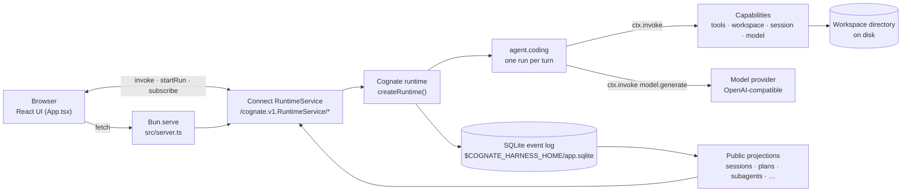

# Cognate Console — documentation

This folder is the technical knowledge system for the repository at
`validation/reconstructions/deepseek-harness/`. It documents two subjects that live in the same
tree:

1. **Cognate Console** — the application under `cognate/`. A single-process Bun web app that runs a
   tool-using coding agent with durable, event-sourced state.
2. **The reconstruction harness** — the differential test rig under `tests/`, `fixtures/`,
   `reference/`, `diffs/`, and `critic/`, which drives both this app and a pinned third-party build
   through one shared driver interface and records behavioural, visual, and architectural evidence.

Read [concepts/mental-model.md](concepts/mental-model.md) first if the words "projection",
"continuation", or "deviation" mean nothing to you yet.

---

## What this project is

A developer opens a local web console, configures an OpenAI-compatible model provider, picks a
directory as their workspace, and talks to a coding agent. The agent can read files, run shell
commands, edit files, and run code — all confined to that workspace. When it wants to do something
privileged, it stops and asks. Everything the agent does is written to a SQLite event log first and
rendered from derived read models, so a server restart loses nothing.

## What problem it solves

Two problems, which is why the repository is shaped the way it is.

**The product problem.** General-purpose agent chat UIs hold conversation state in memory. This one
does not. A pending approval, a half-streamed reply, a completed plan, a finished subagent — each
is an event in a durable log. A kill and restart resumes exactly where it was. That property is what
the test suite is mostly built to prove.

**The validation problem.** This app was reconstructed from a pinned third-party product
(DeepSeek Harness, commit `477b4f42`) to find out whether the Cognate framework could express that
class of application without reference-specific framework primitives. The harness pins the
reference, drives both systems through one `Driver` interface, and records where the
reconstruction deliberately differs. Those differences are called *deviations* and are enumerated in
[reference/deviations.md](reference/deviations.md).

## The system in one picture

Read this as: **the browser never talks to the store or the model directly.** Everything crosses
the Connect service, everything the agent does is recorded before it is shown, and the browser
renders folds of the event log rather than a mutable in-memory conversation.

Intentionally omitted: the kernel/fiber internals behind `ctx.invoke`, the IDM `.sea` model, and the
validation harness. Those have their own pages.

## The seven concepts you need first

| Concept | One line | Canonical page |
|---|---|---|
| Event | An append-only record of something that happened. The log is the truth. | [concepts/glossary.md](concepts/glossary.md) |
| Projection | A pure fold of the log into named key/value rows the UI reads. Derived, rebuildable. | [subsystems/projections.md](subsystems/projections.md) |
| Run | One execution of an agent, identified by `runId`, routed by `correlationId`. | [workflows/run-a-turn.md](workflows/run-a-turn.md) |
| Capability | A named, versioned I/O contract a component publishes and an agent or the UI invokes. | [reference/capabilities.md](reference/capabilities.md) |
| Continuation | A durable "I am blocked, a human must decide" suspension point inside a run. | [explanation/gates-and-continuations.md](explanation/gates-and-continuations.md) |
| Correlation | The routing key on every event: `session:<id>` for turns, `subagent:<run>:<call>` for children. | [concepts/glossary.md](concepts/glossary.md) |
| Deviation | A deliberate, documented behavioural difference from the pinned reference. | [reference/deviations.md](reference/deviations.md) |

## A representative journey

A user types "read `src/greet.ts` and change Hello to Howdy". In outline:

1. The composer calls `startRun("agent.coding", {sessionId, workspaceId, message}, {correlationId: "session:<id>"})`
   over Connect. Nothing else in the app is allowed to run a turn.
2. `agent.coding` emits `session.turn.started`, reads prior turns via `session.history`, resolves the
   workspace root via `workspace.path`, and calls `model.generate`.
3. The provider streams text deltas; each becomes a `run.invocation.progress` event and reaches the
   browser as it happens.
4. The model answers with tool calls instead of prose. For each call the agent emits
   `tool.call.started`, invokes `tool.read` / `tool.bash` / `tool.edit` — each invocation recorded —
   and emits `tool.call.completed` with the result.
5. The agent loops until the model answers in plain text, then emits `message.completed`.
6. The `sessions` and `workspaces` projections update; the sidebar and footer re-render from them.

Full detail, including the approval branch, is in [workflows/run-a-turn.md](workflows/run-a-turn.md).

## Where to go next

**I want to run it**
→ [getting-started.md](getting-started.md), then [tutorials/first-session.md](tutorials/first-session.md)

**I want to understand the architecture**
→ [architecture.md](architecture.md) → [concepts/mental-model.md](concepts/mental-model.md) → the
subsystem pages under [subsystems/](subsystems/)

**I want to change it**
→ [how-to/add-a-capability.md](how-to/add-a-capability.md) (vertical slice),
[how-to/add-a-tool.md](how-to/add-a-tool.md)

**I want to add a feature or a test**
→ [how-to/add-a-journey-test.md](how-to/add-a-journey-test.md),
[reference/journeys.md](reference/journeys.md)

**I am debugging something**
→ [operations/troubleshooting.md](operations/troubleshooting.md)

**I need exact API, event, or configuration details**
→ [reference/](reference/) — [capabilities](reference/capabilities.md),
[events](reference/events.md), [projections](reference/projections.md),
[tools](reference/tools.md), [runtime service](reference/runtime-service.md),
[configuration](reference/configuration.md)

**I want to follow execution**
→ [workflows/](workflows/)

**I want to find the implementation**
→ [source-map.md](source-map.md), and the *Source trail* section at the end of every subsystem,
workflow, and explanation page

**I want to know why it is built this way**
→ [explanation/](explanation/)

**I want to know the full page inventory and which page owns which concept**
→ [documentation-map.md](documentation-map.md)

---

## Sources of truth outside this folder

This documentation system does not duplicate these files; it links to them and keeps them authoritative
for their subject:

| File | Owns |
|---|---|
| `cognate/DESIGN.md` | The visual system: palette tokens, type scale, spacing, surface registers, motion. |
| `cognate/PRODUCT.md` | Product framing: users, purpose, principles, accessibility baseline. |
| `cognate/DEVIATIONS.md` | The long-form record of every deliberate behavioural difference from the reference. |
| `cognate/BINDINGS.md` | The narrative of the 12 IDM→capability bindings and what is deliberately unbound. |
| `cognate/.sea/interaction/` | The Interaction Domain Model: `interaction-model.sea` plus journey catalog, handoff, and validation records. |
| `reference-behavior-matrix.md` | What the pinned reference product actually does, section by section. |
| `architecture-evidence.md`, `primitive-provenance.md`, `parity-report.md` | The architectural-purity, primitive-provenance, and settlement-gate evidence for the reconstruction exercise. |
| `critic/` | Reviewer findings and dispositions, rounds 1–7. |

Where this documentation and one of those files disagree, the file listed above wins for its
subject, and the disagreement is recorded in
[operations/troubleshooting.md](operations/troubleshooting.md#known-documentation-drift).
