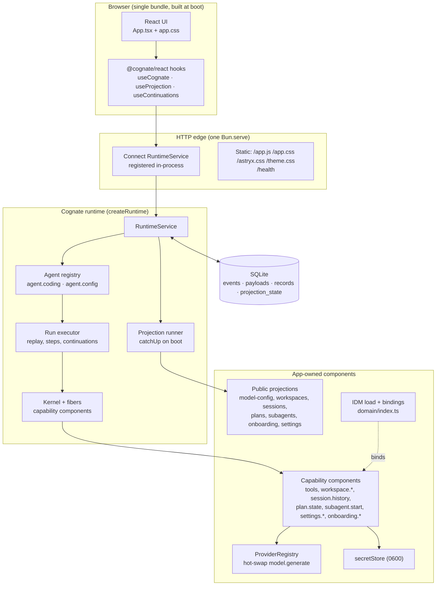
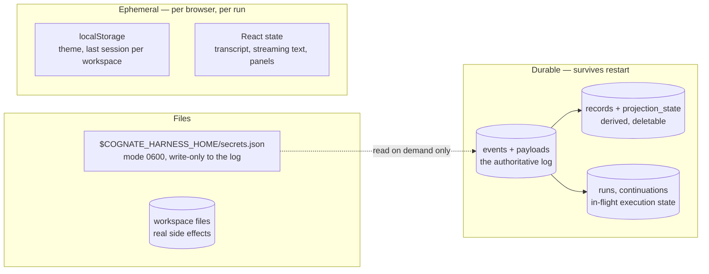
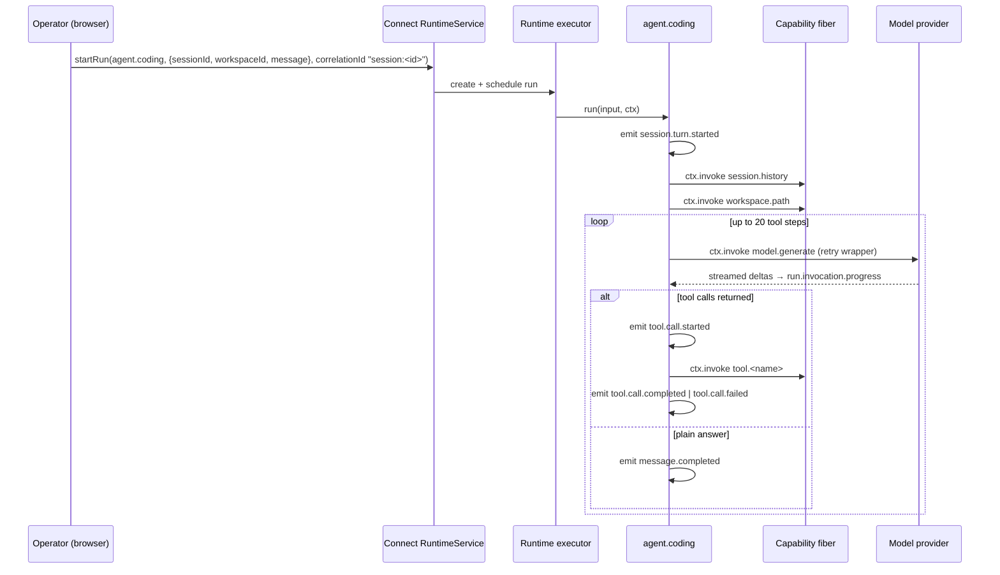

# Architecture

This is the canonical high-level architectural model of Cognate Console. Deeper material lives in
the subsystem pages ([subsystems/](subsystems/)); execution detail lives in
[workflows/](workflows/); rationale lives in [explanation/](explanation/).

Two subjects share this repository: the app (`cognate/`) and the reconstruction harness
(`tests/`, `fixtures/`, `reference/`, `diffs/`, `critic/`). The harness has its own page:
[subsystems/validation-harness.md](subsystems/validation-harness.md).

---

## 1. The organising idea

Cognate Console keeps **no mutable conversation state**. The only state that is written and trusted
is an append-only event log in SQLite. Everything the interface shows — the session list, the
current workspace, the model in use, the plan, the subagents, the "have I seen the first-run notice"
flags — is a **projection**: a pure function from the log to named rows, recomputed on boot.

This is not a stylistic preference. It is what makes the app's central claim true: a pending human
approval survives the process being killed.

```
write path:  action -> capability handler or agent run -> ctx.emit/ctx.invoke -> event log (durable)
read path:   event log -> projection -> Connect ReadProjection -> browser render
```

Because every write lands in the log first, no read path has to trust anything a component happens
to be holding in memory. `tests/architecture/event-history-authoritative.test.ts` deletes every
projection row in SQLite, restarts, and asserts the projections come back byte-identical.

## 2. Logical architecture



**Notice what is absent.** There is no separate model-service process, no websocket, no background
worker, no cache layer, no message broker. The runtime, the RPC endpoint, and the UI are one
`Bun.serve` in one process. The reasoning is in
[explanation/runtime-composition.md](explanation/runtime-composition.md).

## 3. Runtime architecture

What actually exists while the app is up:

| Thing | Where | Notes |
|---|---|---|
| One Bun HTTP server | `cognate/src/server.ts` `Bun.serve` | 127.0.0.1 only, `idleTimeout: 0` |
| One Connect router | same file, `createConnectRouter` + `registerRuntimeService` | Auth via `devTokenAuthenticator` |
| One runtime | `createRuntime({store, policy, actions, agents, components, projections, system})` | SQLite-backed, WAL |
| N mounted fibers | `tools:all`, `secret:put`, `session:history`, `workspace:path`, `plan:state`, `subagent:start`, `onboarding:dismiss`, `settings:changeWorkDetails`, `workspace:select`, `model:configure`, and one `model-provider:<id>` | The last is replaced on hot-swap |
| One live event follower | `server.ts` `for await (… service.events(…, {follow:true}))` | Tracks newly added workspace ids; aborted on `stop()` |
| One model provider | outbound HTTPS to a configured OpenAI-compatible base URL | Streaming SSE |
| Zero or more child agent processes | `tool.bash` → `bash -lc`; `tool.run_code` → `bun -e` | Short-lived, `cwd` = workspace root, 30s default timeout |

The child processes matter: **the agent really does touch the filesystem.** `J-C-tool-execution`
asserts that `src/greet.ts` on disk no longer contains `Hello` after a turn.

## 4. Dependency architecture

The app's own module graph is strictly layered, and the direction is what keeps the reconstruction
honest.

```
domain/index.ts ─────► .sea/interaction/interaction-model.sea   (semantic source, read at boot)
        │  produces CapabilityContract + SemanticRef
        ▼
src/server.ts ───────► src/capabilities/*   (one component per capability)
        │                 ├─► src/domain/approvalGate.ts, planGate.ts   (pure functions, no I/O)
        │                 ├─► src/projections/*  (pure folds, no I/O)
        │                 └─► src/secrets.ts, src/components/*  (I/O adapters)
        ▼
src/agents/agentCoding.ts ──► capabilities via ctx.invoke only
        │
        ▼
src/ui/App.tsx ───────► @cognate/react hooks ──► Connect ──► RuntimeService
```

Rules that hold, and that a reviewer can check:

- `src/domain/*.ts` and `src/projections/*.ts` perform no I/O. They are decision functions and event
  folds, which is what makes them replay-safe and unit-testable without a runtime.
- Agents never call capability handlers directly. They call `ctx.invoke`, so every call is recorded
  with its result in the log and returned from the record on replay rather than re-executed.
- The UI never reads the store. It reads projections and subscribes to events.
- The UI and `agent.coding` share exactly one vocabulary type module, `src/workDetails.ts`, because
  both need the same four presentation modes.
- The app does not import `@cognate/ui-astryx` components — only its stylesheet paths, which the
  server serves at `/astryx.css` and `/theme.css`. The shell is hand-built.

`tests/architecture/cordis-boundary.test.ts` enforces the framework-level half of this: the app never
imports the kernel implementation (`@cognate/kernel-cordis` or `cordis`) directly.

## 5. Data architecture

There are four distinct stores, and they have different lifetimes and different trust levels.



Data-flow rules that matter:

- **The log is authoritative; projections are derived.** A projection row can be deleted with no loss
  (`event-history-authoritative.test.ts`).
- **The model provider's API key is not in the log.** `model.configure` runs through
  `client.invoke`, which the runtime does not record as an event, so the key argument never reaches
  the durable store. `J-CFG-model-provider.test.ts` opens the SQLite file directly and scans
  `payloads`, `events.metadata`, `records`, and `projection_state` to prove it.
- **The workspace is the only place tool effects land**, and every path is resolved against the
  workspace root with an escape check before any read or write.
- **Two pieces of state are browser-local on purpose**: the theme, and which session was last open
  per workspace. Both are conveniences; both are re-derivable from durable state when it matters
  (`App.tsx` `useTheme`, `rememberSession`).

## 6. Control flow

Who calls whom at runtime:



The runtime executor — not the agent — decides when a run is `running`, `waiting`, `completed`,
`failed`, or `cancelled`, and it is the only thing that resumes a run after a restart. The agent
emits domain events; the executor emits lifecycle events (`run.waiting`, `run.cancelled`,
`run.failed`).

## 7. Trust and security boundaries

This is a **local single-operator tool**, and the code says so. The boundaries that actually exist:

| Boundary | Enforcement | Source |
|---|---|---|
| Workspace containment | `resolveInWorkspace` rejects any resolved path that is not the root or under `root + sep`; `PathEscapeError` | `src/capabilities/tools.ts:21-28` |
| Approval before privilege escalation | `approvalGate` + a durable `tool-approval` continuation; deny text is fed back to the model so it cannot "work around it" | `src/domain/approvalGate.ts`, `src/agents/agentCoding.ts:351-372` |
| Read-before-edit | An existing file must have been read in this turn; the check is boxed in `ctx.step` so it replays from the record | `src/agents/agentCoding.ts:224-234` |
| Credential storage | Write-only file at 0600; the value is never emitted, projected, logged, or returned | `src/secrets.ts`, `src/capabilities/secretPut.ts` |
| Runtime auth | Connect calls require `Authorization: Bearer <tenant>:<actor>` via `devTokenAuthenticator`; the server prints the dev token at boot and labels it "not production auth" | `src/server.ts:240,296` |
| Capability policy | `rulePolicy` grants the 14 app capability ids to `user`/`system` actors; everything else denies | `src/server.ts:55-85` |
| Subprocess time/output | 30s default timeout, 20,000-char output cap, kill on timeout | `src/capabilities/tools.ts:13-14,34-52` |

What is *not* enforced, and should not be mistaken for a guarantee: the action policy allows every
action (`server.ts:87-91`), there is no multi-tenant isolation, and the bind address is fixed to
loopback. The gating that matters is the capability layer and the approval gate. See
[explanation/security-and-trust.md](explanation/security-and-trust.md).

## 8. Extension points

Ranked by how intended they are:

1. **Add a capability** — write a `Component` with `provides: [{id, version, semanticRef}]`, mount
   it in `server.ts`, allow its id in `GRANTED_CAPABILITIES`, and add a binding in `domain/index.ts`
   if it has IDM meaning. → [how-to/add-a-capability.md](how-to/add-a-capability.md)
2. **Add a tool** — add a `ToolDefinition` to `TOOL_DEFS` and a matching `tool.<name>` handler.
   → [how-to/add-a-tool.md](how-to/add-a-tool.md)
3. **Add an agent** — add an `AgentDefinition` to the `agents` array in `createRuntime`. The second
   agent, `agent.config`, is 56 lines and exists to make configuration changes durable.
4. **Add a projection** — a pure `apply(event, state)`. → [how-to/add-a-projection.md](how-to/add-a-projection.md)
5. **Add a journey test** — one file per IDM journey id, named after it.
   → [how-to/add-a-journey-test.md](how-to/add-a-journey-test.md)

The `.sea` model is an *input*, not an extension point: it is parsed at boot, and changing it changes
the digest in the startup log.

## Source trail

- `cognate/src/server.ts` — `startServer`, `GRANTED_CAPABILITIES`, `buildPolicy`, `buildActionPolicy`, `Bun.serve`
- `cognate/src/agents/agentCoding.ts` — `agentCodingAgent`, `TOOL_DEFS`, `invokeModelGenerate`, `invokeTool`, `classifyModelFailure`
- `cognate/src/agents/agentConfig.ts` — `agentConfigAgent`, `AgentConfigInput`
- `cognate/src/capabilities/*.ts` — one component factory per capability
- `cognate/src/projections/*.ts` — `modelConfigProjection`, `workspacesProjection`, `sessionsProjection`, `plansProjection`, `subagentsProjection`, `onboardingProjection`, `settingsProjection`
- `cognate/src/domain/approvalGate.ts` — `approvalGate`, `approvalDeniedToolResult`
- `cognate/src/domain/planGate.ts` — `isPlanOffCommand`, `splitPlanPrefix`, `extractPlanHeading`
- `cognate/src/components/providerRegistry.ts` — `ProviderRegistry.swap`, `buildProvider`
- `cognate/src/components/modelProvider.ts` — `streamingProviderComponent`
- `cognate/src/secrets.ts` — `secretStore`
- `cognate/src/ui/App.tsx` — `App` and all presentational components
- `cognate/domain/index.ts` — `loadDomain`, `tranche5Bindings`, `tranche7Bindings`, `tranche9Bindings`, `tranche10Bindings`
- `cognate/.sea/interaction/interaction-model.sea` — the IDM
- `cognate/test/*.test.ts` — 21 journey tests establishing the behavioural contracts
- `tests/architecture/*.test.ts` — 9 architectural criteria
