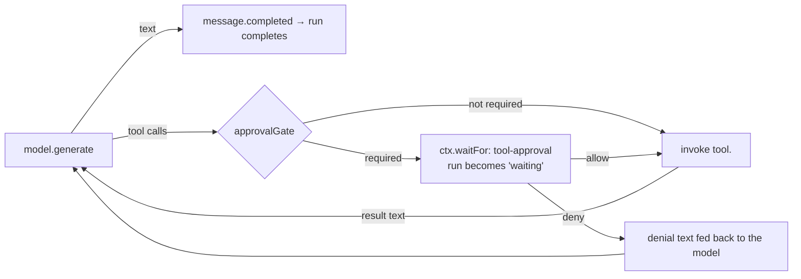

# Mental model

The conceptual structure of Cognate Console, without implementation detail. If you read only one
page after the [home page](../README.md), read this one.

---

## The one idea everything else follows from

**The event log is the state. Everything else is a reading of it.**

Not "the log is a source of truth for auditing" — the log *is* the state. The session list, the
current workspace, which model is configured, the plan, the subagents, whether the first-run dialog
has been dismissed: each is a named **projection**, a pure function from the log to rows. The browser
reads projections and subscribes to the log. It never holds an authoritative copy of anything.

This is why the app behaves the way it does:

- A pending approval survives the process being killed, because "pending" is a continuation row in
  the store, not a JavaScript promise.
- A cancelled turn's partial reply is still visible after the fact, because the deltas were events
  written as they arrived.
- Deleting every projection row and restarting changes nothing, because the rows were a cache of the
  log and nothing else.

## What the operator does

The product loop is short and worth stating plainly:

1. **Configure a model.** Give the app a base URL and an API key. The key is written to a
   write-only file; the non-secret part becomes a durable event; a live provider is mounted. From
   then on `model.generate` works, and changing the model is a mount swap, not a restart.
2. **Choose a workspace.** A directory becomes a `WorkspaceRecord`. Until this exists the composer is
   disabled — the app will not let you ask an agent to work somewhere unspecified.
3. **Send a message.** That starts exactly one agent run, correlated to the session.
4. **Watch, and decide.** Text streams in. Tool calls appear as activity. If the agent wants
   something privileged, the composer is replaced by an approval card and the run stops until the
   operator answers.

Steps 3 and 4 are the interesting part.

## What happens during a turn

An agent run is a loop between the model and the app's capabilities:

Three things are worth noticing.

**The loop is a real loop, bounded.** Up to 20 tool steps per turn. It ends when the model answers
in plain text, or when the budget is hit, in which case the turn says so.

**Tools are not a special mechanism.** `read`, `edit`, and `bash` are capabilities like any other:
the agent invokes them through `ctx.invoke`, which records the call and its result. The model does
not "have filesystem access" because the app gave it a handle; it has access because the app decided
to publish these four capabilities and confine them to one directory.

**Blocking for a human is a first-class runtime state.** When the gate says "this needs a person",
the run's status becomes `waiting` and a continuation row is written. The browser is told about it by
subscription. The browser's answer — a boolean — is written back as a resume input, and the run
continues from exactly that point, in this process or in a later one.

## The three kinds of state, and who owns them

| Kind | Where | Who writes it | Who reads it |
|---|---|---|---|
| Durable domain truth | the event log (SQLite) | capabilities and agents, through the runtime | projections, replays, restart |
| Derived reads | projection rows | projection runner | the browser |
| Conversation conveniences | `localStorage`, React state | the browser | the browser only |

The third row is real but small: the theme, and which session you had open. Both are conveniences.
If `localStorage` is cleared, the app loses nothing except the theme and returns you to a fresh view
of durable state.

## Why the app is shaped as one process

Runtime, RPC, and UI in one `Bun.serve`. No second server, no proxy, no worker, no cache.

This is partly simplicity and partly a specific finding: the reconstruction tried the CLI's
two-server pattern first, and the inner server's `stop()` hung after any invocation that returned an
error response. Building the Connect fetch handler in-process removed the class of problem. The full
reasoning is in [../explanation/runtime-composition.md](../explanation/runtime-composition.md).

## Where the seams are

If you want to change the system, these are the five places things attach:

| Seam | Add | Everything else keeps working because |
|---|---|---|
| Capability | a `Component` with `provides` | the runtime records, authorizes, and replays it for you |
| Tool | a `ToolDefinition` plus a `tool.<name>` handler | the loop, the events, the UI timeline, and the diff view already handle any tool name |
| Projection | an `apply` function | nothing depends on projections existing; the UI reads them by name |
| Agent | an `AgentDefinition` | runs get lifecycle, correlation, replay, and continuations for free |
| Event | a new `eventType` from an agent | any projection can start folding it; no migration |

And one place things are *not* extensible: the `.sea` domain model. It is parsed at boot, and its
digest is logged. Change it and the startup line changes.

## What this app is careful about, and what it is not

**Careful about:** secrets never entering the log; every tool path confined to the workspace; the
human gate firing on privilege escalation and failing closed; not fabricating user-visible state
(which is why the composer's "N tok/s · N% context" footer still reads zero rather than making up
numbers — `cognate/PRODUCT.md` lists that as a constraint, not a bug to be admired).

**Not careful about, and do not assume:** multi-tenancy, network exposure (it binds loopback only),
authorization granularity (the action policy allows everything and relies on the capability layer),
or sandboxing of `bash`/`run_code` beyond path containment and timeouts. `run_code`'s harness is
original and small, not a real sandbox. See
[../reference/deviations.md](../reference/deviations.md).

## A second subject in this repository

Alongside the app sits a validation harness that pins a third-party product, drives both through one
interface, and records screenshots, ARIA trees, pixel diffs, and reviewer findings. It explains a
lot of otherwise-odd choices: exact user-facing strings, deliberate inert controls, a "deviation"
catalogue. If you see something in the app that looks over-specified, the answer is usually in
[subsystems/validation-harness.md](../subsystems/validation-harness.md) or
[../explanation/parity-method.md](../explanation/parity-method.md).

## Next

- Vocabulary you do not yet have: [glossary.md](glossary.md)
- The full picture: [../architecture.md](../architecture.md)
- One turn, end to end: [../workflows/run-a-turn.md](../workflows/run-a-turn.md)
- Why the app is built this way: [../explanation/](../explanation/)
