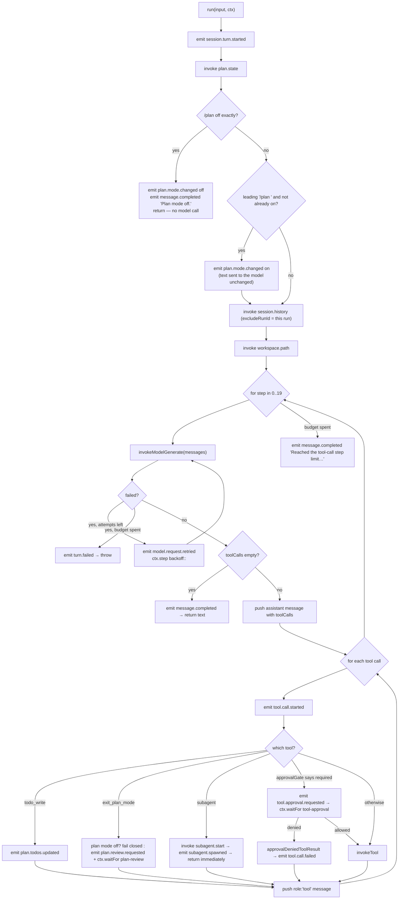

# Subsystem: agent.coding

`cognate/src/agents/agentCoding.ts` (384 lines) is the heart of the app: one run per user turn, and
inside that run a bounded model/tool loop with approval gating, plan mode, subagent delegation, and
provider retry.

## Purpose

Turn `{sessionId, workspaceId, message}` into a completed assistant turn, using the configured model
provider and the app's capabilities, while making every step replayable and every human decision
durable.

## Responsibilities

- Emit the turn's lifecycle-adjacent domain events (`session.turn.started`, `message.completed`,
  `turn.failed`).
- Fold prior turns into model context via `session.history`, and append the new user message.
- Resolve the workspace root once per turn via `workspace.path` and scope every tool call to it.
- Drive the tool loop: call the model, dispatch returned tool calls, feed results back, repeat.
- Own the four in-agent special tools: `todo_write`, `exit_plan_mode`, `subagent`, and the approval
  branch for `run_code` sandbox escalation.
- Enforce the read-before-edit guard for existing files.
- Retry a failed `model.generate` with durably recorded attempts, and classify the terminal failure.

## Non-responsibilities

- It does not implement tools. `todo_write` and `exit_plan_mode` are handled inline because their
  effect is state, not I/O; `read`/`edit`/`bash`/`run_code` are capabilities.
- It does not implement the approval decision. `approvalGate` is a pure function it calls.
- It does not decide policy or authorization. `ctx.invoke` is checked by the runtime.
- It does not wait for subagents. Delegation is fire-and-forget.
- It holds no durable state of its own. Everything it knows is either in the events it emits or
  re-derived at the start of the next run.

## Position in the system

Called by: the browser (`client.startRun("agent.coding", …)` over Connect) and by
`subagent.start` (for a child run). It calls `plan.state`, `session.history`, `workspace.path`,
`model.generate`, `tool.<name>`, and `subagent.start` through `ctx.invoke`; it calls
`approvalGate` and the `planGate` helpers directly.

## Core abstractions

**`AGENT_CODING` / `agentCodingAgent`** — id `agent.coding`, version `1.0.0`.

**`AgentCodingInput`** — `{sessionId, workspaceId, message, mode?}`. `mode` exists so a later change
can plumb the composer's access-mode dropdown into the gate without touching `approvalGate`;
`approvalGate` defaults to `"read-only"` when it is absent.

**`TOOL_DEFS`** — the seven tool definitions advertised to the model: `read`, `edit`, `bash`,
`todo_write`, `exit_plan_mode`, `subagent`, `run_code`. Names and argument shapes were taken from the
reference's tool catalogue; the JSON schemas here are this app's own.

**`MAX_TOOL_STEPS = 20`** — the per-turn loop budget. Hitting it is not a crash: the turn emits
`message.completed` with `"Reached the tool-call step limit for this turn."`

**`MAX_MODEL_RETRIES = 5`** — retries, so at most 6 attempts per model call. Backoff is
`DEFAULT_RETRY_BACKOFF_MS = 300` unless `MODEL_RETRY_BACKOFF_MS` overrides it.

**`classifyModelFailure`** — maps a failed `model.generate` to the `{code, message}` pair the UI's
failure block renders. Prefers structured `failure.details`; falls back to a message regex.

**`invokeModelGenerate`** — the retry wrapper. Each attempt is its own `ctx.invoke`, so replay returns
a recorded attempt's result instead of re-calling the provider.

**`invokeTool`** — dispatch for one tool call, including the read-before-edit guard and the
result-to-text formatting.

**`readFiles: Set<string>`** — the only non-deterministic local state in the agent. It is rebuilt
identically on replay from the same sequence of recorded `tool.read` results, so it stays
deterministic.

## Internal operation

### Turn structure



### The approval branch, in order

1. `tool.call.started` is emitted **first, unconditionally** — before the gate is consulted. This is
   deliberate: the UI keys tool entries off this event, so emitting it only after approval would
   leave a pending approval with no visible tool card at all.
2. `approvalGate({tool, args, mode})` decides.
3. If required: emit `tool.approval.requested` with `{sessionId, toolCallId, tool, permission,
   justification}`, then `ctx.waitFor("approve:<toolCallId>", {type: "tool-approval", condition:
   {kind: "human_approval"}, payload: {tool, args, permission, justification}})`. The run's status
   becomes `waiting`.
4. On resume with `{approved: true}`: emit `tool.approval.decided {approved: true}` and run the tool.
5. On resume with `{approved: false}`: emit `tool.approval.decided {approved: false}`, emit
   `tool.call.failed` with the denial text, and feed that text back to the model. The tool is not
   invoked.

### The read-before-edit guard

```ts
const existed = await ctx.step(`edit-exists:${call.id}`, () => fileExists(workspaceRoot, filePath));
if (existed && !readFiles.has(filePath)) → tool.call.failed, "fs_not_observed: read <path> before editing it"
```

A file that does not exist yet needs no prior read. The disk check is boxed in `ctx.step` so replay
returns the recorded answer instead of touching the filesystem again. `readFiles` is only appended
to after a successful `tool.read` (`invokeTool`, after the `ctx.invoke` resolves).

The `J-D-approval` replay test asserts the observable consequence: after a restart mid-run, each
`toolCallId` appears exactly once among `tool.call.started` events.

### Retry and failure classification

`invokeModelGenerate` loops `attempt = 1 … MAX_MODEL_RETRIES + 1`. On an `InvocationFailedError`:

- If `ctx.signal.aborted` (the run was cancelled), rethrow immediately — do not spend retries or emit
  a spurious retry event on the way out.
- If the attempt budget is spent: `emit("turn.failed", classified)` then `throw new Error(message)`.
  The throw is what makes the run end `failed`.
- Otherwise: `emit("model.request.retried", {attempt, maxRetries, error: classified})` and
  `await ctx.step("backoff:<callIndex>:<attempt>", …)`.

`classifyModelFailure` prefers `failure.details`:

| Condition | Code | Message |
|---|---|---|
| `details.kind === "cancelled"` | `TIMEOUT` | `Request timed out.` |
| `details.status === 408` | `TIMEOUT` | `Request timed out.` |
| `details.status === 500` | `HTTP_500` | `Internal server error` |
| any other numeric status | `HTTP_<status>` | `Request failed (HTTP <status>).` |
| fallback: message matches `/timed out/i` | `TIMEOUT` | `Request timed out.` |
| fallback: anything else | `HTTP_500` | `Internal server error` |

`J-H-provider-error.test.ts` asserts exactly 5 `model.request.retried` events with attempts
`[1,2,3,4,5]`, exactly one `turn.failed`, and `code === "HTTP_500"` for the mock's scripted 500.

## State

Reads: `plans` (via `plan.state`), `workspaces` (via `workspace.path`), runs in correlation
`session:<id>` (via `session.history`), `subagents` (inside `session.history`). Writes: the event
stream only. Holds in memory for the duration of one run: the `messages` array, `readFiles`, and the
current `planState` snapshot.

## Lifecycle

`running` → (optionally) `waiting` on a continuation → `running` → `completed` | `failed`.
`cancelled` can arrive at any point from the browser's Stop button; the agent observes it as
`ctx.signal` abort plus the runtime's halt sentinel.

A run interrupted by a process restart is replayed from its recorded steps on the next boot, so the
only steps that re-execute are ones that had not been recorded.

## Failure modes

| Symptom | Cause | Source |
|---|---|---|
| Run ends with "Reached the tool-call step limit for this turn." | 20 tool steps consumed | `agentCoding.ts:380-382` |
| `Error: exit_plan_mode is only available in plan mode` fed back | `exit_plan_mode` called with plan mode off | `planGate.ts` constant, asserted by `J-E-plan` |
| `fs_not_observed: read <path> before editing it` | editing an existing file not read this turn | `agentCoding.ts:230` |
| `Error: the user rejected escalating this program to "<perm>"…` | approval denied; the exact text is deliberate | `approvalGate.ts:66-68` |
| `Error: path escapes workspace root: <p>` | a tool argument resolved outside the workspace | `tools.ts:21-28` |
| `Error: tool.edit: old_string not found in <f>` / `… is not unique` | edit preconditions | `tools.ts:191-194` |
| Run ends `failed` with a `HTTP_500` failure block | 6 model attempts all failed | `invokeModelGenerate` |
| Turn has a `todo_write` card but no plan state | expected outside plan mode; `todo_write` is recorded regardless | `agentCoding.ts:300-306` |
| Tool result says `started subagent <id>` but the panel stays "running" | expected: the parent never waits | `agentCoding.ts:331-350` |

## Extension points

- **A new tool the model may call**: add a `ToolDefinition` to `TOOL_DEFS`. If it has a capability,
  add `tool.<name>`; the generic `invokeTool` path will pick it up and the UI timeline and diff view
  will render it without further work.
- **A new in-agent special tool**: add a branch in the per-call dispatch. Follow the existing shape —
  emit `tool.call.started` (already done), do the work, emit `tool.call.completed` or
  `tool.call.failed`, and set `resultText`.
- **A new retry policy**: adjust `MAX_MODEL_RETRIES` / `retryBackoffMs`. Keep the "each attempt is its
  own `ctx.invoke`" property or replay-safety is lost.
- **A new model failure code**: extend `classifyModelFailure`. Prefer adding a `details` branch over a
  message regex; the runtime now carries structured detail through the kernel's JSON boundary.
- **Plumbing the access mode**: pass `mode` from the caller's input instead of relying on the
  default. `AgentCodingInput.mode` is already there for exactly this.

## Source trail

- `cognate/src/agents/agentCoding.ts:25` — `AGENT_CODING`
- `cognate/src/agents/agentCoding.ts:27-34` — `AgentCodingInput`
- `cognate/src/agents/agentCoding.ts:36` — `MAX_TOOL_STEPS`
- `cognate/src/agents/agentCoding.ts:42-48` — `MAX_MODEL_RETRIES`, `retryBackoffMs`
- `cognate/src/agents/agentCoding.ts:57-74` — `classifyModelFailure`
- `cognate/src/agents/agentCoding.ts:82-109` — `invokeModelGenerate`
- `cognate/src/agents/agentCoding.ts:111-186` — `TOOL_DEFS`
- `cognate/src/agents/agentCoding.ts:193-210` — `formatToolResult`
- `cognate/src/agents/agentCoding.ts:212-247` — `invokeTool` and the read-before-edit guard
- `cognate/src/agents/agentCoding.ts:249-383` — `agentCodingAgent.run`
- `cognate/src/agents/agentCoding.ts:264-274` — `/plan off` and the `/plan ` prefix
- `cognate/src/agents/agentCoding.ts:351-372` — the approval branch
- `cognate/src/domain/approvalGate.ts:52-68` — `approvalGate`, `approvalDeniedToolResult`
- `cognate/src/domain/planGate.ts:11-52` — plan helpers and exact reflection strings
- `cognate/test/J-B-basic-session.test.ts`, `J-C-tool-execution.test.ts`, `J-D-approval.test.ts`,
  `J-E-plan.test.ts`, `J-F-delegation.test.ts`, `J-H-cancellation.test.ts`,
  `J-H-provider-error.test.ts` — the behavioural contracts
