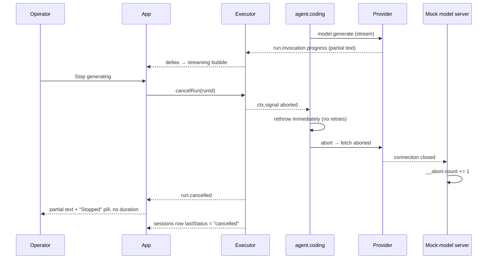

# Workflow: cancellation and provider failure

Journey `J-H-cancellation` (which carries both the cancel and the injected-error branches). What
happens when a run does not finish normally, and why the failure vocabulary is shaped the way it is.

## Summary

Two failure modes share one turn. **Cancellation** is operator-initiated: the browser cancels the
run, the abort signal propagates from the run context through the invocation to the provider's HTTP
request, the run ends `cancelled`, and the partial streamed text is kept. **Provider failure** is
automatic: a failed `model.generate` is retried up to five times with durably recorded attempts, then
the turn fails with a classified code and message.

## Cancellation

### The signal chain

```
client.cancelRun(runId, "user-cancelled")
  → RunContext.signal aborts
    → the executor's guard makes ctx.emit/ctx.step throw the halt sentinel
    → the invocation's HandlerContext.signal aborts
      → streamingProviderComponent passes ctx.signal to provider.stream
        → openAICompatible's AbortSignal.any([...]) aborts the underlying fetch
          → the mock model server's request AbortSignal fires (GET /__abort-count increments)
```

`invokeModelGenerate` checks `ctx.signal.aborted` first on every failure and rethrows immediately, so
a cancelled run does not spend its remaining retries or emit a spurious retry event on the way out.
The comment in the code says exactly why: the guard would throw anyway, but checking makes the intent
explicit.

### What is kept

- The partial streamed text stays in the recorded `run.invocation.progress` events, so the UI's
  streaming hook still has it after the run stops. `J-H-cancellation` asserts the concatenated deltas
  are non-empty.
- `message.completed` is **not** emitted for a cancelled run — asserted explicitly.
- The `sessions` row moves to `lastStatus: "cancelled"`, so reopening the session does not mistake the
  run for still in flight.
- The UI appends the partial text as an assistant row with a "Stopped" pill and **no duration badge**.

### What is not kept

The cancelled turn contributes **only its user message** to future history. `session.history`
synthesizes an assistant message only `if (run.status === "completed")`, so the partial reply is never
folded into the next turn's model context. It is visible in the live UI transcript for that browser
session; it is not restored after a reload. This is a documented assumption, not an oversight.

A follow-up turn in the same session works normally — asserted by the same test.

## Provider failure

### Retry

```ts
for (let attempt = 1; attempt <= MAX_MODEL_RETRIES + 1; attempt++) {
  try { return await ctx.invoke("model.generate", {messages, tools: TOOL_DEFS}); }
  catch (error) {
    if (ctx.signal.aborted) throw error;
    if (!(error instanceof InvocationFailedError)) throw error;
    const classified = classifyModelFailure(error);
    if (attempt > MAX_MODEL_RETRIES) { await ctx.emit("turn.failed", classified); throw new Error(classified.message); }
    await ctx.emit("model.request.retried", {attempt, maxRetries: MAX_MODEL_RETRIES, error: classified});
    await ctx.step(`backoff:${callIndex}:${attempt}`, async () => { const ms = retryBackoffMs(); await Bun.sleep(ms); return ms; });
  }
}
```

Three properties worth naming:

- **Six attempts, five retries.** The mock's `error` scenario fails every time; the test asserts
  exactly 5 `model.request.retried` events with attempts `[1,2,3,4,5]`, then exactly one
  `turn.failed`.
- **Each attempt is its own `ctx.invoke`**, so a replay does not re-run a completed attempt — it
  returns the recorded result. `J-H-provider-error`'s third test restarts the runtime after two
  retries have landed and asserts the final count is still 5, not 7.
- **The backoff is a `ctx.step`**, so a replay does not sleep either; it returns the recorded
  duration. `MODEL_RETRY_BACKOFF_MS` sets the duration (default 300ms; the tests use 10–150ms).

### Classification

`classifyModelFailure` prefers structured detail and falls back to a message regex:

| Condition | Code | Message |
|---|---|---|
| `failure.details.kind === "cancelled"` | `TIMEOUT` | `Request timed out.` |
| `failure.details.status === 408` | `TIMEOUT` | `Request timed out.` |
| `failure.details.status === 500` | `HTTP_500` | `Internal server error` |
| `failure.details.status` = other number | `HTTP_<status>` | `Request failed (HTTP <status>).` |
| fallback, message matches `/timed out/i` | `TIMEOUT` | `Request timed out.` |
| fallback, anything else | `HTTP_500` | `Internal server error` |

The structured path exists because a framework fix (finding F3) now preserves `error.name` and a
JSON-safe `details` object through the kernel's JSON boundary, which previously reduced every thrown
error to `{kind: "failed", message}`. The regex fallback remains for older failures.

**A documentation caveat:** `cognate/DEVIATIONS.md` still says the mapping is "text-based, not
status-based, by construction" and attributes it to the old kernel behaviour. That is now stale — the
code prefers `failure.details`, and `parity-report.md` records the F3 repair. The *behaviour* the
deviation file describes (an honest `HTTP_500` rather than a fabricated `TIMEOUT`) is unchanged, and
`J-H-provider-error` still asserts it. See
[../operations/troubleshooting.md](../operations/troubleshooting.md#known-documentation-drift).

### Recovery

There is no automatic retry of the whole turn and no manual Retry button — the reference shows neither
for a failed turn, and matching that was deliberate. The composer stays available underneath, so a
follow-up message is the recovery path.

The UI renders a failure block ("This turn failed" / message / code) plus a retry disclosure listing
each recorded attempt as `Attempt k/5: <message> (<CODE>)`. The expanded content of that disclosure is
this app's own minimal rendering; the reference's own expanded state was not captured.

## State changes

```
cancelled:  run.cancelled → sessions.lastStatus "cancelled"
            run.invocation.progress (partial text) retained
            message.completed NOT emitted
failed:     model.request.retried ×5 → turn.failed → run.failed
            sessions.lastStatus "failed"
```

## Failure branches

| Situation | Behaviour |
|---|---|
| Cancelled mid-stream | `run.cancelled`; no retries; partial text kept |
| Cancelled during the retry backoff | the backoff sleep is interrupted; the run ends `cancelled` |
| Cancelled before any stream | same; there is simply no partial text |
| Provider 500 six times | 5 retries, then `turn.failed` and the run ends `failed` |
| Provider fails once, then succeeds | exactly 1 retry; the turn completes normally (the mock's `retry` scenario) |
| Provider timeout | `TIMEOUT` / `Request timed out.` from the `kind: "cancelled"` or 408 branch |
| Non-`InvocationFailedError` thrown | rethrown immediately, no retry, no classification |
| Restart mid-retry | the run resumes; recorded attempts are not repeated; the final count is still 5 |
| A failed turn's partial text | **not** in subsequent history |
| A failed turn's user message | **is** in subsequent history |

## Sequence diagram — cancellation



## Sequence diagram — provider failure

```mermaid
sequenceDiagram
  participant A as agent.coding
  participant P as Provider
  participant L as Event log
  participant UI as App

  loop attempt 1..6
    A->>P: ctx.invoke model.generate
    P-->>A: InvocationFailedError (HTTP 500)
    alt cancelled run
      A->>A: rethrow, no retry
    else attempts remain
      A->>L: model.request.retried {attempt, maxRetries:5, error:{HTTP_500}}
      A->>A: ctx.step backoff:<step>:<attempt>
    else budget spent
      A->>L: turn.failed {code:"HTTP_500", message:"Internal server error"}
      A->>A: throw
    end
  end
  L-->>UI: run.failed
  UI-->>UI: failure block + retry disclosure; composer still available
```

## Source trail

- `cognate/src/agents/agentCoding.ts:42-48` — `MAX_MODEL_RETRIES`, `DEFAULT_RETRY_BACKOFF_MS`, `retryBackoffMs`
- `cognate/src/agents/agentCoding.ts:57-74` — `classifyModelFailure`
- `cognate/src/agents/agentCoding.ts:82-109` — `invokeModelGenerate` and the cancel short-circuit
- `cognate/src/components/modelProvider.ts:24` — `provider.stream(request, ctx.signal)`
- `cognate/src/ui/App.tsx:962-1027` — `useStreamingTurn`, including attempt-aware delta handling
- `cognate/src/ui/App.tsx:1150-1189` — `RetryDisclosure`, `FailureBlock`
- `cognate/src/ui/App.tsx:2093-2121` — the cancelled and failed finalisation branches
- `cognate/src/projections/sessions.ts:111-119` — cancelled/failed session rows
- `cognate/src/capabilities/sessionHistory.ts:46-55` — assistant messages only for completed runs
- `fixtures/mock-model/server.ts:481-483` — the `error` scenario
- `fixtures/mock-model/server.ts:485-501` — the `retry` scenario
- `fixtures/mock-model/server.ts:403-433` — `streamInterrupt`
- `fixtures/mock-model/server.ts:462-464` — `GET /__abort-count`
- `cognate/test/J-H-cancellation.test.ts:61-104` — cancel, abort observed, partial text kept, follow-up works
- `cognate/test/J-H-provider-error.test.ts:39-90` — exactly 5 retries then `turn.failed`
- `cognate/test/J-H-provider-error.test.ts:92-130` — recover on the first retry
- `cognate/test/J-H-provider-error.test.ts:132-187` — no duplicated retries across a restart
- `cognate/DEVIATIONS.md` — "Cancellation and provider error/retry (T11)"
