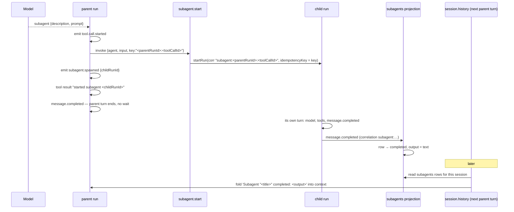

# Workflow: subagent delegation

Journey `J-F-delegation`. When the model calls `subagent`, the agent starts a real second run and
returns immediately. The child is fire-and-forget; its result reaches the parent one turn later.

## Summary

The `subagent` tool starts a child `agent.coding` run correlated `subagent:<parentRunId>:<toolCallId>`
and returns `started subagent <childRunId>` to the model without waiting. The `subagents` projection
observes the child's own events to update the child's row. On the parent's *next* turn,
`session.history` folds the completed child's answer in as a synthetic context message. The child never
appears in the session list.

## Why fire-and-forget

This was corrected during the build. An earlier pass used `@cognate/profile-harness`'s
`spawnSubagent` and synchronously awaited the child, feeding its answer back as this turn's tool
result. That does not match the reference, which returns immediately with a "started subagent" echo.
The corrected shape — start, return, and let the child finish on its own — is what is implemented and
what the test asserts.

## Sequence

1. The model returns `subagent {description, prompt, run_in_background?}`.
2. `tool.call.started` is emitted. `run_in_background` is ignored.
3. `ctx.invoke("subagent.start", {agent: "agent.coding", input: {sessionId: "<parentSession>:sub:<toolCallId>", workspaceId, message: prompt}, key: "<parentRunId>:<toolCallId>"})`.
4. `subagent.start` recovers the tool-call id by stripping `` `${ctx.runId}:` `` from the key, and
   calls `startRun` with `correlationId: "subagent:<parentRunId>:<id>"` and
   `idempotencyKey: key`. **The idempotency key is what makes a restart safe**: a replayed
   `subagent.start` returns the same child run instead of spawning a duplicate.
5. `ctx.emit("subagent.spawned", {sessionId, toolCallId, description, prompt, childRunId})`.
6. The result text is `started subagent ${childRunId}`; `tool.call.completed` carries `{childRunId}`.
7. The parent's turn continues and completes. **Nothing in the parent waits.**

Meanwhile the child runs: a fresh `agent.coding` history, the delegated prompt as its only message,
the same workspace, correlated `subagent:…`.

## How the child's completion is observed

Because there is no parent-side wait, the parent cannot record when the child finishes. So the
`subagents` projection watches the child's own stream, parsing the correlation back apart:

```ts
parseSubagentCorrelation("subagent:<parentRunId>:<toolCallId>") → {parentRunId, toolCallId}
```

Splitting on the **first** colon only, so a `toolCallId` containing colons survives. Then:

| Child event | Row transition |
|---|---|
| `message.completed` | `status: "completed"`, `completedAt`, `output` = the payload's `text` |
| `run.failed` | `status: "failed"`, `completedAt` — only if it was still `running` |

A completion for a row that does not exist returns `[]`. The `subagent.spawned` event is what creates
the row, on the parent's run, with `title` = the `description` and `desc` = the `prompt` truncated to
40 characters.

## How the result reaches the parent

`session.history` reads the `subagents` projection alongside the session's runs. For each parent run
that is **not** the run asking, it appends a synthetic message for every completed child of that run,
immediately after that run's own turn:

```
Subagent "<title>" completed: <output>
```

The role is `user`, not `assistant` — it is context, not a message the operator sent or the parent
produced. The consequence is precise: the parent's *next* model call sees the child's answer. It does
**not** appear as this turn's tool result, and it does not appear in the parent's transcript as an
assistant message. `J-F-delegation` asserts the substring is present in the next turn's history.

## Why children never appear as sessions

`sessions.ts`'s very first line of `apply` is `if (!event.correlationId.startsWith("session:")) return []`.
A child emits the same `session.turn.started` and `message.completed` types as a real turn, so the
correlation guard is the only thing separating them. `subagent.start`'s doc comment states this as its
reason for existing: the packaged `subagent.start` starts a child with *no* correlation at all, so a
child would fall back to the runtime's default and leak into the session list.

`J-F-delegation` asserts the child is queryable by its `subagent:` correlation, that its `runId`
matches what the parent's tool result echoed, and that it is absent from the `sessions` projection.

## Presentation

- The session header shows an "N subagent(s)" disclosure when the active session has rows. The
  disclosure opens a tree of `"<title> · <desc> · continuable · <status> · 0 tok · 0s"` rows.
- "Open `<title>` in sidebar" swaps the single right-hand slot to `RightPanel`, a two-message
  transcript (the child's prompt and its final answer) built entirely from that one `subagents` row.
  There is no separate child-session or child-transcript capability, because children are not
  sessions.
- While a `subagent` call is in flight, the tool activity label reads
  `Coordinating subagents · <description>` (subject to the work-details gate).

## State changes

```
parent run:   tool.call.started → subagent.spawned → tool.call.completed → message.completed
child run:    session.turn.started → run.invocation.progress* → message.completed   (or run.failed)
subagents row: (none) → {status:"running"} → {status:"completed", output} | {status:"failed"}
sessions:     unchanged — the child is not a session
```

## Failure branches

| Situation | Behaviour |
|---|---|
| The child fails | row becomes `failed`; no synthetic history message (only `completed` children are folded) |
| The parent is cancelled before the child finishes | the child keeps running; its row still updates from its own events |
| The server restarts mid-delegation | the child is resumed from its recorded steps, and the `subagent.start` idempotency key prevents a second child. `J-F-delegation`'s second test asserts exactly one run on the `subagent:` correlation and exactly one row |
| The child never completes | the row stays `running` indefinitely; there is no timeout and no watcher |
| A `message.completed` on a `subagent:` correlation with no row | ignored |
| Two children from one parent turn | the mock scripts one; nothing prevents several. Each gets its own `toolCallId` and its own row |
| The parent's next turn happens before the child finishes | the synthetic message is absent; the result arrives on a later turn, whenever that is |

## Sequence diagram



## Source trail

- `cognate/src/agents/agentCoding.ts:159-171` — the `subagent` tool definition
- `cognate/src/agents/agentCoding.ts:331-350` — the fire-and-forget branch
- `cognate/src/capabilities/subagentStart.ts:1-11` — why this app's own capability exists
- `cognate/src/capabilities/subagentStart.ts:37-47` — correlation and idempotency key
- `cognate/src/projections/subagents.ts:18-34` — `SubagentRow`
- `cognate/src/projections/subagents.ts:46-52` — `parseSubagentCorrelation`
- `cognate/src/projections/subagents.ts:58-101` — the three folds
- `cognate/src/projections/sessions.ts:37` — the correlation guard excluding children
- `cognate/src/capabilities/sessionHistory.ts:56-62` — the synthetic parent-context message
- `cognate/src/ui/App.tsx:1263-1324` — `SubagentTree`, `RightPanel`
- `cognate/src/ui/App.tsx:1114-1117` — the "Coordinating subagents" label
- `cognate/test/J-F-delegation.test.ts:67-128` — the full branch plus the next-turn history assertion
- `cognate/test/J-F-delegation.test.ts:130-181` — restart without a duplicate child
- `cognate/DEVIATIONS.md` — "Subagents (T10)"
- `cognate/.sea/interaction/interaction-model.sea:179-190` — the `j_f_delegation` instance
