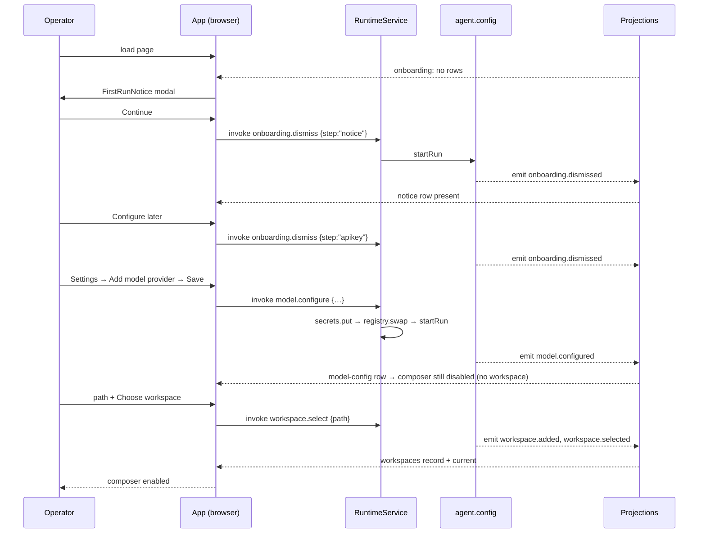

# Workflow: first use

The operator's path from a cold launch to a working composer. This is journey `J-A-first-use` in the
Interaction Domain Model, and it is the composition of two others (`J-CFG-model-provider` and
`J-WS-select`), which is why those two have their own canonical identity and their own tests.

## Summary

Two first-run dialogs appear on a home that has no `onboarding` rows. A model provider must be
configured and a workspace directory chosen. Only then does the composer enable — the settlement
condition of the journey — and the first message can start a turn.

## Sequence

1. **Load.** The browser fetches `/`, `/app.js`, and the three stylesheets. `App` mounts and
   subscribes to seven projections.
2. **Onboarding gate.** `useOnboardingDismissed("notice")` is false on a fresh home, so
   `FirstRunNotice` renders as a modal. "Continue" invokes
   `client.invoke("onboarding.dismiss", {step: "notice"})`.
3. **API-key dialog.** Once the notice is dismissed, `useOnboardingDismissed("apikey")` is still
   false, so `FirstRunApiKey` renders. "Configure later" dismisses it; "Save and continue" is disabled
   until a key is entered and dismisses it the same way. **Neither persists the entered key** — the
   dialog only records the dismissal; full provider setup happens in Settings.
4. **No workspace.** `useCurrentWorkspaceId` is undefined, so the center column renders
   `WorkspaceChooser`: a persistent notice, a path input, and a "Choose workspace" button.
5. **Configure a model.** Settings → Models. The list view is empty on a fresh home; "+ Add model
   provider" opens a two-tab wizard (third-party presets / custom model API). Saving invokes
   `client.invoke("model.configure", {providerId, baseURL, protocol: "openai-compatible", model, apiKey})`.
6. **Choose a workspace.** Typing a path and submitting invokes
   `client.invoke("workspace.select", {path})`. A non-directory or missing path is rejected and the
   message is rendered in a `role="alert"` element.
7. **Composer enables.** `composerDisabled = !currentWorkspaceId || !modelConfig` becomes false.
   With no transcript and nothing running, the center column shows `HeroLanding` — which also hosts a
   composer, so a first message can be sent from there.

## State changes

| Step | Durable effect | Browser effect |
|---|---|---|
| dismiss notice | `onboarding.dismissed {step:"notice"}` → `onboarding` row | modal closes |
| dismiss apikey | `onboarding.dismissed {step:"apikey"}` → `onboarding` row | modal closes |
| configure model | `secrets.json` write; provider fiber mounted; `agent.config` run → `model.configured` → `model-config` row | Settings list view shows the configured provider |
| choose workspace (new) | `agent.config` run → `workspace.added` then `workspace.selected` → `workspaces` record + `current` | sidebar shows the workspace; composer enables |
| choose workspace (known) | `agent.config` run → `workspace.selected` only | `current` moves; no duplicate record |

Nothing is component-local: each of these is an event, and every one of them survives a restart.
That is the mechanism behind the first-run dialogs reappearing on a *new* home and never on the same
one.

## Failure branches

| What you see | Cause | Where |
|---|---|---|
| The notice reappears after dismissing | the invoke failed (permission, or `agent.config` could not start) | `onboarding.dismiss` → `agent.config` run |
| "not a directory: `<path>`" | the path is missing or not a directory | `workspace.select` validation |
| Settings "Save" stays disabled | a required field is empty — `providerId`, `baseURL`, or `model` | the wizard's own validation plus `model.configure` |
| "Save and continue" stays disabled | no API key entered — expected; the dialog cannot configure a provider |
| Composer still disabled after both | the `model-config` or `workspaces/current` row has not committed yet; both are read from projections, not from the invoke's return value |
| Everything reappears after a restart | the home changed. `COGNATE_HARNESS_HOME` unset means `./.data`, and `.data/` is git-ignored |
| Re-selecting the same directory creates a second entry | would be a real bug: the id is `sha256(resolve(path))`, and the in-memory known-id set is seeded from the projection on boot. `J-WS-select` asserts exactly one `record/*` row |

## Sequence diagram

## Verification

Two tests cover the settlement conditions, plus one Playwright journey:

- `cognate/test/J-CFG-model-provider.test.ts` — configure, generate, hot-swap, and the secret scan
- `cognate/test/J-WS-select.test.ts` — record + current, re-select idempotence, and rejection of a
  non-existent path
- `tests/journeys/A-first-use.spec.ts` — "launch shows initial UI with no workspace yet, then model
  config + workspace selection enable the composer" (PASS on both systems in the last recorded run)

## Source trail

- `cognate/src/ui/App.tsx:231-241` — `useOnboardingDismissed`
- `cognate/src/ui/App.tsx:321-404` — `FirstRunNotice`, `FirstRunApiKey`, `FirstRunDialogs`, the dismiss invoke
- `cognate/src/ui/App.tsx:406-454` — `WorkspaceChooser`
- `cognate/src/ui/App.tsx:626-655` — the `model.configure` call sites in the wizard
- `cognate/src/ui/App.tsx:1965` — `composerDisabled`
- `cognate/src/ui/App.tsx:2209-2221` — the three-way center-column branch
- `cognate/src/capabilities/onboardingDismiss.ts:28-38` — the capability
- `cognate/src/capabilities/workspaceSelect.ts:30-47` — validation and the new/known branch
- `cognate/src/capabilities/modelConfigure.ts:34-47` — the three-step order
- `cognate/src/agents/agentConfig.ts:24-49` — the emitted events per command kind
- `cognate/.sea/interaction/interaction-model.sea:88-99` — the `j_a_first_use` instance
- `cognate/.sea/interaction/canonical-journey-catalog.md:11-38` — its full definition
- `cognate/test/J-WS-select.test.ts` — workspace settlement
- `tests/journeys/A-first-use.spec.ts` — the interface-level journey
