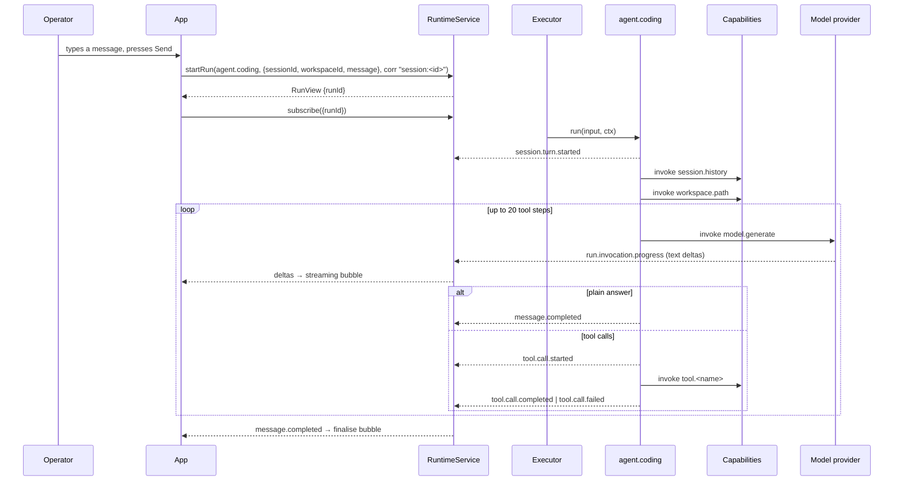

# Workflow: one turn

The central execution path: a human message becomes a durable, replayable agent run and a rendered
assistant turn.

## Summary

The browser starts one `agent.coding` run correlated to the session. The agent emits the turn's
start, folds prior turns and the workspace root into its context, then alternates between calling the
model and invoking the tools the model asked for until it answers in plain text. Everything it does
is emitted as an event before anything is shown, and the UI renders from that stream.

## Sequence

1. **Send.** `send(message)` in `App.tsx` reuses or creates a `sessionId`, appends the user's bubble
   (with an optimistic plan-mode system row if the message starts with `/plan `), then calls
   `client.startRun("agent.coding", {sessionId, workspaceId: currentWorkspaceId, message},
   {idempotencyKey: crypto.randomUUID(), correlationId: `session:${sessionId}`})`.
2. **Turn start.** The agent emits `session.turn.started {sessionId, workspaceId, message}`. The
   `sessions` projection sets `lastStatus: "running"`, `runId`, `updatedAt`, and — the first time only
   — the title.
3. **Plan-mode control.** The agent reads `plan.state`. If the message is exactly `/plan off` it
   emits `plan.mode.changed {on: false}`, emits `message.completed` with `"Plan mode off."` and
   returns — **no model call at all**. Otherwise, if the message carries a leading `/plan ` prefix and
   plan mode is off, it emits `plan.mode.changed {on: true}`; the text sent to the model is unchanged.
4. **Context.** `ctx.invoke("session.history", {sessionId, excludeRunId: ctx.runId})` returns prior
   turns; `ctx.invoke("workspace.path", {workspaceId})` returns the canonical root. Both are recorded,
   so a replay returns the same answers. `messages = [...history, {role:"user", content: message}]`.
5. **Loop** (up to 20 steps):
   - `invokeModelGenerate(ctx, step, messages)` — up to 6 attempts; see
     [cancellation-and-failure.md](cancellation-and-failure.md).
   - Text deltas arrive as `run.invocation.progress` events; the UI's `useStreamingTurn` appends them.
   - **No tool calls** → emit `message.completed {sessionId, workspaceId, text}`, return `{text}`.
   - **Tool calls** → push an assistant message carrying them, then for each call run the dispatch
     described in [tool-loop.md](tool-loop.md), and push a `role: "tool"` message with the result text.
6. **Completion.** `message.completed` makes the `sessions` row `lastStatus: "completed"`. The UI's
   finalisation effect appends the assistant bubble with a duration, a step count, the last successful
   edit summary, and a step snapshot.
7. **Next turn.** The next `send` starts a new run; `session.history` now includes turn 1, which is
   what makes the conversation continuous. `J-B-basic-session` asserts exactly this: after two turns,
   history has 4 messages alternating user/assistant.

## Detailed path

| Step | Symbol | Recorded as |
|---|---|---|
| 1 | `App.tsx` `send` | — (a request, not an event) |
| 2 | `agentCoding.ts` `ctx.emit("session.turn.started", …)` | `session.turn.started` |
| 3 | `planGate.ts` `isPlanOffCommand`, `splitPlanPrefix` | `plan.mode.changed` |
| 4 | `ctx.invoke("session.history" / "workspace.path")` | `run.invocation` |
| 5 | `invokeModelGenerate` | `run.invocation` + `run.invocation.progress` |
| 5 | `ctx.emit("tool.call.started")` | `tool.call.started` |
| 5 | `ctx.invoke("tool.<name>")` | `run.invocation` |
| 5 | `ctx.emit("tool.call.completed" / "tool.call.failed")` | same |
| 6 | `ctx.emit("message.completed")` | `message.completed` |

## State changes

```
sessions:   (no row) → {lastStatus:"running", title, runId} → {lastStatus:"completed", runId}
events:     session.turn.started, [plan.*], run.invocation×n, run.invocation.progress×n,
            tool.call.*, message.completed
transcript: (browser) user bubble → streaming preview → assistant bubble
```

Note that the transcript is *not* a store. It is rebuilt from `session.history` every time a session
is opened, and streamed live from the event subscription while a run is in flight.

## Failure branches

| Branch | Trigger | Result |
|---|---|---|
| Plan-mode off path | message is exactly `/plan off` | `message.completed` `"Plan mode off."`, no `model.generate` |
| Step budget exhausted | 20 tool steps | `message.completed` `"Reached the tool-call step limit for this turn."` |
| Provider failure | 6 attempts failed | `model.request.retried` ×5, then `turn.failed` and the run ends `failed` |
| Cancellation | the operator pressed Stop | `ctx.signal` aborts; the runtime ends the run `cancelled`; partial text is retained |
| Approval required | `run_code` escalated | the run becomes `waiting`; see [approval-gate.md](approval-gate.md) |
| History read fails | a prior run's output is not a string | that turn contributes only its user message |
| `workspace.path` unknown | the id is not in the projection | the run fails with `workspace.path: unknown workspaceId <id>` |

## Sequence diagram



## Observability

Watching a live turn needs no special tooling:

- `curl -s http://127.0.0.1:<port>/health` — semantic object count and digest
- the browser's event subscription is the same channel; `cognate/test/J-B-basic-session.test.ts`
  shows the shape (`client.subscribe({}, event => …)` filtered on `run.invocation.progress`)
- the durable record is `app.sqlite`; `bun:sqlite` can read the `events` and `payloads` tables

`J-B-basic-session.test.ts` asserts at least two `run.invocation.progress` events for a single
`plain` turn, `status === "completed"`, the answer text, the session row's `lastStatus`, and a title
containing the first human message.

## Source trail

- `cognate/src/ui/App.tsx:2041-2067` — `send`
- `cognate/src/ui/App.tsx:2069-2073` — `stop`
- `cognate/src/ui/App.tsx:2080-2121` — the finalisation effect
- `cognate/src/agents/agentCoding.ts:252-278` — turn start, plan control, history, workspace root
- `cognate/src/agents/agentCoding.ts:281-378` — the loop
- `cognate/src/agents/agentCoding.ts:283-286` — the plain-answer exit
- `cognate/src/agents/agentCoding.ts:380-382` — the step-limit exit
- `cognate/src/capabilities/sessionHistory.ts:40-64` — the history fold
- `cognate/src/projections/sessions.ts:38-80` — running and completed rows
- `cognate/test/J-B-basic-session.test.ts:37-72` — the contract
