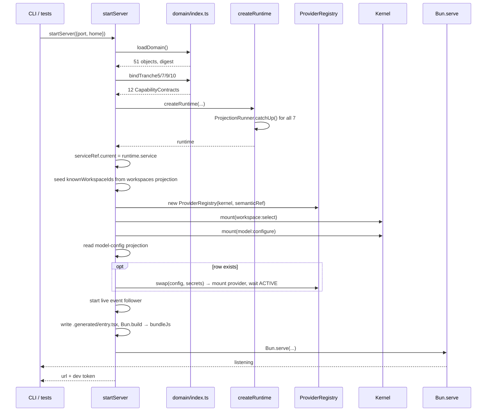

# Workflow: server startup

What happens between `bun run dev` and a browser that can talk to the runtime.

## Summary

`src/server.ts`'s `startServer` creates the data directory, parses the domain model, binds the
capability contracts, composes the runtime, mounts the components that could not be mounted earlier,
re-establishes the live model provider from durable state, generates and bundles the browser entry,
and binds one HTTP server that serves the UI, three stylesheets, a health endpoint, and the Connect
RPC service.

## Sequence

1. `mkdir(home, {recursive: true})`; derive `app.sqlite` and `secrets.json` paths; open the secret
   store.
2. `loadDomain()` — read `.sea/interaction/interaction-model.sea`, parse with
   `loadSemanticProjection`, **throw on any parse error**, and log
   `[domain] loaded 51 semantic objects (digest sha256:…)`. The `Domain` object returned carries the
   projection and a `semanticId(name)` helper.
3. `bindTranche5/7/9/10(domain)` — 12 `CapabilityContract`s, each function asserting its expected
   count. A mismatch throws.
4. `createRuntime({...})` with:
   - `store: <home>/app.sqlite`
   - `policy: buildPolicy()`, `actions: buildActionPolicy()`
   - `agents: [agentConfigAgent, agentCodingAgent]`
   - `components:` eight static components (all except the two below)
   - `projections:` all seven, each `public: true`
   - `system: SYSTEM_CALLER.actor`
   
   The runtime's own startup catch-up runs every projection from position 0 before this resolves, so
   rows are already current when step 5 reads them.
5. `serviceRef.current = runtime.service` — the late-binding closure every service-needing capability
   captured is now satisfied.
6. Seed `knownWorkspaceIds` from the `workspaces` projection's `record/*` keys.
7. `new ProviderRegistry(runtime.kernel, bindings.modelGenerate.semanticRef)`.
8. `runtime.kernel.mount(workspaceSelectComponent(…))` and `runtime.kernel.mount(modelConfigureComponent(…))`.
9. Read the `model-config` projection. If a `current` row exists, `registry.swap(row, secrets)` — mount
   the provider, wait for `ACTIVE`, dispose any previous handle.
10. Start the detached live event follower: `for await (event of service.events(LOCAL_OPERATOR, {follow: true, signal}))`, adding `workspaceId` on every `workspace.added`. Its `catch` absorbs the abort on shutdown.
11. Write `.generated/entry.tsx` from `BROWSER_ENTRY_TEMPLATE` with the local tenant and operator id,
    then `Bun.build({target: "browser", format: "esm"})`. A build failure throws with the concatenated
    logs. Read `stylesheetPaths()` and `src/ui/app.css`.
12. Build the Connect fetch handlers once: `createConnectRouter({})`,
    `registerRuntimeService(router, runtime.service, {authenticate: devTokenAuthenticator, maxJsonDepth: 32})`,
    then a `Map<path, handler>`.
13. `Bun.serve({port, hostname: "127.0.0.1", idleTimeout: 0, fetch})`.
14. Under `import.meta.main`: read `PORT` (default 3180) and `COGNATE_HARNESS_HOME` (default
    `<cognate>/.data`), print the URL and the dev auth token.

## Detailed path



## State changes

| Written | By |
|---|---|
| the home directory and `app.sqlite` (+ WAL/SHM) | the runtime on open |
| `.generated/entry.tsx` | step 11, unconditionally, every boot |
| `secrets.json` | not at boot — only on the first `secret.put` |
| any event | **none at boot** |

Boot itself records no domain events. Everything you see in the log came from an operator action.

## Failure branches

| Failure | Result |
|---|---|
| `.sea` parse error | throw before the runtime exists; the process exits |
| a binding count mismatch | throw; the process exits |
| `Bun.build` failure | throw with the build logs concatenated |
| the `.sea` file is missing | `readFile` rejects; the process exits |
| the port is in use | `Bun.serve` throws |
| the provider re-mount fails on boot | `startServer` rejects; a resumed run cannot continue |

## Verification

```bash
cd cognate
PORT=3181 COGNATE_HARNESS_HOME=/tmp/cg-boot bun src/server.ts
curl -s http://127.0.0.1:3181/health
# {"ok":true,"semantic":{"objects":51,"digest":"sha256:…"}}
```

Two things to check in the console output: the `[domain] loaded 51 semantic objects (digest …)`
line, and the `[deepseek-harness] dev auth: Authorization: Bearer local:operator` line. A digest
other than the one in `docs/subsystems/domain-model.md` means the model changed.

## Source trail

- `cognate/src/server.ts:134-152` — home, store path, secrets, domain load, bindings
- `cognate/src/server.ts:154-179` — `createRuntime`
- `cognate/src/server.ts:182-185` — seeding `knownWorkspaceIds` from the projection
- `cognate/src/server.ts:187-198` — registry plus the two late mounts
- `cognate/src/server.ts:200-213` — provider re-mount on boot
- `cognate/src/server.ts:219-231` — the live event follower
- `cognate/src/server.ts:239-251` — Connect handlers and the UI bundle
- `cognate/src/server.ts:258-278` — `Bun.serve`
- `cognate/src/server.ts:291-297` — env defaults and the two log lines
- `cognate/domain/index.ts:22-34` — `loadDomain` and the digest log
- `cognate/test/helpers.ts:19-25` — the test-side equivalent (`port: 0`)
