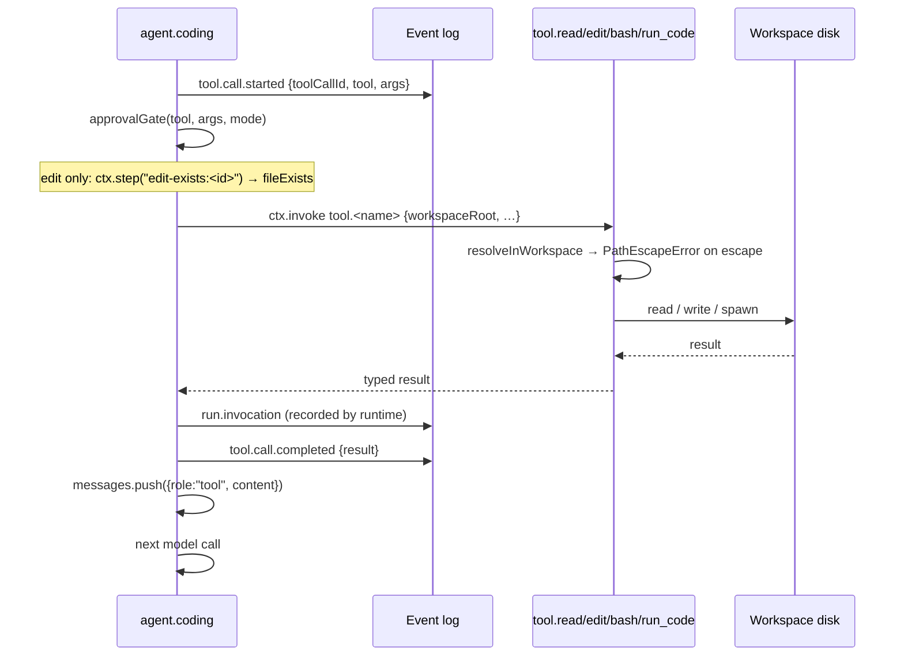

# Workflow: the tool loop

How a model request becomes real filesystem and subprocess effects, and how those effects are recorded.

## Summary

`agent.coding` advertises seven tools to the model. When the model answers with tool calls instead of
prose, the agent emits a start event, dispatches each call, records the outcome, and feeds a plain-text
result back to the model. Three of the seven are handled inline (`todo_write`, `exit_plan_mode`,
`subagent`); the other four are capabilities invoked through `ctx.invoke`.

## The seven tools

| Tool | Schema (required fields in bold) | Handler | Result text fed back |
|---|---|---|---|
| `read` | `file_path` | `tool.read` | the file's contents, verbatim |
| `edit` | `file_path`, `old_string`, `new_string`, optional `replace_all` | `tool.edit` | `Edited <path> (N replacement[s]).` |
| `bash` | `command`, optional `description` | `tool.bash` | `stdout` + `stderr` trimmed and joined, or `(command exited N with no output)` |
| `todo_write` | `todos[{content, status}]` | inline | `Todos updated (N in progress, M pending).` |
| `exit_plan_mode` | `plan` | inline + continuation | see [plan-mode.md](plan-mode.md) |
| `subagent` | `description`, `prompt`, optional `run_in_background` | inline + `subagent.start` | `started subagent <childRunId>` |
| `run_code` | `code`, optional `description`, `sandbox_permissions`, `justification` | approval-gated, then `tool.run_code` | `stdout` + `stderr`, or `(run_code completed with no output)` |

`run_in_background` is accepted and ignored: delegation is always fire-and-forget.

## Sequence

For each tool call the model returns, in this order:

1. `ctx.emit("tool.call.started", {sessionId, toolCallId, tool, args})` — **unconditionally, before
   any gate is consulted.** The UI keys tool entries off this event; emitting it later would leave a
   pending approval with no visible tool card.
2. Compute `approvalGate({tool, args, mode})`. Note the gate is consulted *after* the start event and
   *before* the dispatch.
3. Dispatch:
   - `todo_write` → `ctx.emit("plan.todos.updated", {sessionId, todos})`, then
     `tool.call.completed` with `{todos}`.
   - `exit_plan_mode` → plan mode off means `tool.call.failed` with the exact not-in-plan-mode text;
     otherwise a `plan-review` continuation. See [plan-mode.md](plan-mode.md).
   - `subagent` → `ctx.invoke("subagent.start", …)`, `ctx.emit("subagent.spawned", …)`,
     `tool.call.completed` with `{childRunId}`. Returns immediately. See
     [delegation.md](delegation.md).
   - gate required → approval branch. See [approval-gate.md](approval-gate.md).
   - otherwise → `invokeTool`.
4. `invokeTool`:
   - For `edit` only: the read-before-edit check (below).
   - `ctx.invoke("tool.<name>", {workspaceRoot, ...args})`.
   - On success and only for `read`, add the path to `readFiles`.
   - `formatToolResult` turns the structured result into the text the model sees.
   - `ctx.emit("tool.call.completed", {sessionId, toolCallId, tool, result})`.
   - On throw: catch, `ctx.emit("tool.call.failed", {…, error})`, return `` `Error: ${message}` ``.
     **`PathEscapeError` is caught here too** — a path escape is fed back to the model as text rather
     than failing the run.
5. `messages.push({role: "tool", content: resultText, toolCallId: call.id})`.
6. Next model call.

## The read-before-edit guard

```ts
const existed = await ctx.step(`edit-exists:${call.id}`, () => fileExists(workspaceRoot, filePath));
if (existed && !readFiles.has(filePath)) {
  emit tool.call.failed with `fs_not_observed: read ${filePath} before editing it`;
  return `Error: fs_not_observed: …`;   // tool.edit is NOT invoked
}
```

Three things make this work:

- **Only for files that already exist.** A new file needs no prior read.
- **The disk check is inside `ctx.step`**, so a replay returns the recorded answer and does not touch
  the filesystem again. This is the concrete reason replaying a run cannot double-check or re-run.
- **`readFiles` is rebuilt identically on replay** from the same sequence of recorded `tool.read`
  results, so it is deterministic despite being a plain `Set`.

`readFiles` is updated *after* the `ctx.invoke("tool.read")` resolves — a failed read does not count as
an observation.

## Containment

Every file-touching capability resolves its path against the workspace root and rejects anything that
escapes:

```ts
const resolved = resolve(root, relativeOrAbsolute);
if (resolved !== root && !resolved.startsWith(root + sep)) throw new PathEscapeError(…)
```

`tool.bash` and `tool.run_code` set `cwd` to the resolved root. Note that containment is about the
*working directory*, not a syscall sandbox: a `bash` command can still reference absolute paths
anywhere. That limitation is catalogued in [../reference/deviations.md](../reference/deviations.md).

## Subprocess behaviour

`runSubprocess` spawns with `stdout`/`stderr` piped, arms a 30s timer that kills the process and sets
`timedOut: true`, awaits both streams and the exit code, caps each at 20,000 characters with a
`…(truncated)` marker, and clears the timer in a `finally`.

`tool.run_code` wraps the model's code in an original small harness that defines a single
`tools.bash({command})` and runs the snippet in an async IIFE, setting `process.exitCode = 1` if it
throws. It is deliberately not a reproduction of the reference's sandbox.

## `edit` preconditions

- `old_string` must occur at least once, else `tool.edit: old_string not found in <file>`.
- If it occurs more than once and `replace_all` is not set:
  `tool.edit: old_string is not unique in <file> (N matches) — provide more context or set replace_all`.
- The result carries `diffLines` (common-prefix/suffix line diff), `additions`, `deletions`, and
  `replacements`. The UI's diff card and review panel render from exactly these fields.

## State changes

Per tool call, in the event log: `tool.call.started`, then `run.invocation` for the capability, then
`tool.call.completed` or `tool.call.failed`. In the browser: one `ToolEntry` created, then transitioned.
On disk: whatever the tool actually did.

The `J-C-tool-execution` test asserts all three: the started order is exactly `["read","bash","edit"]`,
no call failed, and `src/greet.ts` on disk contains `Howdy` and not `Hello`.

## Failure branches

| Result text | Cause |
|---|---|
| `Error: fs_not_observed: read <p> before editing it` | editing an existing file not read this turn |
| `Error: path escapes workspace root: <p>` | the argument resolved outside the workspace |
| `Error: tool.edit: old_string not found in <f>` | precondition |
| `Error: tool.edit: old_string is not unique in <f> (N matches) — …` | precondition |
| `(command exited N with no output)` | the command produced neither stream |
| `…(truncated)` in stdout/stderr | the 20,000-char cap |
| `Reached the tool-call step limit for this turn.` | 20 steps consumed |
| An `edit` result with `additions: 0` | the replacement was a no-op string-wise |

## Sequence diagram



## Source trail

- `cognate/src/agents/agentCoding.ts:111-186` — `TOOL_DEFS`
- `cognate/src/agents/agentCoding.ts:193-210` — `formatToolResult`
- `cognate/src/agents/agentCoding.ts:212-247` — `invokeTool` and the read-before-edit guard
- `cognate/src/agents/agentCoding.ts:290-377` — the per-call dispatch
- `cognate/src/agents/agentCoding.ts:297` — the unconditional `tool.call.started`
- `cognate/src/capabilities/tools.ts:21-28` — `resolveInWorkspace`
- `cognate/src/capabilities/tools.ts:34-52` — `runSubprocess`
- `cognate/src/capabilities/tools.ts:83-119` — occurrence counting and `diffLines`
- `cognate/src/capabilities/tools.ts:158-170` — `RUN_CODE_HARNESS`
- `cognate/src/capabilities/tools.ts:179-221` — the four handlers
- `cognate/test/J-C-tool-execution.test.ts:44-56` — event order, final answer, on-disk mutation
- `cognate/test/J-C-tool-execution.test.ts:67-96` — path escape rejected without touching the filesystem
- `tests/journeys/C-tool-execution.spec.ts` — the interface-level journey
